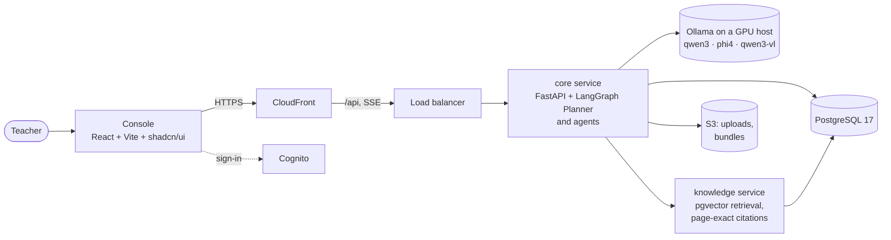

# Mothusi

A digital colleague for South African teachers that takes over the assessment cycle. Give it the goal ("mark this
Term 1 test and get every learner their feedback") and it plans the work, does it, checks its own output, fixes what
is wrong, and hands the teacher finished paperwork to approve. Built for Colleague Zero, Melsoft Academy's
autonomous-agent hackathon (13–14 November 2026).

## Problem

A Grade 10 Mathematics teacher at a public school spends evenings marking a class set by hand, then has to check
the memo, hand a moderation sample to the head of department, verify every total and Programme of Assessment
weighting, and turn the marks into a mark sheet, feedback and a catch-up plan before the next topic in the Annual
Teaching Plan starts.

## Solution

Mothusi runs that whole cycle as a team of agents, with the teacher approving the result:

1. **Checks the memo by sitting the test.** The Setter answers every question itself; where its answer and the
   memo disagree, the run stops and asks the teacher before a single script is marked.
2. **Marks every script against the memo, quoting the evidence.** Each mark the Marker gives carries the part of
   the learner's answer that earned it and the memo line it applied. A quote that isn't in the script fails.
3. **Moderates blind.** The Moderator re-marks a sample without seeing the first marks or any names, the way a head
   of department does. Disagreement sends scripts back with the reason, and widens the sample.
4. **Verifies the arithmetic in code.** Totals, maximums and weightings are computed and checked by deterministic
   rules, never left to a model.
5. **Produces the paperwork.** Mark sheet (XLSX), item analysis, a catch-up plan that fits the weeks left in the
   Annual Teaching Plan and cites the official pages, and a note for every learner. The Reviewer rejects notes that
   label, compare or praise without evidence, and sends them back to the Writer.
6. **Waits for the teacher.** Nothing reaches a learner or parent until the teacher approves.

Learner names are pseudonymised at intake; the Marker and Moderator never see them.

| Agent | Job | How it checks itself |
|---|---|---|
| Planner | Splits the class into batches, decides when to widen moderation and when to ask the teacher | A state machine: `delivered` can only follow `approved` |
| Setter | Sits the test to check the memo | Its answers against the memo; the cognitive-level grid checked in code |
| Reader | Transcribes photographed or scanned scripts | Uncertain readings go to the teacher |
| Marker | Marks each script against the memo with evidence | Rules catch arithmetic and maximum-mark errors and retry |
| Moderator | Blind re-mark of a sample | Disagreement sends scripts back |
| Analyst | Item analysis and the most common errors | Totals verified in code |
| Support | The catch-up plan | Cites the curriculum pages it relies on |
| Writer | Per-learner feedback | — |
| Reviewer | Rejects ungrounded feedback | Sends notes back to the Writer |
| Executor | Writes the outputs, delivers after approval | The approval gate |

## Demo

Each release publishes the teacher console; its URL is on the [releases page](https://github.com/Katlego-tech/Mothusi/releases). The run screen shows
the colleague at work: the goal, the loop as the brief moves between agents, every send-back drawn in red, and the
live feed.

The demo class set is synthetic: 32 Grade 10 Mathematics scripts with planted traps (a memo error, a tidied-up
quote that the learner never wrote, an over-mark, and a feedback note that labels a learner without evidence). An
offline replay runs the whole loop with no model and no network, and gives the same result every time:

```bash
uv run --frozen python -m mothusi_core.smoke
```

## Architecture



Everything runs in AWS af-south-1 (Cape Town). The models are open-weight and served by Ollama on one GPU host, so
learner data stays in South Africa and a run is priced in GPU time rather than tokens.

| Path | What it is |
|---|---|
| `packages/contracts` | Domain models and the Brief/Result envelopes agents hand to each other |
| `packages/rules` | Deterministic checks: arithmetic, weighting, the cognitive grid, moderation sample, evidence quotes, citations |
| `packages/intake` | Memo and script loading, pseudonymisation, PDF/Word memos, photographed scripts |
| `packages/llm` | The model seam: Ollama, Anthropic and replay providers, and the GPU-time cost meter |
| `packages/outputs`, `packages/delivery`, `packages/events` | The bundle, mark sheet and notes; delivery after approval; the event log |
| `services/core` | The Planner graph, the agents and the API (FastAPI + server-sent events) |
| `services/knowledge` | Retrieval over the curriculum documents (bge-m3 embeddings, pgvector) |
| `apps/web` | The teacher console |
| `packs/dbe-caps` | Grade 10 Mathematics and Accounting curriculum packs as data, each with its sources |
| `infra` | AWS CDK app and the start/stop runbook (`infra/ops.sh`) |

## Sponsor Technologies Deployed

Mothusi uses no sponsor SDKs.

| SDK | Where it runs | What it does for us |
|---|---|---|
| — | — | — |

## What's real and what's mocked

Real: the agents, the Planner, every rule and check, the open-weight models on the GPU host, curriculum retrieval
with citations, teacher sign-in, and the outputs.

Mocked, for stability on stage: delivery. The mailer writes standard email files to a local mailbox instead of
sending them, so the approval-then-deliver step runs end to end without emailing anyone. The offline replay
(above) stands in for the models when there is no network.

## How to run it

Requirements: Python 3.14 with [uv](https://docs.astral.sh/uv/), Node.js 24, Docker.

```bash
git clone https://github.com/Katlego-tech/Mothusi.git && cd Mothusi
uv sync --frozen                      # the Python workspace
cp .env.example .env                  # then fill in the blanks it describes
docker compose up -d                  # PostgreSQL 17 + pgvector, RabbitMQ, Ollama (ports on 127.0.0.1)

uv run --frozen python -m mothusi_core.smoke           # the whole loop, offline
uv run --frozen uvicorn mothusi_core.main:app --port 8000

cd apps/web && npm ci && npm run dev   # the console on http://localhost:5173 (proxies /api to :8000)
```

`MOTHUSI_PROVIDER` picks the models: `replay` (offline, the default without an API key), `ollama`, or `anthropic`.

Checks (the same ones CI runs):

```bash
uv run --frozen ruff check . && uv run --frozen pyright && uv run --frozen pytest
(cd apps/web && npm run lint && npm test)
(cd infra && uv run --frozen pytest)
```

### Releases and deployment

There is one AWS environment. A release is a version tag on a commit that is on `main`:

```bash
git tag -a v0.1.0 -m "v0.1.0" && git push origin v0.1.0
```

The release workflow runs the full checks on that commit, builds and pushes the service images tagged with the
version, redeploys the service stack, publishes the console and writes the GitHub release. Merges to `main` are
checked but never deployed. The GPU host, network, data and front-door stacks are changed only by hand after a
`cdk diff`; AWS names that can't change in place are defined once, in `infra/mothusi_infra/stage.py`.

When a release fails, its last step gathers the diagnostics into the run's summary: the identity GitHub presented to
AWS, CloudFormation's failed events, each service's events and why its tasks stopped, and the services' recent logs.

A watchdog runs on your own machine, checks once a minute, and exits with a desktop notification the moment
something needs you: a failed Actions run, a stack that failed or rolled back, an ECS service short of tasks or a
task that crashed, the GPU host stopping or failing its checks, a failed model load, or a run that halted or waits
for the teacher. It only reads; it never changes anything.

```bash
bash infra/watchdog.sh              # until something goes wrong
bash infra/watchdog.sh --gpu-busy   # also when the GPU idles (during an eval or a run)
```

What it costs, from your machine:

```bash
bash infra/costs.sh           # what's running now and the burn per hour and per day
bash infra/costs.sh --spend   # also this month's usage by service and the credits applied
```

## Baseline and dependencies

| Dependency | Used for | Licence |
|---|---|---|
| FastAPI, Uvicorn | The API and server-sent events | MIT, BSD-3-Clause |
| LangGraph (+ Postgres checkpointer) | The Planner's state machine | MIT |
| Pydantic | Contracts between agents | MIT |
| psycopg, pgvector | PostgreSQL access and vector search | LGPL-3.0, MIT |
| sentence-transformers, PyTorch (CPU) | bge-m3 embeddings | Apache-2.0, BSD-3-Clause |
| openpyxl, ReportLab, segno | Mark sheet, PDF report, QR codes | MIT, BSD, BSD |
| pypdf, pypdfium2, python-docx, OpenCV | Reading memos and scanned scripts | BSD-3-Clause, Apache-2.0 or BSD-3-Clause, MIT, Apache-2.0 |
| Anthropic SDK | Optional hosted-model provider | MIT |
| React, Vite, TanStack Query, Tailwind CSS, Radix UI, shadcn/ui | The console | MIT |
| AWS CDK | Infrastructure | Apache-2.0 |
| Ollama | Model serving | MIT |
| Qwen3, Qwen3-VL | Marking, writing, reading scripts | Apache-2.0 |
| Phi-4 | Moderation | MIT |
| BAAI bge-m3 | Curriculum retrieval embeddings | MIT |
| Department of Basic Education CAPS documents and Annual Teaching Plans | The curriculum packs and citations | Published by the DBE; cited by document and page |

Exact versions are pinned in `uv.lock`, `apps/web/package-lock.json` and `infra/uv.lock`.

## Team

Katlego: solo entry, everything from the agents to the infrastructure.
