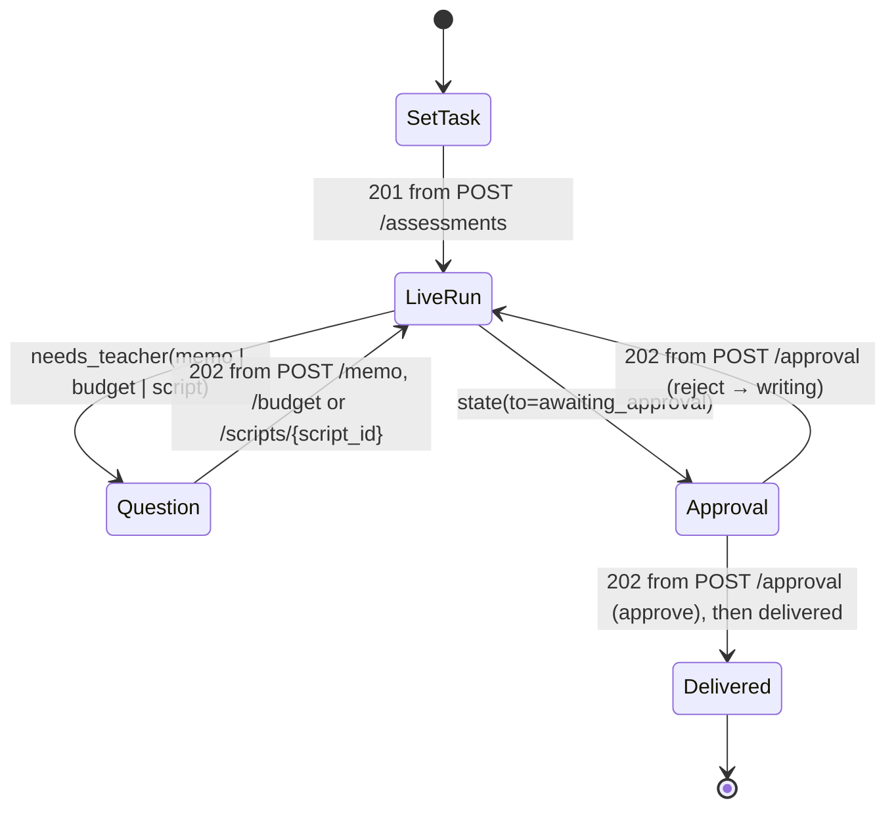
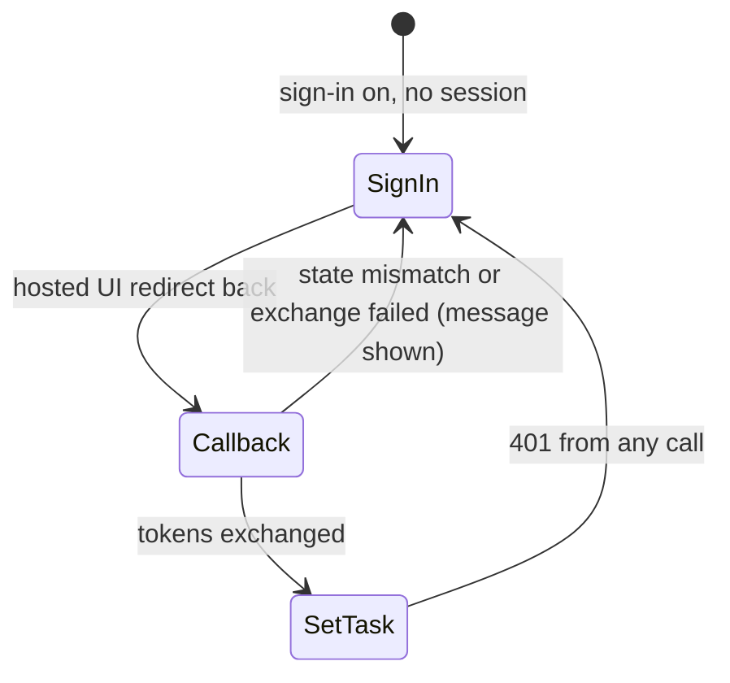
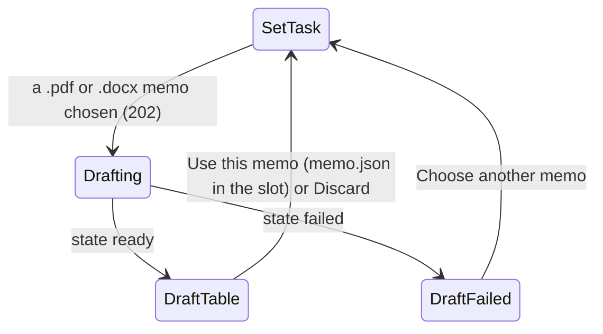

# Design — the teacher console

**Status:** agreed · redesigned 2026-11-08 against a Stitch reference (§2) · **Owner:** the project researcher
(Claude: design and implementation) · **Spec:** the product requirements US5, US6, US8

---

## 1. What this covers

The one web app a teacher (and a judge) uses: set the task, watch the agents work, answer the three
questions Mothusi can ask (a doubtful memo line, a script the Marker could not settle, the spending
limit), read the bundle, approve or reject it, and see what was written and sent. It fixes the HTTP
and SSE contract between the console (`apps/web`) and the core service (`services/core`), the event
kinds of the live log, the component tree, the motion, and the visual reference every screen is built
to. It does not cover how the Planner decides (see [marking-pipeline.md](marking-pipeline.md)) or how
events are stored ([event-log.md](event-log.md)). Nothing in the agreed scope's "Out of scope" list has a
screen here: no SA-SAMS, no WhatsApp, no HOD dashboard, no voice.

## 2. Reference material

**Build each screen to its PNG: layout, tokens, copy.** The PNGs are rendered from the HTML in
`docs/architecture/design/console-ui/mockups/` (headless Chromium at 1440 px, the phone at 390 px, full page);
change the HTML and re-render rather than editing a PNG, so the two never disagree.
`mockups/console.css` holds the tokens the console implementation carries into the Tailwind config verbatim.
`mockups/demo.js` is for the mockups only: with `?replay` on a run screen it replays the log so the
motion can be seen; the console implementation gets the same motion from the SSE stream and does not ship it.

| Screen | Visual reference | State(s) it serves |
| --- | --- | --- |
| Set the task | [console-ui/01-set-task.png](console-ui/01-set-task.png) | before `draft` |
| Live run | [console-ui/02-live-run.png](console-ui/02-live-run.png) | `marking` … `reviewing` (shown at `re_marking`, with a settled script open) |
| Memo check | [console-ui/03-memo-check.png](console-ui/03-memo-check.png) | `memo_check` with `needs_teacher(topic=memo)` |
| Approve the bundle: mark sheet | [console-ui/04-approval.png](console-ui/04-approval.png) | `awaiting_approval` |
| Approve, phone | [console-ui/05-approval-phone.png](console-ui/05-approval-phone.png) | `awaiting_approval` at 390 px |
| A script needs you | [console-ui/06-script-question.png](console-ui/06-script-question.png) | `marking` with `needs_teacher(topic=script)` |
| The spending limit | [console-ui/07-budget-question.png](console-ui/07-budget-question.png) | `marking` with `needs_teacher(topic=budget)` |
| Delivered | [console-ui/08-delivered.png](console-ui/08-delivered.png) | `delivered` |
| Approve the bundle: item analysis | [console-ui/09-approval-item-analysis.png](console-ui/09-approval-item-analysis.png) | `awaiting_approval`, second tab (catch-up plan, learner notes and moderation report are rendered Markdown in the same frame) |

The content in the mockups is the demo's own (the demo script golden path, the synthetic class-set fixture): memo item 2.3, the
evidence retry on L-014 Q3.1, the over-mark on L-021 Q4 (Marker 5/6, Moderator 2/6), the Reviewer's
rejection of L-007's note, the Term 1 Test at 14% of SBA. Every learner answer quoted is a line from
`services/core/fixtures/gr10-maths-t1/scripts.csv`. Totals in the class set and the mark sheet are
mock marks (the fixture carries answers, not marks); they agree with each other across the screens.

**The reference.** Six screens generated with Stitch (stitch.withgoogle.com, "Institutional
Resilience", kept outside the repo) were used as the visual reference. What they got right is kept:
the surfaces (a warm linen ground, white sheets, a bone-coloured tray, calico rules, tonal planes
and 1 px edges, no shadows), one institutional face with tabular figures, the stepper in the top
bar, a progress ring with the finding beside it, a strip of agent cards, the side-by-side view of the
memo and the learner's script with marks written against lines, the stat strip and document tabs on
the approval screen, the phone as a stacked card list. What they invented is not built: SA-SAMS sync,
WhatsApp slips, a school, a named teacher and avatar, notification bells, cohort tabs, voice input,
OCR confidence, "zero-hallucination sandbox", pause and mute, an estimated time remaining, a
precedent archive, a classroom-impact simulation, CAPS achievement levels per learner, a pass rate.
The amber "teacher intervention" colour is replaced by the teal, because the teacher's colour here
is the stamp's, and gold-amber hues are not used in this project.

**The visual idea.** A teacher's marking desk in a school office. The Marker writes in **red ink**,
the Moderator in **green**, as SA schools do; marks, and only marks, are set in a handwriting face
(Kalam). The teacher's own actions, the current state and the Planner's decisions are the deep
**fynbos teal** of the school's stamp. The rules engine is plain grey: it is code, and should look
like it. Colour is spent on marks and on the teacher's one action, never on the chrome. Two things
are the signature: **the class set**, one cell per learner that fills with the Marker's red total and
gets the Moderator's green tick, so 32 scripts read at a glance as a mark book does; and **the
evidence pair**, the memo page and the learner's page side by side, with each pen's quote underlined
in its ink and the marks beside the lines that earned them (Non-negotiable I made visible).

| Token | Value | Use |
| --- | --- | --- |
| `--ground` / `--surface` / `--raised` / `--active` | `#fbf9f5` / `#ffffff` / `#f3efea` / `#ebe6df` | page / sheets / the agents' tray and side panels / a selected row or cell |
| `--border` / `--rule` / `--control` | `#e5e0d8` / `#eee9e1` / `#d5cfc5` | panel edges / row rules / input and button edges |
| `--text` / `--muted` | `#272f2d` / `#5f6866` | text / secondary (5.3:1 on the ground) |
| `--teal` / `--teal-soft` / `--teal-edge` | `#0f3e36` / `#e6f0ed` / `#b8d5cd` | teacher actions, current state, Planner decisions, the needs-teacher card's border |
| `--marker` / `--marker-soft` | `#b8262f` / `#fbe9e9` | Marker ink, failed checks, the cell being marked |
| `--moderator` / `--moderator-soft` | `#1e7a4b` / `#e3f2e9` | Moderator ink, passed checks, disagreements, delivered |
| `--code` / `--code-soft` | `#5a6360` / `#efece7` | rules-engine rows and tags |
| Type | Public Sans 400/500/600/700 (everything), `font-feature-settings: "tnum" 1, "lnum" 1`; Kalam 700 (marks only) | one text face so figures line up digit for digit on a cheap phone; the pen for marks |
| Sizes | title 24–28 · KPI 24 (lead 32) · body 14 · small 12 · tags 11 | nothing above 32 px, nothing under 11 px |
| Radius | 8 px panels · 4 px controls, cells and chips | tight, as the paperwork is |

**Motion.** The judges watch agents work, so the screen shows work happening, and nothing else moves:

| What | Where | How |
| --- | --- | --- |
| An agent with an open Brief | its dot in the agents strip (`.who.live`) | a soft pulse in its ink, 1.6 s |
| The script being marked | its cell in the class set (`.cell.working`) | the red border pulses and the `?` breathes, 1.4 s |
| A new event | its log row (`.ev.arrive`) | rises 10 px and fades in, 0.35 s, once |
| Progress | the ring | the arc moves to the new share over 0.6 s |
| Waiting for the teacher | the state chip (`.chip.wait`) | a slow pulse, 2 s |
| Reduced motion | everything above | stops; the busy dots become a static ellipsis |

Transform and opacity only, no entrance on anything that is not an event, no motion on the
approval screen. Tokens and keyframes are at the foot of `mockups/console.css`.

## 3. Domain model

The console owns no entity. It folds the event stream into one view model; the `created` event
(always seq 0) seeds the title and one pending cell per script, so a reload at any state rebuilds the
screen from the stream alone.

```mermaid
classDiagram
    class RunView {
      assessment_id: str
      title: str
      state: AssessmentState
      events: LogEvent[]
      cells: Map~script_id, ScriptCell~
      scripts: Map~script_id, Mark[]~
      agents: Map~AgentRole, AgentCard~
      checks: {run: int, failed: int, open: int}
      cost_zar: Decimal
      elapsed_s: int
      teacher_steps: int
      total_marks: int
      finding: str
      pending: NeedsTeacher | null
      selected: script_id | null
      apply(event: Event) RunView
    }
    class ScriptCell {
      script_id: str
      status: pending | working | retry | marked | moderated | teacher
      total: int | null
      max_marks: int
    }
    class AgentCard {
      agent: AgentRole
      briefs: int
      live: bool
      task: str
      last_summary: str
    }
    class NeedsTeacher {
      topic: memo | budget | script
      title: str
      fields: the topic's data from §6
    }
    RunView "1" o-- "*" ScriptCell
    RunView "1" o-- "*" AgentCard
    RunView "1" o-- "0..1" NeedsTeacher
```

`RunView.apply` is a pure reducer (one case per event kind in §6) and is where the unit tests go.
`agents` is derived: a `brief` sets the card live with its task, the matching `result` clears it and
counts; `checks` counts `check` events and the open retries; `scripts` keeps the `marks` of the last
passing Marker (or re-mark) `result` per script, which is what the inspector shows; `finding` is the
sentence under the ring (the latest disagreement, failed check, or question to the teacher).

## 4. Flow

```mermaid
sequenceDiagram
    autonumber
    actor T as Teacher
    participant C as Console (apps/web)
    participant S as Core service (FastAPI)
    T->>C: instruction, memo.toml, scripts.csv, pack + task, budget
    C->>S: POST /assessments (multipart)
    S-->>C: 201 {assessment_id, state: draft}
    C->>S: GET /assessments/{id}/events (SSE)
    loop every Brief, Result, check, decision
        S-->>C: event (id = seq)
    end
    S-->>C: needs_teacher {topic: memo, question_id: 2.3, ...}
    T->>C: Use x = −4 and mark
    C->>S: POST /assessments/{id}/memo {decision: use_proposed, question_id: 2.3}
    S-->>C: 202 {state: marking}
    Note over C,S: the stream continues; reconnects send Last-Event-ID and get seq > id
    S-->>C: state {to: awaiting_approval}
    C->>S: GET /assessments/{id}/bundle
    S-->>C: 200 Bundle
    T->>C: Approve and send (or Reject with a note)
    C->>S: POST /assessments/{id}/approval {decision: approve}
    S-->>C: 202 {state: approved}
    S-->>C: delivered {written, sent}
```

A reload rebuilds everything from the stream: the console opens the SSE without `Last-Event-ID`
and the server replays from seq 0. There is no separate snapshot endpoint.

## 5. State

The screen follows the assessment state; the console never decides a transition.



`Question` is the live-run screen with the `NeedsTeacher` card pinned at the foot of the log
(03, 06 and 07 draw the three topics); while it is open the log keeps streaming (a script question
does not stop the batch; a memo or budget question does) and no other action is offered. `Approval`
offers exactly two actions, approve and reject-with-note (US8). `Delivered` (08) shows the three
numbers, what was written, what was sent, and the end of the log; it offers no action.

## 6. Contracts

All bodies are JSON unless stated; money is a decimal string in rand (`"13.02"`); times ISO 8601.

```
GET  /packs
  200 [{pack_id: "dbe-caps/mathematics-gr10", subject, grade,
        tasks: [{term, name, max_marks, weight_percent}]}]

POST /assessments                      multipart/form-data
  goal: str (the teacher's sentence)   memo: file (.toml)   scripts: file (.csv)
  pack_id: str   poa_task: str (PoATask.name)   budget_zar: decimal string
  atp: file (.toml, optional: the ATP weeks still to come, load_atp_weeks; without it the Support
       agent is skipped and the log says "no ATP weeks given: catch-up plan not placed")
  201 {assessment_id: str, state: "draft"}
  422 {errors: [{field: "scripts" | "memo" | "pack_id" | "poa_task" | "budget_zar", message: str}]}
      message is load_memo / load_scripts's own sentence, e.g. "row 7: blank learner"
      (field may also be "atp")

GET  /assessments/{id}/events          text/event-stream
  each frame:  id: <seq>\nevent: <kind>\ndata: <Event JSON>\n\n
  header Last-Event-ID: n  -> replay seq > n, then live. 404 unknown id.

POST /assessments/{id}/memo                          answers needs_teacher(topic=memo)
  {decision: "use_proposed" | "keep_memo" | "amend", question_id: str, answer?: str}
  answer required for amend. 202 {state}. 409 {message} unless state == memo_check.

POST /assessments/{id}/budget                        answers needs_teacher(topic=budget)
  {raise_to_zar: decimal string}     must exceed the spend so far; the run resumes at the batch
  boundary it stopped at. 202 {state}. 409 {message} unless a budget question is pending.
  Not answering is how a teacher stops: the run stays halted and everything marked is kept.

POST /assessments/{id}/scripts/{script_id}            answers needs_teacher(topic=script)
  {decision: "use_attempt", attempt: 1 | 2 | 3}
  | {decision: "set_marks", marks: [{question_id, awarded}]}   (every memo question, once)
  The script leaves the queue with those marks; set_marks become Marks with principle
  "teacher's decision" and are exempt from check_evidence (the log says so). 202 {state}.
  409 {message} unless that script is pending a teacher decision. 422 on a mark over max_marks.

GET  /assessments/{id}/bundle
  200 Bundle   409 {message} unless state in (awaiting_approval, approved, delivered)

POST /assessments/{id}/approval
  {decision: "approve" | "reject", note?: str}     note required (non-empty) for reject
  202 {state}. 409 {message} unless state == awaiting_approval.
```

**Event** (one per frame; `kind` decides `data`). Every quote of a learner's work travels inside the
event, so the evidence pair and the inspector draw from the stream alone; no learner name ever does.

```
Event { seq: int (from 0, gapless per assessment), at: datetime, assessment_id: str,
        kind: EventKind, agent: AgentRole | null, summary: str (one line), payload: <below> }

(Reconciled with the Event contract, packages/contracts events.py and event-log.md §6: the body is
`payload`, not `data`, and seq counts from 0, so `created` is seq 0 and a reconnect with
Last-Event-ID n replays seq > n. The SSE frame's own `data:` line carries the whole Event JSON.)

kind           payload                                                       rendered by
created        {title, goal, pack_id, poa_task, subject, grade, term,        RunTitle + ClassSet
                total_marks, budget_zar, script_ids: [str],                  (seeds every cell)
                questions: [{question_id, question, max_marks, level}]}  (always seq 0)
state          {from: AssessmentState | null, to: AssessmentState, reason}   StateRow + StateRail + Stepper
brief          {brief_id, agent: AgentRole, task, attempt, script_id | null} BriefRow + AgentStrip (live)
result         {brief_id, agent, status: ResultStatus, script_id | null,     ResultRow + ClassSet + AgentStrip
                summary, awarded | null, max_marks | null, reason, cost_zar,  + ScriptInspector
                marks: [Mark] | null}   (Mark verbatim from domain-model.md §3, for marker and
                                         moderator results; null for every other agent)
check          {check, about, passed, detail}    (CheckResult verbatim)      CheckRow + AgentStrip (counts)
decision       {action, reason, brief_id | null}                             DecisionRow
disagreement   {script_id, question_id, question, max_marks,                 DisagreementRow + EvidencePair
                memo_answer, marking_notes, answer,
                first: {awarded, evidence_quote, memo_line},
                second: {awarded, evidence_quote, memo_line}, reason}
needs_teacher  {topic: "memo" | "budget" | "script", title,                   NeedsTeacherCard
                memo:   question_id, question, max_marks, marking_notes, level,
                        memo_answer, proposed_answer, working
                budget: spent_zar, limit_zar, scripts_settled, scripts_total,
                        spent: [{stage, zar}], estimate: [{stage, zar}]
                        (estimate from this run's own cost per script so far)
                script: script_id, question_id, question, max_marks, memo_answer,
                        marking_notes, answer,
                        attempts: [{attempt, awarded, max_marks, failed_check, detail, marks: [Mark]}]}
                (only the topic's own fields)
usage          {cost_zar_total, input_tokens, output_tokens,                 Meters (no log row)
                scripts_settled, teacher_steps, priced: bool}
                (priced false: no sourced prices, so cost reads "not metered", never R0.00)
delivered      {written: [path], sent: [message_id]}                         DeliveredRow + DeliveredScreen
```

**Bundle** (names appear here and only here: this is the teacher's output):

```
Bundle {
  assessment_id, title, state,
  summary: {class_average_percent, scripts, moderated, questions_compared, questions_agreed,
            re_marked, cost_zar, per_script_zar, priced, elapsed_s, teacher_steps},
  mark_sheet: [{learner, raw, out_of, sba_points, year_points, moderated: bool, re_marked: bool}]
              (sorted by learner)
  mark_sheet_csv: str                         (mark_sheet_csv(...) verbatim, for download)
  item_analysis: [ItemStat] + misconceptions: [{question_id, pattern, evidence_quotes, scripts}]
  catch_up_plan_md: str,
  learner_notes: [{learner, outcome, mark_with_quote, next_task, self_assessment_prompt}],
  moderation_report_md: str,
  class_sheet_md: str,
  class_sheet_review: {passed, reason},
  memo_unverified: [{question_id, memo_answer, setter_answer, working}]   (items code could not
                    compare: the teacher checks them before approving; MemoIssue, kind not_comparable)
}
```

## 7. Structure

| Path | New? | Responsibility |
| --- | --- | --- |
| `apps/web/src/api/client.ts` | new | typed calls for the seven HTTP endpoints in §6 |
| `apps/web/src/api/events.ts` | new | `useEventStream(id)`: EventSource with Last-Event-ID, yields `Event` |
| `apps/web/src/run/reducer.ts` | new | `apply(RunView, Event)`: one case per kind; unit-tested |
| `apps/web/src/screens/*` | new | the five screens below |
| `apps/web/src/components/ui/*` | new | shadcn primitives, restyled with the §2 tokens |
| `apps/web/src/motion.css` | new | the §2 motion table, keyframes copied from `mockups/console.css` |
| `services/core/src/mothusi_core/main.py`, `events.py` | new | the endpoints and the event log, to §6 |

Component tree (one log component per event kind):

```
App (router: /new, /runs/:id)
├── TopBar (Wordmark, RunTitle, Stepper[set the task · live run · approval], StateChip)
├── SetTaskScreen                        01-set-task.png
│   ├── GoalField
│   ├── FileSlot ×2 (memo, scripts)      shows the parsed facts or the 422 message
│   ├── PackTaskSelect                   GET /packs (every installed pack; the task list is the pack's PoA)
│   ├── BudgetField
│   ├── WhatHappensNext                  five steps, static copy; the sample rule's numbers from the pack
│   └── StartButton                      "Start marking"
├── RunScreen                            02, 03, 06, 07
│   ├── RunHeader (Ring, SettledCount, Finding, Meters[time · cost · per script · your steps])
│   ├── AgentStrip → AgentCard ×n        agents briefed so far, then one "Waiting" cell for the rest
│   ├── StateRail                        the 11 states of marking-pipeline.md §5 (rejected shown only when entered)
│   ├── EventLog
│   │   ├── StateRow · BriefRow · ResultRow · CheckRow · DecisionRow · DeliveredRow
│   │   ├── DisagreementRow → MarkPair + EvidencePair
│   │   └── NeedsTeacherCard → MemoDecisionForm | BudgetForm | ScriptDecisionForm
│   │       (MemoDecisionForm and ScriptDecisionForm hold an EvidencePair; ScriptDecisionForm
│   │        holds AttemptCard ×n and SetMarksGrid)
│   ├── EvidencePair → MemoPage + ScriptPage   the memo item as a page (question, marking-notes
│   │                                           lines with their marks); the learner's answer as a
│   │                                           page, each pen's evidence_quote underlined in its ink.
│   │                                           PhotoSlot: when the intake received a photographed
│   │                                           page (not on the demo's critical path, the product requirements
│   │                                           non-goals) it sits above the transcript in the same card
│   ├── ClassSet → ScriptCell ×n (+ InkMark, Legend)   a cell click selects the script
│   └── ScriptInspector                  the selected script's Marks: question, mark, quote, memo line
├── ApprovalScreen                       04, 05, 09
│   ├── StatStrip                        the eight figures of Bundle.summary, one divided container
│   ├── DocTabs (mark sheet, item analysis, catch-up plan, learner notes, moderation report) with counts
│   ├── DocumentView (MarkSheetTable + Find + DownloadCSV | ItemAnalysis + Misconceptions | Markdown | LearnerNotes)
│   └── ApprovalBar ("Reject with a note" → NoteForm, "Approve and send"), sticky
└── DeliveredScreen                      08-delivered.png
    ├── StatStrip                        the three numbers and your steps
    ├── WrittenList · SentList           from the delivered event; "not sent" rows for what stays with the teacher
    └── EventLog (tail)
```

As built, against the mockups:

- **The log folds, never drops.** A brief whose result has arrived is shown by that result; passed
  checks on a result's script are its tags; a run of passed checks of one kind is one row; the
  teacher's question is the card at the foot. The log body scrolls inside its panel and follows the
  newest row while the reader is at the bottom. A real 32-script run has hundreds of events; the
  mockups show a curated dozen.
- **Set the task** adds an optional third file, the ATP weeks still to come (§6 `atp`), and a "Load
  the demo class set" button that reads `services/core/fixtures/gr10-maths-t1` (bundled on demand).
  The pack and task are a native select.
- **Approval copy says what happens:** approving writes the five documents to disk and the learner
  notes stay with the teacher (nothing is sent to learners or parents: the fixtures carry no
  contacts; marking-pipeline.md §6.2). The button reads "Approve the bundle". The item-analysis tab
  shows the question text where the mockup has "Topic · ATP week" (no topic is in the data), then the
  class sheet's worked corrections; the Reviewer's verdict on each note and on the class sheet, and
  any memo item code could not verify, are shown before approval.
- **Unpriced runs** read "not metered" where a rand figure would be (no sourced prices yet).
- `.ring` is `.progress-ring` in the app: Tailwind owns a `.ring` utility.

On the phone (≤ 720 px) the stepper hides, the rail hides (the chip carries the state), the strips
become two columns (an odd last cell spans both), the papers stack, and the mark sheet becomes
two-line rows: learner and raw on line 1, percent, SBA points, year points and the moderation tick in
grey on line 2. Nothing is dropped from a row; the page never scrolls sideways.

## 8. Decisions & alternatives

| Decision | Chosen | Rejected, and why |
| --- | --- | --- |
| Live updates | SSE with `Last-Event-ID` replay | WebSocket: two-way is not needed, and SSE reconnects for free; polling: the retry story needs order |
| Source of truth on the client | The event stream, folded by a reducer | A snapshot endpoint as well: two sources that can disagree mid-demo |
| Teacher input | One narrow endpoint per question (memo, budget, script, approval) | One generic "answer" endpoint: its body would be a union the server must re-validate per topic |
| Rebuilding after a reload | A `created` event at seq 1 | Reading the upload again: the console would need the files the teacher sent |
| Learner names | Only in `Bundle` | In events: the log is shown to judges, and names never reach an agent anyway (US1) |
| Quotes and memo lines in the log | Carried in `result.marks`, `disagreement` and `needs_teacher(script)` | A `GET /scripts/{id}` for the console to fetch: a second source, and a fetch in the middle of a live log |
| The agents strip | Derived in the reducer from `brief` / `result` | A new `agents` event: the stream already says who is working |
| Marks typography | A handwriting face for marks only | Handwriting everywhere: illegible and a gimmick; none: loses the red/green pen idea the teacher recognises |
| The Stitch reference | Its surfaces, type, stepper, strips, evidence pair, tabs and phone stack | Its invented features (§2): each would be a lie on screen or a promise the core does not keep |
| The teacher's colour | The reference's deep teal | The reference's amber: an orange-yellow hue this project does not use; the earlier ballpoint blue: a second accent next to the teal |
| Pictures of the memo and the script | Typeset facsimiles of the memo item and the learner's answer, with a slot for a photographed page | A generated photograph as in the reference: the demo's scripts are typed (the product requirements non-goals), so a photo would show something Mothusi never saw |
| Motion | Only on work happening (§2 Motion) | Entrances and decoration: the judges must read a pulse as "an agent is busy", so nothing else may pulse |

Deviations from architecture-defaults.md: none (shadcn/ui with its
own tokens, per §3).

## 9. How this is verified

- the console implementation's reducer tests: a `check` with `passed=false` then a `brief` with `attempt=2` then a
  passing `result` produces three log rows in that order and one cell going retry → marked
  (the product requirements US8 scenario 1); the Marker's card is live between the brief and the result; `scripts`
  holds the passing result's marks.
- the console implementation compares each screen against its PNG in §2 at 1440 px and 390 px, with `prefers-reduced-motion`
  on and off.
- the Planner implementation's API tests: every endpoint in §6 answers its 2xx and its 409/422 as written; replay with
  `Last-Event-ID: n` returns exactly seq > n; a `disagreement` and a `needs_teacher(script)` carry the
  learner's answer and the memo item; no event carries a learner name (the grounding test in the product requirements).
- The approval screen offers approve and reject-with-note and nothing else (the product requirements US8 scenario 2).

## 10. Open questions

- [x] **ADR 0002 (2026-11-10):** the photographed page is on the golden path. Designed in §11
      (print answer sheets, upload pages, the reading check).

- [ ] Dark theme: the mockups are light only. Decide in the console implementation whether the demo laptop needs it.
- [x] (Superseded by §11.) The photographed page: the intake has no image field (the product requirements keeps handwriting off the critical
      path). If the demo shows one photographed script as the aside the product requirements allows, `Script` needs an
      optional `pages: [path]` in domain-model.md first, and `PhotoSlot` renders it.
- [x] The `budget` and `script` cards are drawn (07, 06).

---

## 11. Pages: answer sheets, uploads and the reading check (ADR 0002) — draft 2026-11-10

**Spec:** US9 · **Intake side:** [intake.md](intake.md) §11.

### 11.1 What changes for the teacher

The cycle now starts before the test is written:

1. **Set the task.** The teacher sets the task with the memo and **a class list** (CSV, one column
   `learner`) instead of a scripts CSV, choosing "Scripts: answer sheets (photos or PDF)". The CSV path
   stays as it is.
2. **Print the answer sheets.** "Print answer sheets" downloads one PDF holding every learner's sheet:
   the name printed in the band, and a QR code on every page.
3. **Upload the pages.** After the test, the teacher uploads phone photos or scanned PDFs, in any order
   and any number of files. Each file shows a row: uploaded, or refused with intake's message, and a
   Remove control.
4. **The pages are checked before reading.** "Read N files and start" first checks every page's corner
   squares and code (no model). A refused page is marked on its file's row; a printed page that no
   file supplied is listed under its pseudonym ("L-002 · pages 1 and 2"). The teacher retakes and
   uploads, removes a file, then "Check the pages again", or chooses **"Read without them"**: every
   box on a missing page then comes to the reading check (never a silent zero). With no readable page
   at all there is nothing to start from, and only uploading helps.
5. **The run starts.** If any line was read with uncertainty, the run asks a **reading check** before
   marking.

### 11.2 Reference material

| Kind | Where |
| --- | --- |
| Visual reference | three mockups in the style of `console-ui/01–09`, made in the upload-screen implementation: `10-set-task-sheets.png` (set the task with a class list), `11-upload-pages.png` (print and upload), `11b-page-gaps.png` (the check before reading: a refused photo, missing pages, "Read without them"), `12-reading-check.png` (the reading check in the live run), rendered from `mockups/10–12-*.html` and `mockups/11b-page-gaps.html` (headless Chromium, 1440 px) |
| Existing screens to match | `console-ui/01-set-task.png` (form layout), `console-ui/06-script-question.png` (a question with evidence) |
| Tokens and type | §2 of this doc, unchanged; a reading is set in the body face, never in the handwriting face kept for marks |

### 11.3 Components (additions to §7's tree)

```
SetTask
├── ScriptsModeToggle          "CSV of typed answers" | "Answer sheets (photos or PDF)"
├── ClassListField             .csv with header learner (pages mode only)
SheetsReady                     new screen after 201 in pages mode
├── PrintSheetsButton           GET /assessments/{id}/answer-sheets.pdf
├── PageUpload                  drag-and-drop or camera roll; one row per file: status · Remove
└── PageGaps                    after a 409 from /pages/ready: refused files (on their rows),
                                missing pages per pseudonym, "Read without them" when can_accept
ReadingQuestion                 a Question variant (topic = reading)
├── ReadingItem × n             crop image (signed URL) · the reading in a textarea (a whole box
│                               keeps its line breaks) · Confirm | Correct
└── ConfirmAllButton            confirm every untouched item
```

### 11.4 State (additions to §5)

```mermaid
stateDiagram-v2
    SetTask --> SheetsReady : 201 from POST /assessments (pages mode)
    SheetsReady --> SheetsReady : uploads accepted or refused per file; Remove (DELETE)
    SheetsReady --> PageGaps : 409 with refused / missing from POST /pages/ready
    PageGaps --> SheetsReady : upload or remove a file
    PageGaps --> LiveRun : 202 from POST /pages/ready {accept_gaps: true} (can_accept only)
    SheetsReady --> LiveRun : 202 from POST /pages/ready
    LiveRun --> Question : needs_teacher(topic=reading)
    Question --> LiveRun : 202 from POST /reading
```



### 11.5 Contracts (additions to §6)

```
POST /assessments                      multipart/form-data
  as today, but exactly one of: scripts: file (.csv) | class_list: file (.csv, header learner)
  class_list -> 201 {assessment_id, state: "draft", mode: "pages"}; names are pseudonymised here
  (pseudonymise), and the map never leaves the core

GET  /assessments/{id}/answer-sheets.pdf
  200 application/pdf (every learner's sheet; outputs-and-delivery.md renders it)
  409 unless mode == pages

POST /assessments/{id}/uploads         {files: [{name: str, content_type: str, size: int}]}
  200 {uploads: [{name, method: "PUT", url, headers: {...}}]}
      AWS: S3 presigned PUT to the uploads bucket (af-south-1), 15-minute expiry
      local: url = /assessments/{id}/uploads/{name} on the core (PUT, body = the file)
  422 on a content_type other than image/png, image/jpeg or application/pdf, or over 25 MB a file

DELETE /assessments/{id}/uploads/{name}     (the upload-screen implementation review)
  204 the file is gone; 404 no such upload; 409 once reading has started

POST /assessments/{id}/pages/ready     {accept_gaps: bool = false} (body optional)
  every page is first checked on geometry alone (deskew, QR, crops; no model), into a scratch dir
  202 {state} -> the run reads the pages; with accept_gaps, refusals also arrive as `check` events
  409 {message, refused: [str], missing: [{script_id, pages: [int]}], can_accept: bool}
      when a page was refused or a printed page is missing and accept_gaps is false, or when no
      page could be read (can_accept false: accept_gaps cannot start it). The assessment keeps
      waiting: uploads, removals and another POST all still work.
  The assessment's lock is held from the check to the launch, and PUT/DELETE uploads take it too,
  so the run reads exactly the checked files; a concurrent second POST gets 409 (not waiting).
  409 {message} unless mode == pages and the run has not started

needs_teacher(topic = "reading") event data:
  {items: [{script_id, question_id, line_no: int | null, line: str, crop_url: str | null,
            page_missing: bool}]}
      line_no null = an unreadable box, or a box on a page that never arrived (page_missing,
      crop_url null): the teacher types it or confirms it blank. crop_url is a signed path
      relative to the API base (the console adds its /api prefix), valid 15 minutes.

GET  /assessments/{id}/reading        (the page-reader implementation review)
  200 {items: [...]}: the pending reading check with freshly signed crop_urls; the console calls
  it whenever it shows the question (event-log links may have expired). 409 unless reading_check.

POST /assessments/{id}/reading         {answers: [ReadingAnswer ...]}   (intake.md §11.6)
  every flagged (script_id, question_id, line_no) answered exactly once; 202 {state}; 409 unless
  state == reading_check;
  422 naming an unknown or missing line
```

### 11.6 Decisions

| Decision | Chosen | Rejected, and why |
| --- | --- | --- |
| Uploads | Straight from the browser to S3 with presigned PUTs | Multipart through the core: about 400 MB for a class of photos, held in a Fargate task's memory |
| Class list before the test | Required in pages mode | Learning names from the photos: that is the name-reading ADR 0002 avoids |
| Reading check placement | Before marking, as a question | At approval: by then the marks rest on the misreading |

---

## 12. Teacher sign-in on the AWS URL (ADR 0001) — built 2026-11-11

**Task:** the sign-in implementation · **Server side:** [deployment-aws.md](deployment-aws.md) §6.5 (Cognito JWT on every
route except `/health` and `GET /n/{token}`).

### 12.1 Flow

The flow is the authorization code grant with PKCE against the Cognito hosted UI of
`mothusi-teachers` (invited accounts only):

1. With no session, the console shows a **Sign in** screen with one button.
2. The button redirects to `https://<cognito-domain>/oauth2/authorize`.
3. Cognito redirects back to `/auth/callback?code=…`.
4. The console exchanges the code at `/oauth2/token`.
5. It keeps the ID token and refresh token **in memory only**, so a closed tab means signing in again.
   Nothing goes in `localStorage`. *(As built:* the PKCE verifier, the `state` and the page to return
   to must survive the full-page redirect to Cognito and back, which memory cannot; they sit in
   `sessionStorage` under `mothusi.signin` for that one round trip and are removed at the callback,
   before the code is exchanged. No token is ever written there.)
6. It sends `Authorization: Bearer <id token>` on every API call.
7. One minute before the ID token expires, it uses the refresh token. A 401 sends the teacher back to
   the Sign in screen; the page they were on (a run's `/runs/{id}`) is the return path kept with the
   verifier, so the live log reattaches after sign-in (it replays from seq 0). A return path that is
   not a same-site path (`//host`, `https:`) becomes `/new`.

When `VITE_COGNITO_CLIENT_ID` is unset (the laptop, tests), sign-in is off and the console behaves
exactly as today.

### 12.2 Live events with a token

`EventSource` cannot send headers. `apps/web/src/api/events.ts` therefore switches to a **fetch-based
SSE reader**: `fetch` with the Authorization header and `ReadableStream`, parsing `id:`, `event:` and
`data:` frames and ignoring `: ping` comments. It sends `Last-Event-ID` on reconnect, so the replay
semantics of §6 hold. No token is ever put in a URL.

### 12.3 Contracts

```
Build-time config (Vite), from SSM at deploy (deployment-aws.md §6.8):
  VITE_COGNITO_DOMAIN     https://mothusi-<acct>.auth.af-south-1.amazoncognito.com
  VITE_COGNITO_CLIENT_ID  the SPA client id (no secret)
  VITE_AUTH_REDIRECT      https://<distribution-domain>/auth/callback
apps/web/src/auth/session.ts
  signIn(): void                      redirect with PKCE (S256 challenge, state checked on return)
  completeSignIn(url: URL): Promise<void>
  authHeader(): Record<string, string>   {} when sign-in is off
  onUnauthorized(): void              clears the session, shows Sign in
apps/web/src/api/events.ts
  openEvents(id, onEvent, lastEventId?) -> close()   fetch-based reader, same events as today
```

No new library is needed: PKCE uses Web Crypto (`crypto.subtle.digest`), and the frame parser is small
enough to own. The Cognito domain and client are the ones MothusiFront outputs.

**Visual reference:** `13-sign-in.png` (rendered from `mockups/13-sign-in.html`): the wordmark bar,
one heading, one sentence, the notice when there is one (red, `role="alert"`), one button.

### 12.4 States (additions to §5)



## 13. A memo from a PDF or Word file — built 2026-11-11

**Server side:** [intake.md](intake.md) §12 (memo_text, the Setter's draft, the two endpoints).
**Visual reference:** `14-memo-draft.png` (from `mockups/14-memo-draft.html`).

### 13.1 Flow

1. The Memo slot on Set the task accepts `.toml`, `.pdf` or `.docx`. A TOML memo behaves as before.
2. A PDF or Word file goes to `POST /memo-drafts` with the selected pack; the slot says "Reading the
   memo…", and a 422 (a scan, a `.doc`) shows its sentence on the slot.
3. A **MemoDraftPanel** under the file slots polls `GET /memo-drafts/{id}` every 2 s ("The Setter is
   copying … into rows"), then shows the rows as an editable table: question number (with the
   question text under it, read-only), marks, the memo's answer and the marking notes, and the level
   as a select of the pack's levels. Rows can be removed and added; the paper total is editable.
4. The panel re-runs the Memo contract's checks on every edit (`rowProblems`: a number on every row
   and no repeats, marks above 0, an answer, a level from the pack, rows adding up to the total) and
   lists what is still to fix in red. **Use this memo** stays disabled until that list is empty.
5. Use this memo turns the table into `memo.json` (a `Memo`) in the memo slot ("N items · T marks,
   checked by you from <file>"); Start marking sends it like any memo. Discard the draft clears it.
6. A failed draft says why ("<file>: the memo could not be read …") and offers "Choose another memo".

### 13.2 Components (additions to §7)

```
SetTask
└── MemoDraftPanel(draftId, onUse(file, facts), onDiscard)
    ├── drafting: a status line          ready: the table, the total, the problems, Use / Discard
    └── failed: the message and "Choose another memo"
```

### 13.3 States



## 14. The live run as a colleague at work (redesign, 12 Nov 2026, branch `web/agent-console`)

**Why.** The project researcher, 12 Nov: "the user interface doesn't feel like that of an agent." The competition's own
site (`preparation/docs/event/colleague-zero-2026-11-12.md`) shows what the judges picture: a goal,
a plan, agents handing work to each other, a check that sends work back, a count of human
interventions, and a feed of tagged lines. The 02 screen had all of that data, laid out as a dashboard
of equal panels (a ring, four meters, a strip, a rail, a log, a grid), so nothing read as the loop.
This section replaces §7's `RunScreen` composition. The desk idea of §2 stays: paper, the inks, one
face, the class set and the evidence pair. What changes is the order of the screen and the shape of
work in it.

### 14.1 The screen, top to bottom

```
TopBar (unchanged)
GoalBand        GOAL  "Mark my Grade 10 Term 1 Maths test and get it ready for my HOD."   06:42 · R 11.84 · 1 decision of yours
LoopStrip       Planner ─ Setter ─ Marker ─ Code ─ Moderator ─ Analyst ─ Support ─ Writer ─ Reviewer ─ You ─ Executor
                done      done     working   71 checks  6 blind    waiting ...                       approves   after you
                                    ◀ sent back · L-014 · attempt 2 of 3            (a correction, drawn under the rule)
                31 of 32 scripts settled · 2 corrections · 71 checks · 1 decision of yours
NowPanel | Feed | ClassSet
```

- **GoalBand.** The teacher's instruction verbatim (`created.goal`), because a colleague works
  towards a goal, and the three meters that were in the header: time, cost (or "not metered"),
  and the teacher's decisions so far. The progress ring is gone; the loop strip carries progress.
- **LoopStrip** (the signature of this screen). Eleven stations in the pipeline's real order,
  drawn as tiles on one rule: the eight agents, the rules engine ("Code", between Marker and
  Moderator, since that is where the checks run), the teacher ("You", where non-negotiable I sits)
  and the Executor. Each tile carries the role's initials in the mono face and one line of status:
  `done · <last result>`, the open Brief's task when live, `n checks · m failed` for Code,
  `needs you` / `n decisions` for the teacher, `after your approval` / `delivered` for the Executor.
  A **brief**, a small teal slip on the rule, sits at the live station and slides to the next one
  on each `brief` event (0.6 s). A **correction** is the slip in red: when the latest Brief is
  attempt 2 or 3 and has no result yet, a red return line is drawn under the rule from the station
  that sent it back (Code for the Marker and Moderator, Reviewer for the Writer, the Setter's
  re-read for the memo) to the agent, labelled `sent back · L-014 · attempt 2 of 3`. Under the
  strip, four counters: scripts settled, corrections (Briefs with attempt > 1), checks run, the
  teacher's decisions. The last is the honest version of the site's "human interventions".
- **NowPanel.** The live station, large: tile, name, what it is doing, the Brief id, attempt n of 3,
  Briefs so far. Between Briefs it shows the Planner and its last decision. When the run needs the
  teacher, the panel *is* the `NeedsTeacherCard` (§7's forms, unchanged) and spans the whole row
  (`.now.wide`), since the attempts, the set-marks grid and the evidence pair need the width; the
  feed and the class set sit under it until the teacher answers. Intake (reading uploaded pages,
  §11) has no tile of its own: its Briefs show under the Planner's tile, with intake's task.
- **Feed.** §7's `EventLog`, folded the same way, restyled as a terminal: the time and the agent
  tag in the mono face, the tag in brackets and in its ink (`[MARKER]` red, `[MODERATOR]` green,
  `[PLANNER]` teal, `[CODE]` grey, `[YOU]` teal), the body in Public Sans as before. The evidence
  pair and the marks in ink are unchanged.
- **ClassSet.** Unchanged (§2's signature), but mounted only once `marking` has been entered.

The agents strip and the state rail of §7 are retired from this screen: the loop strip is both.

### 14.2 Only the components the state needs

The screen is assembled from the run's state, and the code for a panel is fetched when the state
first needs it (`React.lazy` + `Suspense`, as the approval and delivered screens already are):

| Panel | Mounted when | Loaded |
| --- | --- | --- |
| GoalBand, LoopStrip, Feed | always | with the screen |
| NowPanel: an agent | no question pending | with the screen |
| NowPanel: the teacher's form (`ask.tsx`, the largest component) | `pending !== null` | on first question |
| ClassSet | `marking` entered (`cells` exist and the state has passed `memo_check`) | on first marking |
| EvidencePair (inside the feed) | a `disagreement` event | with the feed (small; the tests read it synchronously) |

### 14.3 Tokens and motion added to §2

| Token | Value | Use |
| --- | --- | --- |
| `--font-mono` | IBM Plex Mono 400/500 | the goal label, station initials, feed time and tags, the correction label |

| What | Where | How |
| --- | --- | --- |
| The brief moving | `.loop .packet` | `left` eases to the live station over 0.6 s (`cubic-bezier(.16,1,.3,1)`) |
| A correction | `.loop .packet.red`, `.loop .correction` | the slip turns red at the agent that got the work back; the return line appears, no animation |
| The live station | `.station.live .tile` | the §2 pulse, in the station's ink |
| Reduced motion | the slip | jumps; the pulse stops |

Styles live in `apps/web/src/agent.css`. Phone (≤ 720 px): the goal band stacks, the stations
become a horizontal scroll-snap row (the rule and the slip hide; the live tile's ink carries the
position), the three columns stack: now, feed, class set.

### 14.4 Visual reference

[console-ui/18-agent-run.png](console-ui/18-agent-run.png), rendered from the app itself on the
planted fixture (`apps/web/src/run/__fixtures__/planted-events.jsonl`, folded to the L-014 re-brief
so the correction is visible; taken before the product was renamed, so it still shows the old name)
rather than from a hand-written mockup: this screen is chosen by state,
and a mockup of it would drift. Re-render it (headless Chromium at 1440 px) when the screen changes.

### 14.5 Decisions

- Paper, not the site's navy panel: the console keeps one theme (§2), and the inks already say who
  is who. The site's device that is borrowed is the one the judges will recognise, a brief moving
  along the loop and coming back on a correction; its rendering is Mothusi's.
- "You" is a station. The teacher's approval is part of the loop, not outside it, and the counter
  of the teacher's decisions is the honest "human interventions" figure: a question the teacher
  had to answer is counted, never hidden.
- Code is a station between Marker and Moderator because that is where every check runs; the
  Moderator is the blind second marking, a different kind of check, and keeps its own place.
- The ring is retired: 31 of 32 is a number, and the strip shows where the work is.

The deployed environment keeps its original AWS names; see infra/mothusi_infra/stage.py.
