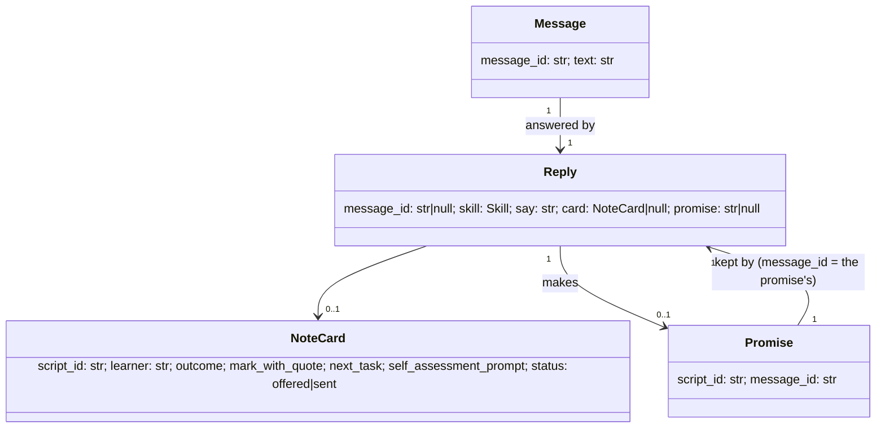

# Design — The conversation: talking to Mothusi while it works

**Status:** agreed (Katlego, 2026-11-14 04:25) · **Owner:** Katlego (Claude) ·
**Spec:** the console's live run; [voice-colleague.md](voice-colleague.md) (shares this doc's skills)

---

## 1. What this covers

A text conversation with Mothusi beside the live run. The teacher can write at any time: during
marking, moderation and approval. Mothusi answers at once while the run carries on. Writing never
pauses, blocks or reorders the marking graph. Three skills ship first:

| Skill | The teacher writes | Mothusi does |
| --- | --- | --- |
| `run_status` | "how far are you?", "status" | Says the stage, scripts marked of total, scripts waiting for the teacher, rand spent of budget, minutes so far. |
| `explain_mark` | "why did L-014 get 3 on 2.1?" | Gives the mark, the learner's words that earned it and the memo line it applied. A first mark that is not yet moderated is labelled **provisional**. |
| `send_feedback` | "send L-001 their feedback" | When L-001's note is ready (§5), it puts the note in the thread as a card with **Approve and release**. When it isn't, it says why and promises to come back. The promise is kept with a card once the note is ready. |
| `fallback` | anything else | Says honestly what it can't do mid-run and lists what it can. Never improvises an action. |

Decisions (Katlego, 2026-11-14):

1. **Who reads the message:** rules first, then our model. Fixed patterns catch the three skills
   instantly. Anything they miss goes to the Ollama model on the GPU (`qwen3:14b`), which only
   **chooses a skill and its arguments** as validated JSON. If the model fails or isn't configured
   (replay), the answer is `fallback`.
2. **Early release:** Mothusi never emails a learner or parent; delivery files the notes and
   publishes each learner's note page behind the QR link the teacher hands over. So "send L-001 their
   feedback" **releases** that one note early: it is filed and its page goes live. Only for a **settled** learner: their marks are final (moderation closed) and their
   note is drafted and passed the Reviewer. The teacher's click on **Approve and release** is the approval
   for that one learner. At whole-set delivery, learners already sent are skipped: no one gets two notes.
3. **Scope before the 07:00 freeze:** the text thread and the three skills. Voice (a mic on the same
   thread, [voice-colleague.md](voice-colleague.md)) and "mark L-001 next" come after.

Non-negotiables this keeps:

- **Code composes every sentence about a mark** (`say`), as in voice-colleague.md §8. The model never
  writes a mark, a quote, a memo line or a curriculum fact; it picks a skill.
- **Nothing reaches a learner without the teacher's approval:** the send is a button the teacher
  presses on a card showing the exact note. Chat text alone never sends ("yes send it" gets a reply
  pointing at the button).
- The marking graph is untouched: the conversation reads snapshots and writes only its own events.

**The communication box** (Katlego, 2026-11-14 04:30): a dedicated box docked on the **right of the
run screen**, full height, beside everything else. It is the one place the teacher and Mothusi talk:

- **Mothusi's updates**, as short sentences, derived in the browser from events the run already emits:
  each stage change ("Marking 32 scripts"), a script flagged for the teacher ("L-014 needs you", which
  opens it in Needs-you), a Moderator disagreement, the moderation sample, a halt, the set ready for
  approval, delivery and each early send. Nothing in the box replaces the feed: the feed stays the
  full log; the box is the conversation about it.
- **The teacher's messages** and **Mothusi's replies**, with note cards (§5) inline.
- **The input**: a text box now; the voice control (voice-colleague.md) sits in the same input row
  later, and spoken turns land in the same thread as text turns.

On a phone (under 900 px) the box becomes a sheet opened from a "Talk to Mothusi" button with an
unread count.

Not covered: voice, approving the whole set from chat, changing marks from chat (the existing
Needs-you and approval flows do that), reprioritising.

## 2. Reference material

| Kind | Where |
| --- | --- |
| Visual reference / mockup | [console-ui/19-communication-box.png](console-ui/19-communication-box.png): the box as built and reviewed with Katlego on 2026-11-14 (drawn from the build, not before it: the freeze left no time for a separate mockup) |
| Design system / tokens | `apps/web/src/index.css`, `console.css`, `agent.css` (the console's own tokens) |
| Existing code this must match | `services/core/src/mothusi_core/main.py` (`script_answer`: snapshot, 202, inbox); `apps/web/src/run/reducer.ts` (`apply`); `components/needs-you.tsx` (a side queue that never pauses the run) |
| Shared skills | [voice-colleague.md](voice-colleague.md) §6.1, §6.3 (`run_status`, `explain_mark`; same `say` rules) |

## 3. Domain model



A **promise** is stored per assessment (`planner.store`, namespace `("promises", assessment_id)`,
key `script_id`), like the answer inbox. It is kept, at most once, when the run reaches
`awaiting_approval`: for each promise whose note passed review, Mothusi emits a `reply` carrying the
card. A promise whose note failed review is kept with a `say` explaining that and no card.

## 4. Flow

```mermaid
sequenceDiagram
  participant T as Teacher (console)
  participant API as core API
  participant C as Colleague (responder)
  participant G as Planner graph (marking)
  T->>API: POST /assessments/{id}/messages {text}
  API->>API: emit `message` event
  API-->>T: 202 {message_id}
  API->>C: background task (never holds the run lock)
  C->>API: planner.snapshot(id) (read only)
  C->>C: rules → else model picks skill → code composes say
  C->>API: emit `reply` event (and store a promise, if any)
  API-->>T: SSE: message, reply
  G-->>T: SSE: marking events keep arriving throughout
  Note over G,C: on reaching awaiting_approval, kept promises emit `reply` with a card
  T->>API: POST /assessments/{id}/notes/{script_id}/send
  API->>API: settled? card offered? not sent? → deliver that one note
  API-->>T: 202; SSE: `note_sent`
```

## 5. State

When `send_feedback` may offer the card (code, not the model):

| Run state | L-xxx | Reply |
| --- | --- | --- |
| any before `awaiting_approval` | has a first mark | provisional total, and "marks are final after moderation (the blind sample is drawn once every script is marked); I'll bring you the note to approve then" + promise |
| any before `awaiting_approval` | no first mark yet | "not marked yet" + promise |
| `awaiting_approval` | note passed review | card (status `offered`) |
| `awaiting_approval` | note failed review | the Reviewer's reason; no card |
| `delivered` | — | "already delivered with the set" |
| — | already sent early | "sent at HH:MM" |
| unknown pseudonym | — | "no learner L-xxx in this class" |

The card goes `offered → sent` on the send's `note_sent` event; a reload rebuilds it from events.

## 6. Contracts

### 6.1 Events (`packages/contracts/src/mothusi_contracts/events.py`)

```python
class EventKind(StrEnum):
    ...  # existing ten + TEACHER unchanged
    MESSAGE = "message"  # the teacher wrote in the thread
    REPLY = "reply"  # Mothusi answered (or kept a promise)
    NOTE_SENT = "note_sent"  # one learner's note sent early, on the teacher's click
```

Payloads (`agent` is null on all three):

```
message:   {message_id: str, text: str}
reply:     {message_id: str | null, skill: "run_status"|"explain_mark"|"send_feedback"|"fallback",
            say: str, card: NoteCard | null, promise: str | null}       # promise = script_id
NoteCard:  {script_id, learner, outcome, mark_with_quote, next_task, self_assessment_prompt}
note_sent: {script_id: str, sent: [str], written: [str]}
```

`message_id` is `m-<n>` (n from 1 per assessment). `summary` lines: message → the text (first 80
chars); reply → `say` (first 80); note_sent → "L-001's note sent".

### 6.2 Endpoints (`services/core/src/mothusi_core/main.py`)

```
POST /assessments/{assessment_id}/messages   body {text: str (1..1000, stripped)}
  202 {message_id}          404 unknown id    422 empty/too long
  409 "the run is delivered; start a new run to ask about it"   (state delivered or halted)

POST /assessments/{assessment_id}/notes/{script_id}/send     no body
  202 {state}               404 unknown id/script
  409 when: state != awaiting_approval; no reply has offered this card; already sent;
            the note failed review
```

Sending one note uses the same message builder and mailer as whole-set delivery, filtered to that
pseudonym, and stores `script_id` in `("early_sent", assessment_id)`. The whole-set delivery skips
those pseudonyms and its `delivered` summary counts them as "sent earlier".

### 6.3 The responder (`services/core/src/mothusi_core/colleague.py`, new)

```python
Skill = Literal["run_status", "explain_mark", "send_feedback", "fallback"]

class Intent(Contract):          # what rules or the model return
    skill: Skill
    script_id: str | None = None   # "L-001" form, validated against the run's script ids
    question_id: str | None = None # validated against the memo

def match_rules(text: str) -> Intent | None          # pure; regexes over lowercased text
async def understand(text: str, provider: Provider | None) -> Intent   # rules, else model, else fallback
def compose(intent: Intent, state: RunState, promises: set[str], early_sent: set[str]) -> ReplyBody
async def respond(...)  # snapshot → understand → compose → emit reply (+ store promise)
async def keep_promises(...)  # called once when the run reaches awaiting_approval
```

The model prompt holds the skill list, the run's script ids and question ids, and the teacher's text.
It returns `Intent` JSON only. Names typed by the teacher are matched to pseudonyms in code
(`state["names"]`); the model never receives the names map.

## 7. Structure

| Path | New? | Responsibility |
| --- | --- | --- |
| `packages/contracts/.../events.py` | change | three kinds |
| `services/core/src/mothusi_core/colleague.py` | new | §6.3 |
| `services/core/src/mothusi_core/main.py` | change | two endpoints; background task |
| `services/core/src/mothusi_core/graph/planner.py` | change | keep promises on `awaiting_approval`; delivery skips early-sent |
| `services/core/tests/test_colleague.py` | new | §9 |
| `apps/web/src/api/types.ts`, `api/client.ts` | change | event payloads; `postMessage`, `sendNote` |
| `apps/web/src/run/reducer.ts` | change | `RunView.thread: ThreadItem[]` folded from the three kinds plus the update events (§1) |
| `apps/web/src/components/talk.tsx` | new | the communication box: thread, updates, note card, input (mockup) |
| `apps/web/src/screens/RunScreen.tsx` | change | the box docked right, full height; a sheet under 900 px |

`ThreadItem` (browser only): `{kind: "update", seq, text, scriptId?} | {kind: "message", seq, messageId,
text, status: "sending"|"sent"|"failed", reason?} | {kind: "reply", seq, messageId, skill, say, card?,
promise?}`; a card's sent state comes from `note_sent`. Updates are made by one pure function
`updateFor(event): string | null` so their wording is tested in one place.

## 8. Decisions & alternatives

| Decision | Chosen | Rejected, and why |
| --- | --- | --- |
| Where replies are made | A responder beside the graph, reading snapshots | A graph node: replies would wait for a batch boundary (minutes). |
| Understanding the text | Rules, then our model choosing a skill | Model only: every reply queues behind marking on the GPU. ElevenLabs text mode: data leaves Cape Town; unverified SDK. |
| Who writes about marks | Code (`say`) | The model phrasing from JSON (Non-negotiable I). |
| Early send | Settled + reviewed + a click on the card | Before moderation: a moderated mark could change after the note went out. |
| Thread storage | Events in the run log | A separate store: two sources of truth; no reload rebuild. |

## 9. How this is verified

- `test_colleague.py` (replay, the planted run):
  - every rule pattern in §1 maps to its skill;
  - an unknown text without a model gives `fallback`;
  - `explain_mark` says the awarded marks, the evidence quote verbatim and the memo line, plus
    "provisional" before moderation closes;
  - each §5 row;
  - a `message` POST during `marking` returns 202 while the graph keeps emitting, and no graph event
    is delayed by it;
  - send: 409 before `awaiting_approval`, 409 without an offered card, 202 then 409 on a second send;
  - the whole-set delivery skips the early-sent learner.
- Vitest: the reducer folds message/reply/note_sent into `thread` (and rebuilds it on reload); the
  thread posts and shows the teacher's message at once; the card's button calls `sendNote` and shows
  "Sent" on `note_sent`; with the POST refused, the message shows the server's reason.
- Visual: the thread against the mockup at 1440 and 390 wide.

## 10. Open questions

- [ ] GPU contention: during marking, a model-routed message waits behind marking calls. The rules
  cover the demo's sentences; measure model-routed latency in the next eval.

## 11. What teachers will ask: the request catalogue

Katlego, 2026-11-14 05:00: the colleague is **available on every page, with or without a run**. It
answers questions, returns stats for the current run, says **where the run hit a wall**, and
prepares new work (a lesson plan from the ATP) by handing it to sub-agents and asking follow-up
questions. Its capabilities rest on its **sources of truth**:

- the **ATP**: `packs/dbe-caps/atp/<subject>-gr10.toml`, one row per teaching week, each cited to its DBE page;
- the **PoA**: `packs/dbe-caps/<subject>-gr10.toml` `[[poa]]`, from Circular S8 of 2023, Annexure §26;
- the **memo**: the run's memo;
- the run's own state and events;
- and, for wording beyond a topic name, the page-cited curriculum passages from the knowledge service.

Where none of these covers a request, the colleague says it can't do it and names what is missing.
It never improvises.

Status: **can** = built or in the easy-wins slice below · **after X** = answerable once the run has
passed stage X, and before then the reply says when · **next** = designed, after the freeze ·
**can't** = an honest refusal with the reason.

| # | The teacher asks | Source | Skill | Status |
|---|---|---|---|---|
| **A** | **This run** | | | |
| A1 | "How far are you?" | run state | `run_status` | can (built) |
| A2 | "Give me the stats for this run": average, highest and lowest, spread, per-question average | first marks, then final marks (code) | `run_report` | can: provisional during marking, final after moderation |
| A3 | "Where did you get stuck?" / "What went wrong?" | events: halts, flags and their reasons, failed checks, re-briefs, disagreements, a widened sample, budget | `run_walls` | can |
| A4 | "Why did L-014 get 3 on 2.1?" | marks: evidence quote and memo line | `explain_mark` | can (built) |
| A5 | "Which questions did the class struggle with?" | `item_stats` | `run_report` (items) | after analysing; provisional per-question averages before |
| A6 | "Who needs catch-up?" | `catch_up_plan` | `run_report` (catch-up) | after writing |
| A7 | "Send L-001 their feedback" | the note and its review | `send_feedback` | can (built; release from the card) |
| A8 | "Change L-014's mark to 5" / "Approve the set" | — | `cannot` | can't here: marks change only through Needs-you or approval, and approval only on its screen |
| A9 | "Mark L-001 next" | — | — | next |
| **B** | **The memo** | | | |
| B1 | "What does the memo give for 2.3?" | memo item: answer, marks, notes | `memo_item` | can |
| B2 | "Did you find anything wrong in my memo?" | the Setter's memo-check results | `memo_item` (check) | can after memo check |
| B3 | "How many marks is question 3 / the whole test?" | memo totals (code) | `memo_item` | can |
| **C** | **The PoA** | | | |
| C1 | "How much does this test count?" | `[[poa]]` weight and its source | `poa` | can |
| C2 | "What is the PoA for term 2?" | `[[poa]]` by term | `poa` | can |
| C3 | "What does L-001's mark count towards the year?" | `converted` | `run_report` | after analysing |
| C4 | "How many scripts must be moderated?" | pack `moderation` | `poa` | can |
| **D** | **The ATP** | | | |
| D1 | "What should I teach in term 2 week 3?" | ATP row (code), cited | `atp` | can |
| D2 | "When is trigonometry taught?" | ATP rows matching the topic | `atp` | can |
| D3 | "What does CAPS say about functions?" | knowledge search, with pages | `curriculum` | can when the knowledge service is reachable; otherwise says so |
| **E** | **New work (sub-agents)** | | | |
| E1 | "Prepare a lesson plan for week 6" | ATP + CAPS passages | `lesson_plan`: Clarify → Research → Writer → Reviewer → teacher | **Clarify and Research can**; Writer and Reviewer next |
| E2 | "Set a practice test from the ATP" | ATP (ADR 0004) | — | next |
| E3 | "Make a worksheet / homework" | ATP + CAPS | the `lesson_plan` pipeline | next |
| **F** | **Outside the sources** | | | |
| F1 | Another grade or subject | — | `cannot` | can't: "I only hold the Grade 10 Mathematics and Accounting ATPs." |
| F2 | "Email the parents" / contact a learner | — | `cannot` | can't: Mothusi never contacts learners or parents |
| F3 | Report cards, SA-SAMS export | — | `cannot` | can't: not built |
| F4 | Anything else | — | `fallback` | lists what it can do |

### 11.1 The lesson plan's first two steps (E1, in the easy-wins slice)

**Clarify.** Mothusi asks only for what is missing, one question at a time:

- the subject: Mathematics or Accounting;
- the term and week, or a topic (resolved to ATP weeks in code);
- how many lessons, and how long each is;
- anything about the class (optional).

**Research.** Code looks up the ATP rows; the knowledge service returns CAPS and ATP passages for
the topic. The reply lists the week, the topic and each passage with its source and page. That is
the brief the Writer will receive. Until the Writer ships, the reply ends: "Drafting the full plan
from this is the next step I'll be able to take."

### 11.2 Without a run (every page)

`POST /colleague/messages {text, context: {pack_id?, subject?, assessment_id?}}` returns
`200 {reply: ReplyBody, ask?: str}`. It is synchronous, because there is no run to stream. The
thread lives in the browser for that session. On a run's page the box keeps using the run's thread
(§6), and run-less questions asked there (B, C, D, E, F) go through the same skills.

## 12. Voice: the same colleague, spoken (Katlego, 2026-11-14 05:30)

The mic sits in the box's input row on every page. Voice is **not a second brain**: the ElevenLabs
agent has one client tool, `ask_mothusi`, and every spoken request goes through the same skills,
refusals and citation rules as text (§11). This replaces voice-colleague.md §6.3's five tools; its
recorded limits (§1 there) still hold, and are enforced by construction:

- the agent's own model never states a mark, a curriculum fact or a learner's work: it reads
  `ask_mothusi`'s answer (`say`, composed in code) aloud verbatim;
- it cannot approve or release anything: no tool does, and releasing a note stays a click on its card;
- a spoken turn lands in the thread like a typed one (on a run: the run's `message`/`reply` events;
  elsewhere: the session thread), so the teacher sees what was heard and what was said.

```
GET /voice/session                       (main.py; auth as the other endpoints)
  200 {signed_url}                       from GET https://api.elevenlabs.io/v1/convai/conversation/
                                         get-signed-url?agent_id=<ELEVENLABS_AGENT_ID>, header xi-api-key
  503 {message: "Voice is off: <reason>"}  no key or agent id configured, or ElevenLabs unreachable/refused
```

Configuration: `ELEVENLABS_API_KEY` from the secret `thuto/elevenlabs`; `ELEVENLABS_AGENT_ID` from the
SSM String `/thuto/elevenlabs-agent-id`; both injected only when the service stack deploys with
`-c voice=true` (the release workflow passes it).

Browser: `@elevenlabs/react` 1.20.2 (MIT; `ConversationProvider` + `useConversation`, `startSession({signedUrl})`).
The client tool:

| Tool | Parameter | Does | Returns to the agent |
| --- | --- | --- | --- |
| `ask_mothusi` | `question: string`: the teacher's request in their own words | posts it exactly as typed text would be (run thread, or `POST /colleague/messages`) and waits for the reply (60 s) | the reply's `say` (plus `ask`, if a follow-up question is needed) |

In the ElevenLabs dashboard the agent gets that tool (blocking: "wait for response" on) and a prompt in
these words or stricter: "You are Mothusi's voice. For every request, call ask_mothusi with the
teacher's words and read its answer aloud exactly. Never add marks, quotes, curriculum facts or learner
details of your own. If asked to approve or release something, say it is done on the screen. Ask the
teacher to say learner numbers like L-014, not names."

States of the mic: off → connecting → listening / speaking → off; an error or a 503 shows "Voice is
unavailable" with the reason, and the box works as text. Audio goes to ElevenLabs; the box says so
before the first session ("Voice goes to ElevenLabs. Say learner numbers, not names.").

## 13. At capacity (Katlego, 2026-11-14 05:33)

When the GPU is busy with a run, a colleague who is at capacity says so and attends to the request
afterwards. It doesn't keep the teacher waiting in silence, and it doesn't pretend.

- **At capacity** means some run's task is working on a model stage right now: `Runs.tasks` has an
  unfinished task. A run paused on a teacher's question is not using the GPU.
- **Code-composed skills answer at once, even at capacity:** `run_status`, `run_report`, `run_walls`,
  `explain_mark`, `send_feedback`, `memo_item`, `poa`, `atp`, `curriculum`, `cannot`, and the lesson
  plan's Clarify and Research steps. None of them needs the GPU.
- **Requests that need the model are deferred:** text the rules can't place, so the model must
  understand it. The reply is immediate:
  "I'm at capacity: I'm marking *<title of the busy run>* on my GPU right now. I'll attend to this as
  soon as that's done, and answer here." The request is stored as `("deferred", scope)` with its
  `message_id` and text. The scope is the run's id, or `desk` for the run-less box.
- **When capacity frees**, meaning the busy task finishes or pauses for the teacher, every deferred
  request is understood with the model, composed, and answered. On a run's thread the answer is a
  `reply` event carrying the original `message_id`. For the desk it is stored and fetched:

```
POST /colleague/messages  -> 200 {reply, ask, lesson, deferred_id: str | null}
GET  /colleague/deferred/{deferred_id}
  202 {state: "waiting"}         still at capacity
  200 {reply, ask, lesson}       answered
  404 unknown id
```

The desk box polls each waiting `deferred_id` every 10 s and adds the answer to the thread when it
arrives. On voice, `ask_mothusi` returns the at-capacity sentence straight away, so the agent says it
aloud.

## 14. The colleague opens things on the screen (Katlego, 2026-11-14 05:37)

A reply can carry an **action**, composed in code beside `say`. The box carries it out when the
reply first arrives: never when a reload replays the thread. The reply also shows a button that
does it again ("Open L-001's script").

```
ReplyBody.action: {open: "script" | "note" | "stats" | "approval" | "desk" | "new", script_id: str | null} | null
```

| The teacher says | Skill | Action |
| --- | --- | --- |
| "Open L-001's script" / "show me L-001's sheet" | `open` | `script`, L-001: on the run, the class set selects L-001; at approval, the mark sheet tab |
| "Open L-001's feedback" / "…note" | `open` | `note`, L-001: at approval, the notes tab, scrolled to that learner; before approval, `say` explains it isn't written yet and opens the script instead |
| "Show me the stats" / "the item analysis" | `open` (+ `run_report`'s numbers in `say`) | `stats`: at approval, the item-analysis tab; before approval, nothing to open, and `say` gives the provisional figures |
| "Take me to the approval" | `open` | `approval` when the run is awaiting approval; otherwise `say` says when it will be |
| "Go to my desk" / "Start a new set" | `open` | `desk` → `/`; `new` → `/new` |
| `explain_mark` / `run_report` / a note card | as today | `script` / `stats` / `note` alongside the reply |

So that "L-001" can find its card, the bundle's `learner_notes[]` and `mark_sheet[]` gain `pseudonym`.
The teacher's screen already shows names, so this adds no exposure. The event log stays name-free.
The browser carries out an action through one `mothusi:open` window event: `RunScreen` and
`ApprovalScreen` listen; the box navigates for `desk`, `new` and `approval`.
