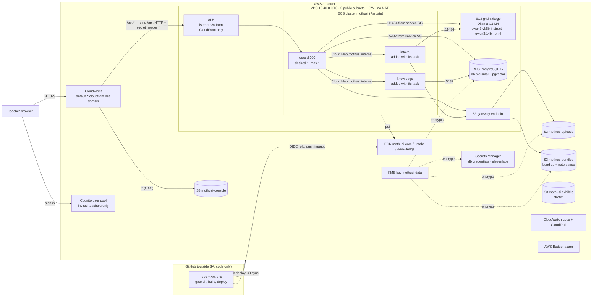
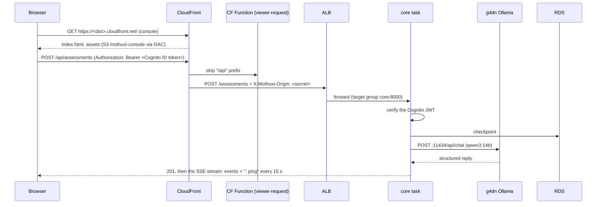
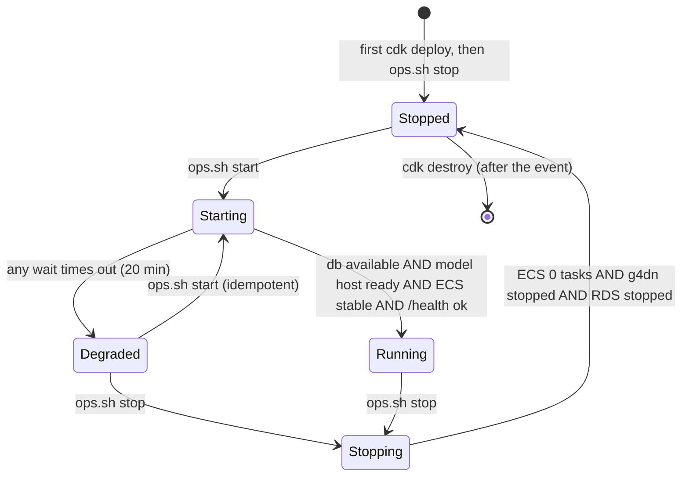

# Design — deployment on AWS af-south-1 (`infra`)

**Status:** draft · **Owner:** the project researcher (Claude) · **Spec:** the product requirements system criteria (live URL, data stays in af-south-1), US9 ·
**Decision:** [ADR 0001](../../adr/0001-aws-cape-town-open-models.md)

---

## 1. What this covers

The cloud stack that runs Mothusi in AWS Cape Town (af-south-1) under option A:

- the network;
- the data stores;
- the GPU model host;
- the containers and the front door;
- sign-in, secrets, logs and CI;
- the runbook that starts the stack for testing and judging and stops it in between.

It does **not** cover:

- what the services do: [marking-pipeline.md](marking-pipeline.md), [intake.md](intake.md), and the
  knowledge service's doc;
- which model each agent calls ([llm-seam.md](llm-seam.md));
- how bundles and learner note pages are written to S3 ([outputs-and-delivery.md](outputs-and-delivery.md)).

This doc only provides the buckets, roles and environment variables those lanes use. The laptop's
`docker-compose.yml` stays the offline fallback (option C) and is unchanged.

## 2. Reference material

| Kind | Where |
| --- | --- |
| The decision and the options weighed | [docs/adr/0001-aws-cape-town-open-models.md](../../adr/0001-aws-cape-town-open-models.md), [docs/architecture/hosting-options.md](../hosting-options.md) |
| Option A's diagram, costs and sources (read 2026-11-10) | [docs/architecture/mothusi-aws-map.html](../mothusi-aws-map.html) §04–§05, §11 |
| Local stack this mirrors | `docker-compose.yml` (Postgres 17 + pgvector 0.8.7, RabbitMQ 4.3.7, Ollama 0.40.15) |
| Env names the code reads today | `services/core/src/mothusi_core/providers.py` (`MOTHUSI_PROVIDER`, `OLLAMA_URL`, `MOTHUSI_OLLAMA_MODEL`), `services/core/src/mothusi_core/main.py` (`MOTHUSI_DATA`, `MOTHUSI_WEB_ORIGINS`), `graph/planner.py` (`MOTHUSI_TEACHER_EMAIL`), `POSTGRES_URL` |
| Console API base | `apps/web/src/api/client.ts`: base `/api`, overridable by `VITE_API_URL` |
| The one build script | the validation checks, run by `.github/workflows/checks.yml` |

Prices used below come from the AWS af-south-1 price lists published 2026-11-05 and read 2026-11-10:

| Item | Price |
| --- | --- |
| g4dn.xlarge | $0.698/h |
| Fargate, x86 | $0.0546 per vCPU-h; $0.006 per GB-h |
| RDS db.t4g.small (Single-AZ, PostgreSQL) | $0.041/h |
| RDS storage | $0.151 per GB-month |
| EBS gp3 | $0.1047 per GB-month |
| ALB | $0.03/h, plus $0.0095 per LCU-h |
| Public IPv4 | $0.005/h each |
| NAT gateway (not used) | $0.057/h, plus $0.057/GB |
| Secrets Manager | $0.40 per secret per month |
| KMS | $1 per key per month |

## 3. Domain model

No new entities. The structure is the component diagram (§4) and the stacks (§6.1).

## 4. Components



**Security groups.** Ingress rules not listed here do not exist.

| SG | Inbound | Attached to |
| --- | --- | --- |
| `alb-sg` | TCP 80 from the AWS-managed prefix list `com.amazonaws.global.cloudfront.origin-facing` only | ALB |
| `service-sg` | TCP 8000 from `alb-sg`; TCP 8000 from `service-sg` (core ↔ intake ↔ knowledge) | every Fargate task |
| `model-sg` | TCP 11434 from `service-sg` only. No SSH: admin is Session Manager | the g4dn |
| `db-sg` | TCP 5432 from `service-sg` only | RDS |

There is no port 22 anywhere. Tasks and the g4dn have public IPs for outbound traffic only (image
pulls, model downloads, ElevenLabs); their security groups admit nothing from the internet. The ALB
also rejects any request without the `X-Mothusi-Origin` header that CloudFront adds (§6.3), so the ALB
hostname cannot be used as a back door.

**IAM roles.**

| Role | Trusted by | Allows |
| --- | --- | --- |
| `mothusi-task-execution` | ecs-tasks | pull from the three ECR repos; write its log groups; read the secrets named in §6.4 and decrypt with `mothusi-data` |
| `mothusi-core-task` | ecs-tasks | `s3:GetObject/PutObject/ListBucket` on `mothusi-uploads` and `mothusi-bundles`; `s3:DeleteObject` on `mothusi-bundles` only (`publish_bundle` removes a partly uploaded prefix before retrying, outputs-and-delivery.md §4); `kms:Decrypt/GenerateDataKey` on `mothusi-data`; `cognito-idp:AdminGetUser` on the pool (not used before the voice implementation) |
| `mothusi-intake-task` | ecs-tasks | `s3:GetObject/ListBucket` on `mothusi-uploads`; KMS decrypt |
| `mothusi-knowledge-task` | ecs-tasks | its secrets, plus `s3:GetObject` on `mothusi-curriculum-<acct>` (the passage snapshot it loads at start, knowledge.md §4.1) and `kms:Decrypt` on `mothusi-data` with the condition `kms:ViaService = s3.af-south-1.amazonaws.com` (the bucket is SSE-KMS; the execution role's grant does not cover the task's own calls). The key policy names this task role |
| `mothusi-model-host` | ec2 | `AmazonSSMManagedInstanceCore` (Session Manager, Run Command); `CloudWatchAgentServerPolicy` |
| `mothusi-github-deploy` | the GitHub OIDC provider, `repo:<owner>/<repo>:ref:refs/heads/main` only | ECR push to the three repos; `cloudformation:*` on `Mothusi*` stacks through the CDK bootstrap roles (`sts:AssumeRole` on `cdk-*-af-south-1` roles); `ssm:GetParameter` on `parameter/mothusi/*` (release.yml reads the console bucket, distribution and Cognito values); `s3:ListBucket` on the `mothusi-console` bucket ARN and `s3:PutObject/DeleteObject` on its objects (`aws s3 sync --delete` lists first); `cloudfront:CreateInvalidation` on the distribution |

## 5. Flows and state

### 5.1 A teacher's request



**Failure paths**

- **Ollama unreachable** (host stopped, still pulling, or wrong IP): the provider raises a retryable
  `ProviderError`. The Planner logs it and the run ends at `needs_teacher` (marking-pipeline.md §6.2).
  `/health` reports `"ollama": "unreachable"` (§6.5).
- **CloudFront's origin response timeout is 30 s by default.** A silent SSE stream would be cut, so the
  core sends a comment line (`: ping`) every 15 s (§6.5). The ALB idle timeout is 3600 s.
- **The core task is replaced** (deploy or crash): runs held in its memory and in its `MOTHUSI_DATA` on
  ephemeral storage are lost. The core is therefore pinned at one task with no autoscaling, and deploys
  happen only outside the judging window (§5.2). Durable bundles are the outputs lane's S3 write.
- **RDS stopped:** the core cannot checkpoint, `/health` reports `"db": "unreachable"`, and the ALB
  marks the target unhealthy.

### 5.2 Start and stop (the runbook)

The stack has four lifecycle states. `infra/ops.sh` is the only way to move between them (§6.6).



| State | What runs | What it costs per hour (§2 prices) |
| --- | --- | --- |
| Stopped | ALB, CloudFront, the 2 ALB IPv4s; storage (RDS 20 GB, EBS 100 GB, S3, ECR, secrets, KMS) | ALB $0.0395 + IPv4 $0.01 ≈ $0.05/h, plus storage pro rata |
| Running | the above, plus core, intake and knowledge on Fargate, RDS, the g4dn, task IPv4s | ≈ $0.289/h base + $0.698/h GPU ≈ $0.99/h |

**`ops.sh start`**, in order:

1. `aws ec2 start-instances --instance-ids <ModelHostInstanceId>` **first**: g4dn capacity in
   af-south-1b can run out (`InsufficientInstanceCapacity`, seen 2026-11-12), and starting the
   host first makes that fail in seconds, before RDS is started and billing. On that error the
   start ends Degraded with RDS untouched.
2. `aws rds start-db-instance --db-instance-identifier mothusi-db`, so the database and the host
   boot at the same time (sequential, the first cold start spent 4m14s on RDS before the host
   began; 2026-11-12). Then wait for both: `rds wait db-instance-available` and
   `ec2 wait instance-status-ok`.
3. Wait for Ollama: `aws ssm send-command --document-name AWS-RunShellScript` running
   `/opt/mothusi/model-ready.sh` until it exits 0, polling every 20 s.
4. Warm the marker: `HOME=/root ollama run qwen3:14b ""` through the same Run Command (SSM shells have no HOME, and the Ollama CLI panics without it), so the first real call
   does not pay the load time.
5. `aws ecs update-service --cluster mothusi --service <s> --desired-count 1` for each deployed service,
   then `aws ecs wait services-stable --cluster mothusi --services <all>`.
6. `curl -fsS https://<DistributionDomain>/api/health`, which must report every dependency `ok`.

**`ops.sh stop`** reverses it: ECS desired count 0 and wait; `aws ec2 stop-instances` and wait
`instance-stopped`; `aws rds stop-db-instance`.

**`ops.sh status`** prints each piece's state and the overall state from the diagram.

**Before judging:** run `ops.sh start` **60 minutes before the window**. Starting RDS and the g4dn and
loading models take minutes each, and these timings are unmeasured. the live deployment check measures one cold start and
records it here.

**Stopped RDS restarts itself after 7 days.** `ops.sh status` warns when a stop is older than 6 days.

## 6. Contracts

### 6.1 CDK app and stacks

`infra/` is a CDK v2 app in Python, managed with uv, plus a pinned CDK CLI in `infra/package.json`.
Versions are those pinned in the CDK implementation. Region `af-south-1`; the account comes from the environment. Bootstrap
once: `cd infra && npx cdk bootstrap aws://<account>/af-south-1`.

Stack names and contents are verbatim. Stacks reference each other through SSM parameters under
`/mothusi/` instead of CloudFormation exports, so the service stack can be replaced without unpicking
exports.

| Stack | Lifecycle | Resources | SSM outputs (`/mothusi/...`) |
| --- | --- | --- | --- |
| `MothusiNetwork` | kept | VPC `10.40.0.0/16`, 2 public subnets (af-south-1a, af-south-1b), IGW, no NAT, S3 gateway endpoint; the four SGs of §4; Cloud Map private DNS namespace `mothusi.internal` | `vpc-id`, `subnet-ids`, `sg/alb`, `sg/service`, `sg/model`, `sg/db`, `namespace-id` |
| `MothusiData` | kept (retain policy on RDS, buckets and key) | KMS key `mothusi-data`; buckets `mothusi-uploads-<acct>`, `mothusi-bundles-<acct>`, `mothusi-console-<acct>`, `mothusi-exhibits-<acct>`, `mothusi-curriculum-<acct>` (the knowledge snapshot, knowledge.md), `mothusi-trail-<acct>` (all block public access, SSE-KMS except console (SSE-S3, CloudFront OAC), uploads lifecycle 30 days; the uploads bucket's CORS rule is applied by `MothusiFront`, not here, because only MothusiFront knows the distribution domain (see MothusiFront)); RDS `mothusi-db` PostgreSQL 17 (latest 17.x minor offered in af-south-1, verified in the CDK implementation), db.t4g.small, Single-AZ, 20 GB gp3, KMS-encrypted, not public, `db-sg`, credentials in a generated secret; secret `mothusi/elevenlabs` (value set by hand); secret `mothusi/note-key` (generated, 48 bytes, never rotated by a deploy); ECR repos `mothusi-core`, `mothusi-intake`, `mothusi-knowledge` (keep the last 10 images); CloudTrail trail `mothusi` (management events) to `mothusi-trail`; AWS Budget `mothusi-monthly` | `kms-key-arn`, `bucket/uploads`, `bucket/bundles`, `bucket/console`, `bucket/exhibits`, `bucket/curriculum`, `db/endpoint`, `db/secret-arn`, `ecr/core`, `ecr/intake`, `ecr/knowledge`, `secret/elevenlabs-arn` |
| `MothusiModelHost` | kept; **stopped** between sessions | g4dn.xlarge in the first public subnet, `model-sg`, instance profile `mothusi-model-host`, root EBS gp3 100 GB encrypted with `mothusi-data`, IMDSv2 required, user data in §6.2 | `model-host/instance-id`, `model-host/url` (`http://<private IP>:11434`; the private IP survives stop and start) |
| `MothusiService` | redeployed on each release; scaled to 0 between sessions | ECS cluster `mothusi`; Fargate services `core` (1 vCPU / 2 GB, desired ≤ 1, max 1), `intake` (0.5 / 1), `knowledge` (1 / 4), each only when `-c services=core,intake,knowledge` lists it; Cloud Map names `core.mothusi.internal` and so on; log groups `/mothusi/<service>` (7-day retention); task roles of §4 | `cluster-name`, `service-names` |
| `MothusiFront` | kept | internet-facing ALB in `alb-sg`; HTTP listener :80 whose default action is a fixed 403, with one rule: `X-Mothusi-Origin` equals the secret → target group `core` (:8000, health check `GET /health/live`, idle timeout 3600 s); CloudFront distribution: default behaviour → `mothusi-console` via OAC (cached), with a viewer-request CloudFront Function `spa-rewrite` that rewrites any path with no file extension (for example `/auth/callback`) to `/index.html`, leaving the query string (`code`, `state`) untouched, so the SPA handles the Cognito callback; `/api/*` → ALB origin (caching disabled, all headers and query strings forwarded, origin custom header `X-Mothusi-Origin`, CloudFront Function `strip-api-prefix` on viewer-request); `/n/*` → the same ALB origin with caching disabled and the path **unchanged** (no strip function), so a learner's QR link reaches the core's `GET /n/{token}` (outputs-and-delivery.md §6.2); an `AwsCustomResource` calling `s3:PutBucketCors` on `mothusi-uploads` with one rule: origin `https://<distribution-domain>` (and `http://localhost:5173` only when the `devCors` context is set), method `PUT`, headers `Content-Type` and every header the uploads endpoint returns in `headers` (console-ui.md §11.5), max age 3000 s (browsers send a preflight that presigning does not bypass; doing it here avoids a MothusiData ↔ MothusiFront cycle on a fresh account); Cognito user pool `mothusi-teachers` (admin-create-user only, no self sign-up), SPA app client (no secret, auth code + PKCE), hosted UI domain prefix `mothusi-<acct>` | `front/distribution-domain`, `front/distribution-id`, `front/alb-dns`, `front/core-target-group-arn`, `cognito/user-pool-id`, `cognito/client-id`, `cognito/domain` |
| `MothusiCi` | kept | IAM OIDC provider `token.actions.githubusercontent.com`; role `mothusi-github-deploy` (§4) | `ci/deploy-role-arn` |

`MothusiFront` owns the core target group. `MothusiService` reads its ARN from
`/mothusi/front/core-target-group-arn` and registers the core service with it, so `MothusiFront` is deployed first. The ALB and the distribution are kept, so **the judges' URL never changes**
(§8).

### 6.2 Model host bootstrap

- **AMI.** An AWS Deep Learning AMI with NVIDIA drivers (Ubuntu, x86_64), resolved at deploy time from
  the AMI's public SSM parameter. No AMI id is hard-coded. The path, from the DLAMI release page
  ("Deep Learning Base OSS Nvidia Driver GPU AMI (Ubuntu 22.04)", checked 2026-11-11), is
  `/aws/service/deeplearning/ami/x86_64/base-oss-nvidia-driver-gpu-ubuntu-22.04/latest/ami-id`; it is
  the default of the stack's `ModelHostAmi` parameter. **Still to check on the account:** that the
  parameter resolves in af-south-1 (`aws ssm get-parameter --region af-south-1 --name <path>`); if it
  does not, pass another DLAMI path as the parameter.
- **User data**, run once, idempotent:
  1. Install Ollama **0.40.15** (the version `docker-compose.yml` pins) from its release archive
     `ollama-linux-amd64.tar.zst`, checked against sha256
     `628c018404a4206493efd38e46251c154ede5141b8b8dc85c659b3b027c47379` (the release's own
     `sha256sum.txt`, read 2026-11-11), extracted into `/usr/local`.
  2. A systemd unit `ollama.service` with `OLLAMA_HOST=0.0.0.0:11434`, `OLLAMA_KEEP_ALIVE=30m` and
     `OLLAMA_MAX_LOADED_MODELS=1` (one 16 GB T4: models load one at a time, ADR 0001),
     `OLLAMA_NUM_PARALLEL=4` (four requests decode together: ~25 tok/s combined against ~17 for one,
     measured 2026-11-12) and `OLLAMA_LOAD_TIMEOUT=15m`.
  3. `ollama pull qwen3-vl:8b-instruct`, `ollama pull qwen3:14b`, `ollama pull phi4`. The digests reported
     after the first pull are written into §6.7 by the model-host setup, so a later pull of a moved tag is noticed.
  4. Write `/opt/mothusi/model-ready.sh`: it exits 0 only when `curl -fsS localhost:11434/api/tags` lists
     all three tags and `nvidia-smi` shows the T4. `model-ready.sh --digests` also prints each tag's
     digest, which is how §6.7 is filled after the first pull.
  The script is `infra/mothusi_infra/model_host_user_data.sh` (shellchecked by the gate).
- **Volume.** Models live on the 100 GB root volume, about 25 GB for the three tags. A stop keeps them,
  so a start does not download them again.

### 6.3 CloudFront ↔ ALB

- `strip-api-prefix` (CloudFront Functions, viewer-request): if `uri` starts with `/api/`, remove the
  first 4 characters (`/api`); `/api` alone becomes `/`.
- Origin protocol HTTP to the ALB on port 80. A custom header `X-Mothusi-Origin` carries a random value
  generated by CDK and stored in SSM SecureString `/mothusi/front/origin-secret`.
- The `/api/*` behaviour uses the managed `CachingDisabled` cache policy, the `AllViewerExceptHostHeader`
  origin request policy, and an origin response timeout of 60 s.

### 6.4 Environment and secrets per service

| Name | core | intake | knowledge | Source |
| --- | --- | --- | --- | --- |
| `MOTHUSI_PROVIDER` | `ollama` | — | — | plain |
| `OLLAMA_URL` | ✓ | ✓ | — | SSM `/mothusi/model-host/url` at deploy |
| `MOTHUSI_OLLAMA_MODEL` | `qwen3:14b` | — | — | plain; replaced by per-agent model names when llm-seam.md's revision lands |
| `POSTGRES_HOST`, `POSTGRES_PORT`, `POSTGRES_DB`, `POSTGRES_USER`, `POSTGRES_PASSWORD` | ✓ | — | ✓ | the RDS secret (ECS `secrets`, by JSON key) |
| `POSTGRES_URL` | ✓ | — | ✓ | composed by the image's entrypoint from the five above |
| `MOTHUSI_DATA` | `/data` (ephemeral) | `/data` | — | plain |
| `MOTHUSI_UPLOAD_BUCKET` | ✓ | ✓ | — | SSM `/mothusi/bucket/uploads` |
| `MOTHUSI_BUNDLE_BUCKET` | ✓ | — | — | SSM `/mothusi/bucket/bundles` |
| `MOTHUSI_WEB_ORIGINS` | `https://<distribution-domain>` | — | — | SSM |
| `KNOWLEDGE_URL` | `http://knowledge.mothusi.internal:8000` when `knowledge` is in `-c services=`, otherwise unset (the core then uses `NoKnowledge` and logs it, knowledge.md §4.2) | — | — | plain, from the Cloud Map name |
| `KNOWLEDGE_SNAPSHOT` | — | — | `s3://mothusi-curriculum-<acct>/<key>` | SSM `/mothusi/knowledge/snapshot`, written by the ingest upload step (knowledge.md §6.4) before the first deploy that includes knowledge |
| `MOTHUSI_PUBLIC_URL` | `https://<distribution-domain>` (the base of every learner QR link) | — | — | SSM `/mothusi/front/distribution-domain` |
| `MOTHUSI_NOTE_KEY` | ✓ | — | — | secret `mothusi/note-key` in `MothusiData`: 48 random bytes generated once by CDK (`SecretsManager` generated secret), kept across deploys so printed links stay valid; the execution role may read it |
| `MOTHUSI_NOTE_LINK_DAYS` | `14` | — | — | plain (outputs-and-delivery.md §6.2) |
| `COGNITO_USER_POOL_ID`, `COGNITO_CLIENT_ID` | ✓ | — | — | SSM |
| `AWS_REGION` | `af-south-1` | ✓ | ✓ | plain |
| `ELEVENLABS_API_KEY` | ✓ (the voice implementation only) | — | — | secret `mothusi/elevenlabs` |
| `MOTHUSI_TEACHER_EMAIL` | unset (Maildir, the demo service declarations) | — | — | — |
| `ANTHROPIC_API_KEY`, `RABBITMQ_URL` | **not set** (ADR 0001; RabbitMQ deferred) | — | — | — |

Console build: `VITE_API_URL` is left unset, so the console uses `/api` on the same CloudFront domain.

### 6.5 What the core must expose (owned here; built in the API authentication implementation)

```
GET /health  -> 200 {"status": "ok"|"degraded",
                     "db": "ok"|"unreachable",
                     "ollama": "ok"|"unreachable",
                     "models": ["qwen3-vl:8b-instruct", "qwen3:14b", "phi4"]}   # from GET {OLLAMA_URL}/api/tags
             -> 503 with the same body when status is "degraded"
             no auth; no learner data; ops.sh reads it (a deep check)
GET /health/live -> 200 {"status": "live"} whenever the process serves requests; no dependencies
             checked. This is the ALB target-group health check: a stopped or still-loading G4dn
             must not make ECS kill and restart a healthy core in a loop (found while building
             the API authentication implementation, 2026-11-10).
SSE /assessments/{id}/events: a comment line ": ping\n\n" every 15 s while idle
Auth: every route except /health, /health/live, GET /n/{token} and GET /c/... (signed crop links, intake.md §11.7) requires a valid Cognito JWT (ID token, issuer
      https://cognito-idp.af-south-1.amazonaws.com/<pool-id>, audience <client-id>); 401 otherwise.
      GET /n/{token} is a learner's link: its HMAC token is the credential (signature and expiry
      checked by read_note_link, outputs-and-delivery.md §6.2), never a teacher JWT.
      Off when COGNITO_USER_POOL_ID is unset (laptop, tests).
```

### 6.6 `infra/ops.sh`

```
bash infra/ops.sh start   # Stopped|Degraded -> Running; exit 0 only in Running
bash infra/ops.sh stop    # any -> Stopped; exit 0 only in Stopped
bash infra/ops.sh status  # prints one line per component and the overall state; exit 0 always
```

`ops.sh` reads every id from the SSM parameters of §6.1 and hard-codes none. Each wait has a 20-minute
cap and then reports `Degraded`.

### 6.7 Pinned model digests

Filled by the model-host setup after the first pull (2026-11-11, `model-ready.sh --digests` on the account):

| Tag | Digest |
|---|---|
| `qwen3-vl:8b-instruct` | `70e58e37beb15464e19aa903dedb2cba828b89c0fb186f75ff2738c7347b96eb` (pulled 2026-11-12; replaced `qwen3-vl:8b`, which thinks even with `think: false`) |
| `qwen3:14b` | `bdbd181c33f2ed1b31c972991882db3cf4d192569092138a7d29e973cd9debe8` |
| `phi4:latest` | `ac896e5b8b34a1f4efa7b14d7520725140d5512484457fab45d2a4ea14c69dba` |

### 6.8 CI: `.github/workflows/release.yml`

- **Trigger:** `workflow_dispatch` only. Deploys are deliberate and never run during judging.
- **Job `gate`:** the same validation checks as `checks.yml`, which the deploy job needs to pass.
- **Job `deploy`:**
  1. Assume `mothusi-github-deploy` through OIDC.
  2. `docker buildx build --platform linux/amd64` for each service in `services=`, tagged `<git sha>`,
     and push to ECR.
  3. `cd infra && npx cdk deploy MothusiService -c imageTag=<sha> -c services=<list> --require-approval never`.
  4. `npm ci && npm run build -w apps/web`, then `aws s3 sync apps/web/dist s3://<console bucket> --delete`.
  5. `aws cloudfront create-invalidation --paths "/*"`.
- **Prerequisite (the project researcher):** a GitHub repo with this repo pushed and the remote added. Today there is no
  remote, and the judges need the repo link by Sat 14 Nov 11:00.

### 6.9 Cost guardrail

AWS Budget `mothusi-monthly`: a $60 monthly cost budget, alerting at 50%, 80% and 100% of actual spend and
100% of forecast. Alerts go to the address passed as `-c budgetEmail=...` at deploy; it is never written
into the repo. $60 is above the $22 estimate for option A, so an alert means something was left
running.

## 7. Structure

| Path | New? | Responsibility |
| --- | --- | --- |
| `infra/app.py` | new | instantiates the six stacks of §6.1 for af-south-1 |
| `infra/mothusi_infra/network.py`, `data.py`, `model_host.py`, `service.py`, `front.py`, `ci.py` | new | one stack each |
| `infra/mothusi_infra/model_host_user_data.sh` | new | the §6.2 bootstrap |
| `infra/functions/strip-api-prefix.js` | new | the §6.3 CloudFront Function |
| `infra/ops.sh` | new | the §5.2 runbook |
| `infra/pyproject.toml`, `infra/package.json`, `infra/cdk.json` | new | uv project; pinned CDK CLI; `"app": "uv run python app.py"` |
| `infra/tests/test_stacks.py` | new | CDK assertions (§9) |
| `services/core/Dockerfile`, `services/core/docker-entrypoint.sh` | new | image for the core; composes `POSTGRES_URL` |
| `services/core/src/mothusi_core/main.py` | changed | `/health`, the SSE ping, Cognito JWT check (§6.5) |
| `.github/workflows/release.yml` | new | §6.8 |
| `pyproject.toml` (workspace) | changed | add `infra` to the uv workspace, or keep it a separate project (decided in the CDK implementation) |

## 8. Decisions & alternatives

| Decision | Chosen | Rejected, and why |
| --- | --- | --- |
| Outbound internet for tasks and the g4dn | Public subnets with public IPs; security groups admit nothing inbound | A NAT gateway: $0.057/h plus $0.057/GB, more than the stack's whole base rate, for no gain at this size |
| Where ALB and CloudFront live | A kept `MothusiFront` stack; ~$0.05/h even when stopped | Destroying the ALB with the services (the cost page's assumption): saves about $1 a day but changes the origin on every start and risks the judges' URL during the window. This deviates from `mothusi-aws-map.html` §05, which counts the ALB only while running: about +$1/day |
| Stopping the GPU | `ec2 stop-instances` on a kept instance | Destroying it: every start would download about 25 GB of models again |
| Services compute | ECS on Fargate | EC2 for the services: more to patch; Fargate is per-second and scales to 0. App Runner closed to new customers on 30 April 2026 |
| Model host | EC2 g4dn.xlarge with Ollama | SageMaker real-time on ml.g4dn ($0.977/h, managed): a new adapter; Ollama works with `mothusi_llm` today |
| IaC | AWS CDK in Python | Terraform: a second language and state backend; CDK fits the Python stack and the architecture plan's locked stack (ADR 0001) |
| Front-door TLS | CloudFront's default certificate for viewers; HTTP from CloudFront to the ALB, locked by prefix list and secret header | A custom domain with ACM on the ALB: needs a domain we do not have. The CloudFront→ALB hop is unencrypted (open question 1) |
| Teacher auth | Cognito JWT verified in the core | ALB `authenticate-cognito`: needs an HTTPS listener and so a certificate |
| Cross-stack wiring | SSM parameters | CloudFormation exports: they block replacing `MothusiService` |

Deviations from the architecture defaults: RabbitMQ is not deployed
(deferred, the architecture plan Messaging) (source note not in this repo).

## 9. How this is verified

- `cd infra && uv run pytest`: CDK `Template` assertions:
  - no `AWS::EC2::NatGateway`;
  - `model-sg` allows 11434 only from `service-sg`; `db-sg` allows 5432 only from `service-sg`;
  - no security group allows 0.0.0.0/0 inbound (the ALB's only ingress is the CloudFront prefix list);
  - RDS `StorageEncrypted` with the `mothusi-data` key and `PubliclyAccessible: false`;
  - every bucket blocks public access;
  - the core service has `DesiredCount ≤ 1` and no scaling policy;
  - the ALB idle timeout is 3600.
- `npx cdk synth` succeeds for all six stacks with no hard-coded account id or AMI id.
- `bash infra/ops.sh start` from Stopped reaches Running, `curl https://<domain>/api/health` reports
  all `ok`, and the demo class set marks through the console. Then `ops.sh stop` reaches Stopped
  (the live deployment check, on the real account).
- A request to `http://<alb-dns>/health` without the header returns 403.

## 10. Open questions

- [ ] **The CloudFront → ALB hop is HTTP.** Encrypting it needs a domain and an ACM certificate on the
  ALB. CloudFront VPC origins could keep the ALB private, but their support in af-south-1 is
  **unverified**. POPIA s19 calls for "reasonable" measures; the project researcher to decide whether to buy a domain
  before real learner data is used. Synthetic data only until then.
- [x] **SSE auth.** Settled in console-ui.md §12: a fetch-based SSE reader sends the `Authorization`
  header, so no token goes in a URL.
- [x] **Checked on the account 2026-11-11:** the DLAMI SSM path resolves in af-south-1
  (`ami-00a3eafa971fe6b29`); RDS offers PostgreSQL 17.7 to 17.11 (the stack pins major 17);
  g4dn.xlarge is offered in af-south-1b and 1c only, so the model host takes the 1b subnet
  (`network.MODEL_HOST_SUBNET`); the CloudFront origin-facing prefix list is `pl-c0aa4fa9`.
- [ ] **Still unverified:** pgvector 0.8.2 on RDS 17 (the knowledge service's `CREATE EXTENSION`, runbook step 11);
  CloudFront's maximum origin response timeout without a quota increase; cold-start minutes.
- [ ] **Amazon MQ's RabbitMQ engine in af-south-1** is unverified. It is deferred anyway (the architecture plan
  Messaging), so nothing here depends on it.
- [x] **The G-instance quota:** granted 2026-11-11 (8 vCPUs, AWS's email to the project researcher; checked on the
  account, step 1 of the live-testing runbook) (source note not in this repo). The fallback below is not needed.
  Original note: the quota starts at 0 vCPUs on a new account. If it is not granted by Wed 11 Nov
  evening, `MothusiModelHost` is not deployed and ADR 0001's fallback (B or D) needs a new ADR and a new
  provider. Every other stack is unchanged.
- [ ] **The intake and knowledge images** depend on those lanes' tasks. `MothusiService` deploys only the
  services listed in `-c services=`.
- [x] **GPU capacity during the event: settled 2026-11-12 (the project researcher).** The g4dn is started at
  about 04:00 SAST on Fri 13 Nov and kept running until Sat 14 Nov 16:00 SAST (judging can run past
  13:00), 36 h: the g4dn alone is $25.13; with RDS and Fargate from 07:00 and stopped by hand
  Fri 19:00 → Sat 06:00, ~$32.20 in all; left up from 07:00, ~$34.80; everything from 04:00,
  ~$35.50 (plus ~$0.70 storage). Each hour past 16:00 adds ~$1. Waiting for capacity on the day
  could cost the demo. It is never stopped during the event, since a restart can be refused again. `ops.sh stop` stops the g4dn too,
  so it is not used overnight; RDS and Fargate stay up, or are stopped by hand. Refusals seen on
  2026-11-12: one start at ~11:45 and two at 16:37 and 16:41 SAST; each cleared within ~3 minutes.
  The research that led here follows.
- [x] **GPU capacity during the event (research, 2026-11-12).**
  `ops.sh start` hit `InsufficientInstanceCapacity` for g4dn.xlarge in af-south-1b on 2026-11-12
  (cleared after ~2½ minutes). Costs for the window Fri 13 Nov 07:00 → Sat 14 Nov 13:00 SAST
  (30 h), at g4dn.xlarge $0.698/h, the rest of the stack $0.289/h running and ~$0.05/h stopped
  (§5.2), and gp3 $0.1047/GB-month in af-south-1 (AWS price list, published 2026-11-10):

  | Option | What runs | Cost for the 30 h | Start can fail on capacity? |
  |---|---|---|---|
  | 1. Always on | everything, the whole window | ~$29.60 | the Friday start only |
  | 1b. Stop overnight (Fri 19:00 → Sat 06:00) | 19 h running, 11 h stopped | ~$19.30 | the Friday start and the Saturday 06:00 restart |
  | 2. Capacity Reservation, always on | as 1; the reservation covers the running g4dn (billed once) | ~$29.60 | the Friday start only |
  | 2b. Capacity Reservation, stop overnight | reservation held 30 h; RDS and Fargate stopped overnight | ~$27.00 | the Friday start only; the Saturday restart is guaranteed |
  | 4. Second zone (af-south-1c), stop overnight | as 1b, plus a second host's 100 GB gp3 in 1c | ~$20, ~$0.20 to set up, then $10.47/month for the disk until deleted | only if both zones are short at once |

  Notes: a Capacity Reservation is created (or refused) at once and only while capacity exists, so
  it is made right after the g4dn starts, not booked ahead; it is billed at the on-demand rate
  whether or not an instance runs in it. Options 1 and 2 cost the same; the reservation pays only
  if the host must be stopped or restarted mid-event. 2b against 1b is ~$7.70 for a guaranteed
  Saturday restart. Option 4's AWS cost is small; its cost is about half a day of work and a VPC
  change (a third AZ) the day before the event, and it lowers the risk rather than removing it.
  Credit on the account: $156.86 (2026-11-12), $40 more if the EC2 and Bedrock activities finish.

## 11. Alignment notes (driver, 2026-11-10)

- **Knowledge snapshot.** `mothusi-curriculum-<acct>` in `MothusiData` holds the passage snapshot that
  [knowledge.md](knowledge.md) builds on the laptop. Only the knowledge task reads it.
- **The eval run** ([eval.md](eval.md)) runs as a one-off ECS task on the core image
  (`python -m mothusi_core.eval.run ...`) in `MothusiService`'s cluster, with the core task's role and env.
  Laptop runs against the G4dn are also allowed through SSM port forwarding. No extra stack is needed.
- **Budget stack (2026-11-10, found while building the CDK implementation).** CloudFormation in af-south-1 has no
  `AWS::Budgets::Budget`, so the $60 monthly budget is its own stack, `MothusiBudget`, deployed to
  **us-east-1** (Budgets is global). It references nothing in the other stacks. us-east-1 needs a
  one-off `cdk bootstrap aws://<acct>/us-east-1`. `MothusiData` no longer holds the budget.
- **GitHub OIDC provider.** the project researcher's account already has
  `oidc-provider/token.actions.githubusercontent.com` (checked 2026-11-10), and an account allows only
  one provider per URL. `MothusiCi` therefore imports it by ARN, and `-c createGithubOidcProvider=true`
  creates one in a fresh account. The deploy role's `cloudfront:CreateInvalidation` is scoped to
  `distribution/*` in this account, so `MothusiCi` does not wait on `MothusiFront`'s SSM parameter.


The deployed environment keeps its original AWS names; see infra/mothusi_infra/stage.py.
