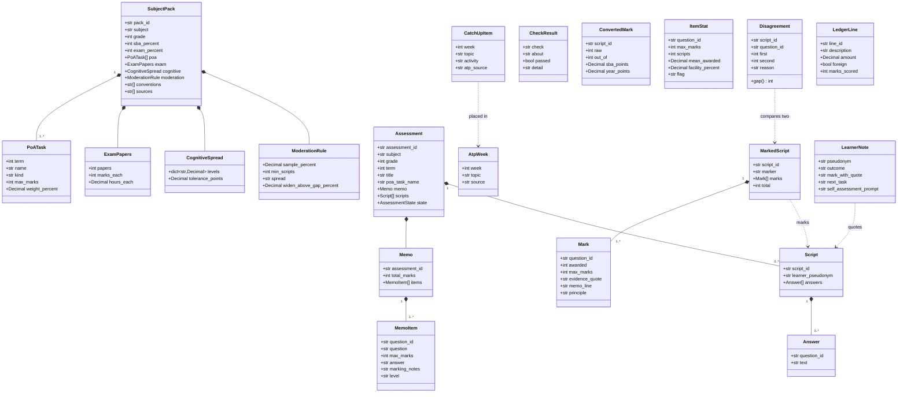

# Design — domain model

**Status:** agreed · **Owner:** the project researcher (Claude) · **Spec:** the product requirements US1–US7

> The entities every lane builds to. Code: `packages/contracts/src/mothusi_contracts/models.py`.
> A field that is not here must not be invented downstream; this doc changes first, in its own PR.

---

## 1. What this covers

The nouns of one assessment cycle: the **curriculum pack** (what depends on the curriculum, not on
Mothusi), the **assessment** a teacher hands in (memo and scripts), the **marks** agents produce, and
the **check results**, **converted marks** and **item statistics** the rules engine derives. It does
not cover how agents talk to each other ([marking-pipeline.md](marking-pipeline.md) §6) or which
checks exist ([rules-engine.md](rules-engine.md)).

## 2. Reference material

| Kind | Where |
| --- | --- |
| Programme of assessment, Mathematics Gr 10–12 | DBE Circular S8 of 2023 Annexure §26, summarised in `preparation/docs/research/dbe-teachers-site.md` §1 |
| Cognitive levels, Mathematics | CAPS FET Mathematics §4 (20 / 35 / 30 / 15) |
| Teacher documents and their formats | `docs/evidence/sa-teacher-documents.md` |
| Curriculum-pack idea and the five subjects | `preparation/docs/research/curricula-and-subjects.md` §2–3 |
| Pack data, first instance | `packs/dbe-caps/mathematics-gr10.toml` |

## 3. Domain model

`Event` (`events.py`: seq, at, assessment_id, kind, agent, summary, payload) is the log record; it is
drawn and owned by [event-log.md](event-log.md).

**Invariants the models enforce** (all in `models.py`, all tested in
`packages/contracts/tests/test_models.py`):

- Every model is frozen and rejects unknown fields (`extra="forbid"`). An agent's structured
  output either fits the contract or fails loudly; it is never "close enough".
- `Memo.items` add up to `Memo.total_marks`, and `question_id`s are unique; a `Script` holds one
  `Answer` per `question_id`.
- `Mark.awarded ≤ Mark.max_marks`, and **a mark above zero carries a non-empty `evidence_quote`**.
  Whether the quote is really in the learner's answer is the rules engine's job
  ([rules-engine.md](rules-engine.md) §3 `check_evidence`), because it needs the script.
- `CognitiveSpread.levels` sum to 100; `sba_percent + exam_percent = 100`. `SubjectPack.cognitive`
  is optional: a curriculum that publishes no grid carries `None` (both packs held today have one:
  Mathematics 20/35/30/15, Accounting 30/40/30 from CAPS FET Accounting §4.3 Table 1), and the Planner logs "check skipped" rather than inventing targets (the product requirements US7).
- `AtpWeek` rows are the weeks the annual teaching plan has left; a `CatchUpItem` must sit in one
  of them with the same `atp_source` (`check_catch_up`). `LedgerLine` is Accounting's unit of
  marking for the foreign-entry rule.
- `Assessment.memo.assessment_id == Assessment.assessment_id`.
- Learners are **pseudonyms only** (`Script.learner_pseudonym`). The mapping to names lives with
  the teacher's outputs, never in anything an agent reads (POPIA; blind marking).
- Marks are integers (no half marks in the CAPS memos we hold); money and percentages are `Decimal`.

**Semantics of the mark-sheet numbers.** `PoATask.weight_percent` is the task's share of the SBA
component (the annexure's percentages add up to 100 per grade). `ConvertedMark.sba_points` is the
raw mark scaled to that weight; `year_points` is `sba_points × sba_percent / 100`, the contribution
to the learner's year mark. Rounding is `ROUND_HALF_UP` to two decimals, applied once at each step,
never on the raw mark ([rules-engine.md](rules-engine.md) §3 `convert_mark`).

## 4. Flow

Not here; the sequence is [marking-pipeline.md](marking-pipeline.md) §4.

## 5. State

`AssessmentState` is the one lifecycle in this model. Its transitions are drawn and owned by
[marking-pipeline.md](marking-pipeline.md) §5.

## 6. Contracts

The models are the contract: `from mothusi_contracts import ...`. Agents produce JSON that
`Model.model_validate_json` must accept. The agent envelopes (`Brief`, `Result`) are in
`envelopes.py` and specified in the agent contracts.

## 7. Structure

| Path | New? | Responsibility |
| --- | --- | --- |
| `packages/contracts/src/mothusi_contracts/models.py` | new | the entities above, with validators |
| `packages/contracts/src/mothusi_contracts/envelopes.py` | new | `Brief`, `Result`, `AgentRole`, `ResultStatus` |
| `packages/contracts/tests/test_models.py` | new | one test per invariant |
| `packs/dbe-caps/mathematics-gr10.toml` | new | the first `SubjectPack` as data, with its sources |
| `packs/dbe-caps/accounting-gr10.toml` | new | the second pack: S8 Annexure §1.1 weights, conventions from the Nov 2025 NSC memos' marking principles, CAPS §4.3 grid 30/40/30 |

## 8. Decisions & alternatives

| Decision | Chosen | Rejected, and why |
| --- | --- | --- |
| Where curriculum facts live | A `SubjectPack` loaded from TOML, one file per subject and grade | Constants in code: a second subject (Accounting) would mean code changes for data; prompts: a judge can't audit a prompt against the circular |
| Cognitive levels | Pack-defined strings with weights | A fixed enum: Accounting and English use different level names |
| Evidence quote | Required on the `Mark` itself | A separate evidence table: every consumer would have to join it, and a mark with no evidence could exist |
| Marks | `int` | `Decimal`: the memos we hold award whole marks; half marks would reopen every total check |
| Learner identity | Pseudonym on the script | Names on the script: the Marker and Moderator must not see them (POPIA, blind marking) |

Deviations from architecture-defaults.md: none. The contracts
package is the shared `contracts` package the defaults call for.

## 9. How this is verified

- `uv run --frozen pytest packages/contracts/tests` proves each invariant fails for the right input.
- `uv run --frozen pyright` in strict mode over `packages/`: the models type-check as consumers use them.
- The pack file loads into `SubjectPack` and its weights sum to 100 ([rules-engine.md](rules-engine.md) §3).

## 10. Open questions

- [ ] **Option A additions (2026-11-10), contracts owned by their lanes' docs:**
  - from [intake.md](intake.md) §11.3/§11.6: `TranscribedLine`, `Transcription`, `PageImage`,
    `AnswerCrop`, `ReadingAnswer`, and `Answer.uncertain_lines` / `Answer.unreadable`;
  - from [outputs-and-delivery.md](outputs-and-delivery.md) §3: `MmRect`, `SheetBox`, `SheetPage`,
    `AnswerSheetManifest`;
  - from [knowledge.md](knowledge.md) §6.1: `PassageKind`, `Passage`, and `CatchUpItem.citation`.

  The class diagram in §3 gains them when those tasks land.

- [ ] Half marks: none in the Maths and Accounting memos held. Confirm for English rubrics before
      US7's English pack; if needed, `awarded` becomes `Decimal` in its own design change.
- [x] Question text (2026-11-08, the user's decision): `MemoItem.question`, optional (default `""`),
      the question as printed on the paper. The Setter sits the test from it; the Marker gets it in
      its Brief. A memo without questions still loads.
- [ ] Whether a `Mark` needs a `level` of its own, or always inherits `MemoItem.level` (current).
