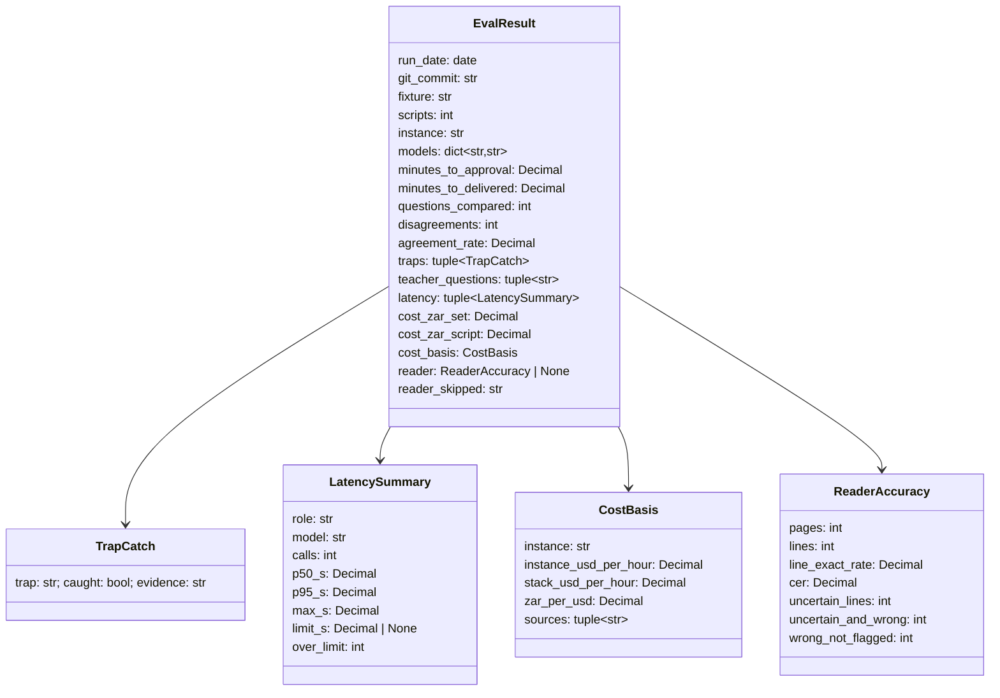

# Design — the eval run: the numbers on the slide

**Status:** draft · **Owner:** the project researcher (Claude) · **Spec:** the product requirements Goals ("report measured outcomes"), US2 (agreement rate), US9
(reader accuracy), the system criteria; the architecture plan non-negotiable 2 (R40, 15 minutes, a 30-second Marker
call); the demo script step 8

---

## 1. What this covers

One command runs the whole graph on the deployed open models (ADR 0001: Ollama on the G4dn in
af-south-1) over the 32-script synthetic set. It writes `services/core/eval/results-<date>.json` with
five measurements:

- **moderator agreement**;
- **minutes per set**;
- **rand per set and per script**, from GPU and stack wall time;
- **the page reader's accuracy** on the synthetic photographed set;
- **per-call latency**, including the Marker against its 30-second limit.

the demo script step 8 and the demo Q&A quote the file, never a remembered number.

It does not cover:

- **The AWS one-off task definition.** The deployment design owns it.
- **Per-agent model choice.** That is llm-seam.md, being revised by the driver. The eval only records
  which model served each role.
- **Building the photographed set** (resources-to-fetch row 11). The team writes and photographs it.

## 2. Reference material

| Kind | Where |
| --- | --- |
| The run to mirror | `services/core/src/mothusi_core/smoke.py` (`run_planted`, `check_planted`): the same Planner, the same scripted teacher answers, the same trap checks, but 32 scripts and a live provider |
| Fixture | `services/core/fixtures/gr10-maths-t1/` (`memo.toml`, `scripts.csv`, `atp-weeks.toml`, `traps.md`: four planted traps) |
| Rules used for agreement | `mothusi_rules.disagreements`, `should_widen`; RunState fields `questions_compared`, `disagreements` (`graph/state.py`) |
| Meter and pricing | `packages/llm/src/mothusi_llm/meter.py` (`Pricing`, `load_pricing`, `price`, `Meter`), `services/core/src/mothusi_core/providers.py` (`Metered`) |
| Prices (held 2026-11-10) | g4dn.xlarge $0.698/h and base stack $0.289/h (AWS af-south-1 price lists, published 2026-11-05); R16.3515 per USD (SARB, 2026-11-10): `docs/architecture/mothusi-aws-map.html` §05, resources-to-fetch row 4 |
| Photographed set | resources-to-fetch row 11 (not yet made); the reader contract is in `docs/architecture/design/intake.md`, which the driver is revising (ADR 0002) |

## 3. Domain model



The meaning of each measurement is fixed here, so the slide cannot drift:

- **`agreement_rate`** = `1 − disagreements / questions_compared`, from the final RunState. It counts
  every compared (script, question) pair across the blind sample and any widening, before re-marks
  change anything. It is exact-match agreement on awarded marks: `disagreements` already counts any
  difference. Four decimal places, half up.
- **`minutes_to_approval`** = from `Planner.start` to the moment the state becomes
  `awaiting_approval`. **`minutes_to_delivered`** runs to `delivered`. The scripted teacher answers
  take no time. Two decimal places.
- **`cost_zar_set`** = (`minutes_to_delivered` / 60) × (`instance_usd_per_hour` + `stack_usd_per_hour`)
  × `zar_per_usd`, plus any token cost `Metered` reports (0 for Ollama). Two decimal places, half up.
  `cost_zar_script` = `cost_zar_set / scripts`.
  - With `--instance laptop`, both hourly rates are 0 and the basis says so.
  - The GPU is billed for the run's wall time, not per call, because the instance runs whether it is
    busy or idle. Keeping it running between sets is the stack's cost, priced on the architecture
    page, not here.
- **`latency`** groups every provider call by (role, model). Percentiles use the nearest-rank method.
  `limit_s` = 30 for the Marker (the architecture plan non-negotiable 2) and `None` for the rest. `over_limit`
  counts calls above `limit_s`.
- **`traps`** are the four in traps.md. Each is caught exactly as `check_planted` defines it, extended
  to 32 scripts:
  - "memo 2.3" — flagged before the first Marker brief;
  - "L-014 evidence" — a failed evidence check, then a passing attempt 2;
  - "L-021 over-mark" — a disagreement on Q4 then a re-mark, **only if L-021 is in the sample**,
    otherwise `caught=false` with evidence "not sampled";
  - "L-007 note" — a Reviewer rejection, then a passing note.

  `evidence` is the deciding event's seq and summary.
- **`reader`** comes from the photographed set (§4.2), or is `None` with `reader_skipped` giving the
  reason, for example "no photographed set at services/core/fixtures/gr10-maths-t1-photos".
  - `cer` is the character error rate, the Levenshtein distance divided by the reference length,
    summed over all lines, after whitespace normalisation.
  - `line_exact_rate` is the share of lines equal after normalisation.
  - `wrong_not_flagged` counts wrong lines the reader did not flag as uncertain. It is the number
    that matters for the product requirements US9.
- **`teacher_questions`** lists every question the run asked, by topic and question id. The memo
  question is expected; any other is an intervention the slide must mention.

## 4. Flow

### 4.1 The marking run

```mermaid
sequenceDiagram
    participant E as eval/run.py
    participant T as Timed (wraps each provider)
    participant P as Planner (live providers, Postgres or in-memory checkpointer)
    participant M as Ollama on the G4dn
    E->>E: load memo, 32 scripts, atp-weeks, pack; git rev-parse HEAD
    E->>P: start(new_run(...)), clock starts
    loop until delivered, halted or 60 resumes
        P->>T: complete(...) per agent call
        T->>M: the call
        M-->>T: reply
        T-->>P: reply (records role, model, seconds, tokens)
        P-->>E: state, with a question or awaiting_approval
        E->>P: resume(answer): memo "use_proposed"; any other question gets its first offered option (recorded); approval "approve"
    end
    E->>E: agreement, minutes, cost, latency, traps from the state and the event log
    E->>E: reader accuracy (§4.2), when the set exists
    E-->>E: write results-<date>.json and print the summary lines
```

**Failure paths:**

- **The run halts or exceeds 60 resumes.** The file is still written, with `minutes_to_delivered`
  null and a `halted` reason, and the exit code is 1. A failed run is a measured result, never a gap
  in the file.
- **Ollama is unreachable at start.** One `GET /api/tags` precheck runs; on failure, exit 2 with "model
  host unreachable at <OLLAMA_URL>". No file is written, because nothing was measured.
- **A model is not pulled.** The precheck names the missing models, and the exit code is 2.
- **The output date already exists.** A suffix `-2`, `-3` and so on is added. Results are never
  overwritten.

### 4.2 The reader pass

For each page in `services/core/fixtures/gr10-maths-t1-photos/manifest.toml`, the reader is called
through the same seam the intake uses. That contract is defined in intake.md, which the driver is
revising, and the eval calls exactly that function. Its lines are compared with the manifest's
reference lines. The reader runs only on the configured model host: on AWS that is the Cape Town G4dn
(ADR 0001), and the photographed set is synthetic (row 11).

## 5. State

None beyond the Planner's own (marking-pipeline.md §5).

## 6. Contracts

```python
# services/core/src/mothusi_core/eval/results.py
class TrapCatch(Contract):
    trap: str = Field(min_length=1)
    caught: bool
    evidence: str

class LatencySummary(Contract):
    role: str = Field(min_length=1)          # AgentRole value, or "reader"
    model: str = Field(min_length=1)
    calls: int = Field(ge=1)
    p50_s: Decimal = Field(ge=0)
    p95_s: Decimal = Field(ge=0)
    max_s: Decimal = Field(ge=0)
    limit_s: Decimal | None = None
    over_limit: int = Field(ge=0)

class CostBasis(Contract):
    instance: str = Field(min_length=1)      # "g4dn.xlarge" | "laptop" | ...
    instance_usd_per_hour: Decimal = Field(ge=0)
    stack_usd_per_hour: Decimal = Field(ge=0)
    zar_per_usd: Decimal = Field(gt=0)
    sources: tuple[str, ...]                 # copied from pricing.toml `source` fields

class ReaderAccuracy(Contract):
    pages: int = Field(ge=1)
    lines: int = Field(ge=1)
    line_exact_rate: Decimal = Field(ge=0, le=1)
    cer: Decimal = Field(ge=0)
    uncertain_lines: int = Field(ge=0)
    uncertain_and_wrong: int = Field(ge=0)
    wrong_not_flagged: int = Field(ge=0)

class EvalResult(Contract):
    run_date: date
    git_commit: str = Field(min_length=7)
    fixture: str
    scripts: int = Field(ge=1)
    instance: str
    models: dict[str, str]                   # role -> model actually called (from Timed)
    minutes_to_approval: Decimal | None
    minutes_to_delivered: Decimal | None
    halted: str | None = None
    questions_compared: int = Field(ge=0)
    disagreements: int = Field(ge=0)
    agreement_rate: Decimal | None          # None when questions_compared == 0
    traps: tuple[TrapCatch, ...]
    teacher_questions: tuple[str, ...]
    latency: tuple[LatencySummary, ...]
    cost_zar_set: Decimal | None
    cost_zar_script: Decimal | None
    cost_basis: CostBasis
    reader: ReaderAccuracy | None
    reader_skipped: str = ""

# services/core/src/mothusi_core/eval/metrics.py  (pure; Codex-ready)
def agreement(questions_compared: int, disagreements: int) -> Decimal | None
def percentile(values: Sequence[float], q: float) -> Decimal          # nearest rank, 2 dp
def summarise_latency(calls: Sequence[CallTiming], limits: Mapping[str, float]) -> tuple[LatencySummary, ...]
def run_cost(basis: CostBasis, minutes: Decimal, token_cost_zar: Decimal) -> Decimal
def cer(reference: str, read: str) -> tuple[int, int]                # (edit distance, reference length)
def reader_accuracy(pages: Sequence[Sequence[tuple[str, str, bool]]]) -> ReaderAccuracy
    # one inner sequence per photographed page, each line (reference, read, uncertain);
    # ReaderAccuracy.pages = len(pages); a page with no lines still counts; tested with a 3-page case
class CallTiming(Contract):
    role: str; model: str; seconds: float; input_tokens: int; output_tokens: int

# services/core/src/mothusi_core/eval/timed.py
class Timed:                                  # a Provider wrapper, like Metered
    def __init__(self, inner: Provider, role: str, model: str, sink: list[CallTiming]) -> None
    # time.perf_counter around inner.complete; records even when complete raises (seconds counted).

# CLI
uv run --frozen python -m mothusi_core.eval.run --pricing packages/llm/pricing.toml \
    --instance g4dn.xlarge [--fixture services/core/fixtures/gr10-maths-t1] [--out services/core/eval]
  env: MOTHUSI_PROVIDER=ollama, OLLAMA_URL=<model host>, optional POSTGRES_URL
  stdout, last four lines (the demo script step 8 copies them):
    agreement <rate> on <n> compared questions
    minutes <to approval> (<to delivered> to delivered)
    rand <per set> per set, <per script> per script (<instance>)
    reader <line_exact_rate> lines exact, CER <cer>, <wrong_not_flagged> wrong unflagged | reader skipped: <reason>
```

**`pricing.toml`, GPU time (a proposal; the driver aligns llm-seam.md §6 and resources-to-fetch row
4).** The file keeps `[rates]` and `[[model]]`, with Ollama models at 0 and `source = "self-hosted;
billed as GPU time"`, so `price()` and `Meter` stay as they are. It gains:

```toml
[[instance]]
name = "g4dn.xlarge"
usd_per_hour = "0.698"
source = "AWS EC2 price list, af-south-1, published 2026-11-05 (read 2026-11-10)"

[[instance]]
name = "laptop"
usd_per_hour = "0"
source = "the team's own machine"

[stack]
usd_per_hour = "0.289"
source = "docs/architecture/mothusi-aws-map.html §05: ALB + Fargate (core 1/2, intake 0.5/1, knowledge 1/4) + RDS db.t4g.small + 6 IPv4, AWS af-south-1 price lists published 2026-11-05"
```

```python
# packages/llm/src/mothusi_llm/meter.py  (additions)
class InstancePrice(Contract): name: str; usd_per_hour: Decimal (ge 0); source: str
class StackPrice(Contract): usd_per_hour: Decimal (ge 0); source: str
# Pricing gains:  instance: tuple[InstancePrice, ...] = ();  stack: StackPrice | None = None
def instance_price(pricing: Pricing, name: str) -> InstancePrice   # unknown name: ValueError naming the known ones
```

**Photographed set manifest** (`services/core/fixtures/gr10-maths-t1-photos/manifest.toml`; the team
fills it with the photos, row 11):

```toml
[[page]]
image = "L-003-p2.jpg"          # the cover page is never in this set
script_id = "L-003"
[[page.line]]
question_id = "1.1"
text = "(x-3)(x+2)=0"           # exactly what the team wrote, copied from scripts.csv
```

## 7. Structure

| Path | New? | Responsibility |
| --- | --- | --- |
| `services/core/src/mothusi_core/eval/__init__.py` | new | package |
| `services/core/src/mothusi_core/eval/results.py` | new | §6 result models |
| `services/core/src/mothusi_core/eval/metrics.py` | new | §6 pure metrics (Codex) |
| `services/core/src/mothusi_core/eval/timed.py` | new | `Timed` |
| `services/core/src/mothusi_core/eval/run.py` | new | the CLI and §4 |
| `services/core/eval/results-<date>.json` | new, committed | each run's file |
| `packages/llm/src/mothusi_llm/meter.py` | change | `InstancePrice`, `StackPrice`, `instance_price` |
| `packages/llm/pricing.toml` | new | the driver writes it with the sources above |
| `services/core/fixtures/gr10-maths-t1-photos/` | new | photos + `manifest.toml` (the team, row 11) |
| the demo script step 8, the demo Q&A Q4 | change | quote the four summary lines with the file's name |

The eval contract originally named `services/core/eval/run.py`. The module moves inside the package so it
is importable, type-checked and covered by the gate. The results directory stays
`services/core/eval/`.

## 8. Decisions & alternatives

| Decision | Chosen | Rejected, and why |
| --- | --- | --- |
| Cost basis | Wall time × (GPU + stack) hourly rates | Per-token prices: zero for Ollama, so they would report R0 and mislead; per-call GPU seconds: the instance is billed while idle too |
| Agreement | Exact match on awarded marks over every compared pair, from the run's own state | Agreement with a teacher's gold marks: there are none for a synthetic set, and inventing a "gold" would be a fabricated mark |
| Teacher answers | Scripted as in the smoke; every non-memo question recorded | Failing on any question: a live model may ask one fairly, and that is a result worth reporting |
| Where it runs | Wherever `OLLAMA_URL` reaches the model host: a one-off ECS task in af-south-1, or the laptop for the offline number | Only the laptop: it would not measure the deployed T4 |
| Output | A new dated file per run, committed | Overwriting: the slide must be traceable to one run |

## 9. How this is verified

- **`metrics`** (unit):
  - agreement on 0, 12 and 24 of 24 compared questions;
  - `percentile` against a worked list;
  - `run_cost` on the worked figure: 12.00 minutes on g4dn.xlarge = 0.2 h × (0.698 + 0.289) ×
    16.3515 = **R3.23** (0.2 × 0.987 = 0.1974 USD; 0.1974 × 16.3515 = 3.2278);
  - `cer("x=3", "x=8")` = (1, 3);
  - `reader_accuracy` counts `wrong_not_flagged`.
- **`instance_price`**: a known instance prices; an unknown one raises, naming the known ones;
  a pricing file without `[[instance]]` still loads.
- **`run.py`**: against the replay provider and the 6-script set, the file validates as
  `EvalResult`, all four traps are `caught` (L-021 is in that set), and the four summary lines print.
  The real run on the G4dn is the Done.

## 10. Open questions

- [ ] **One run or several.** Open models vary between runs. Report the median of three runs on
  Thursday if time allows (`--runs 3`); the contract above is one run per file.
- [ ] **The 30-second Marker limit** was set for Claude. If `over_limit` > 0 on the T4, the answer is
  an architecture-plan PR, not a quiet change to `limit_s`.
- [ ] **The budget question.** With Ollama, `Metered` reports R0 in tokens, so the Planner's R40
  budget guard never fires. Whether the Planner should price GPU wall time live is llm-seam.md's call
  (the driver).
- [ ] **The reader seam's exact signature** comes from intake.md (revised for ADR 0002). §4.2 binds
  to it when it lands.
