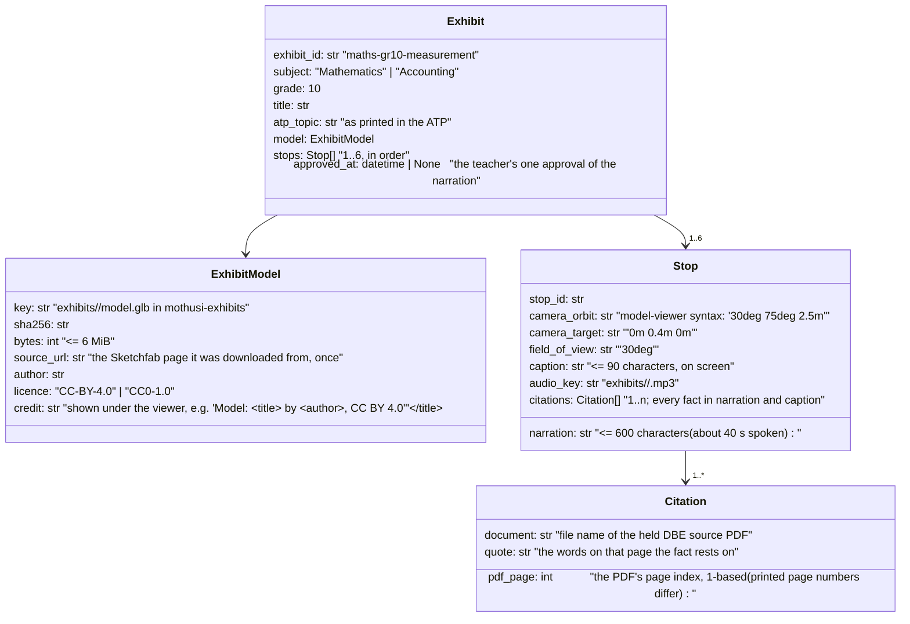
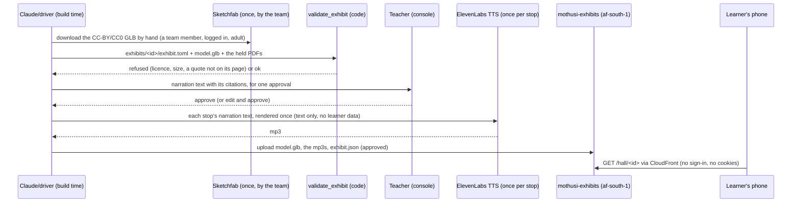
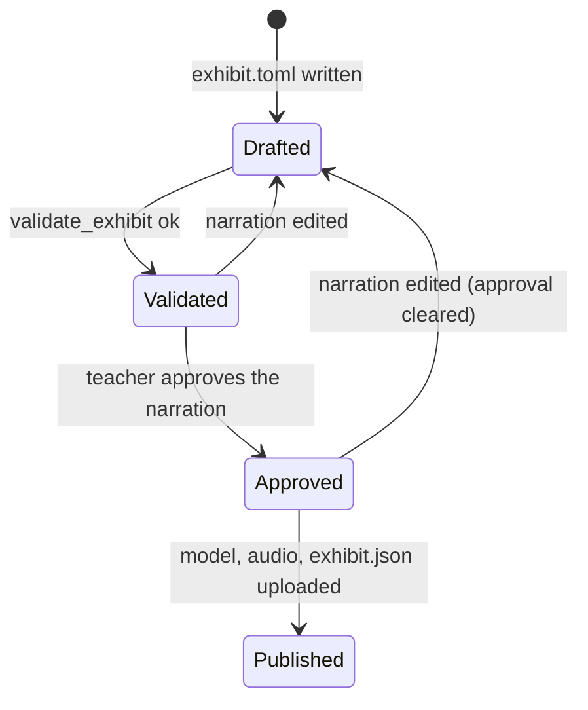

# Design — the exhibition hall (stretch)

**Status:** draft 2026-11-11 · **Owner:** the project researcher (Claude) · build tasks it allows are listed in §11 · **Spec:** [ADR 0004](../../adr/0004-learner-section-stretch.md);
the agreed scope "Stretch"

## 1. What this covers

Narrated 3D exhibits for Grade 10 Mathematics and Accounting, viewed on a learner's phone or the
teacher's laptop: one model, a few **camera stops**, and at each stop a short narration whose every
fact cites a page of a DBE document the repo holds. The first two exhibits are the Grade 10
Mathematics Measurement topic and the Grade 10 Accounting equation with the perpetual inventory
system (ADR 0004). **Not covered:** learner sign-in, practice tests and results (learner-section.md),
the voice colleague (voice-colleague.md), and any exhibit outside Maths and Accounting.

**Who sees it, and what it records.** An exhibit holds no learner data and records nothing about
who views it: no analytics, no cookies, no per-learner progress. It is therefore served without
sign-in at `/hall`, and the learner section links to it. Learners' phones contact only Mothusi's own
CloudFront distribution: never Sketchfab (its terms §1.4 bar users under 18) and never ElevenLabs.

## 2. Reference material

| Kind | Where |
| --- | --- |
| Decision | `docs/adr/0004-learner-section-stretch.md` (sourcing, serving, narration, the two first exhibits) |
| Curriculum sources (held, gitignored) | *ATP 2023-24 Gr 10 Mathematics (DBE)*, *CAPS FET Mathematics*, *ATP 2023-24 Gr 10 Accounting (DBE)*, *CAPS FET Accounting* |
| Where the bucket is | `docs/architecture/design/deployment-aws.md` §6 (`mothusi-exhibits-<acct>` in MothusiData) |
| Visual reference | none yet: producing `docs/architecture/design/console-ui/15-hall.png` is the first step of the build task (§11), in the console's tokens (console-ui.md §2) |
| Viewer | `@google/model-viewer` 4.4.0 (Apache-2.0, released 2026-10-09), bundled into `apps/web` from npm |

## 3. Domain model

The exhibit assets and manifests named in §3–6 are to be built and published; the paths show the
planned layout, not files present in this checkout.



**Invariants (checked in code, §6):**
- Every stop has at least one citation.
- Every citation's quote occurs on that PDF page's text: `pdftotext -layout -f p -l p`, with whitespace collapsed.
- A model whose licence is not CC-BY-4.0 or CC0-1.0 is refused, and so is one over 6 MiB.
- An exhibit with `approved_at` unset is never served.

## 4. Flow



**Failure paths:**
- **A quote isn't on its page.** The PDF text was misread, or the fact rests on a page the repo doesn't hold. The exhibit is refused and names the stop. The fact goes in resources-to-fetch, never into narration from memory.
- **TTS is unavailable.** The stop plays without audio and shows its narration as text. Captions are always on screen anyway.
- **The GLB fails to load on a phone.** The stop list and narration text still show, under "the model could not load on this phone".

## 5. State



## 6. Contracts

```python
# packages/contracts/src/mothusi_contracts/exhibits.py (exported from mothusi_contracts). The contracts
# take what a manifest says; check_exhibit is what refuses it, so a refusal names its reason.
class Citation(Contract):
    document: str = Field(min_length=1)       # file name of the held DBE source PDF
    pdf_page: int = Field(ge=1)
    quote: str = Field(min_length=1)

class Stop(Contract):
    stop_id: str = Field(pattern=r"^[a-z0-9-]+$")
    camera_orbit: str = Field(min_length=1)   # model-viewer syntax, e.g. "30deg 75deg 2.5m"
    camera_target: str = Field(min_length=1)  # e.g. "0m 0.4m 0m"
    field_of_view: str = Field(min_length=1)  # e.g. "30deg"
    caption: str = Field(min_length=1, max_length=90)
    narration: str = Field(min_length=1, max_length=600)
    audio_key: str = Field(min_length=1)
    citations: tuple[Citation, ...] = ()      # check_exhibit requires at least one

class ExhibitModel(Contract):
    key: str = Field(min_length=1)
    sha256: str = Field(pattern=r"^[0-9a-f]{64}$")
    bytes: int = Field(ge=1)                  # check_exhibit requires <= MAX_MODEL_BYTES
    source_url: str = Field(min_length=1)
    author: str = Field(min_length=1)
    licence: str = Field(min_length=1)        # check_exhibit requires one of LICENCES
    credit: str = Field(min_length=1)

class Exhibit(Contract):
    exhibit_id: str = Field(pattern=r"^[a-z0-9-]+$")
    subject: Literal["Mathematics", "Accounting"]
    grade: int = Field(ge=10, le=12)
    title: str = Field(min_length=1)
    atp_topic: str = Field(min_length=1)
    model: ExhibitModel
    stops: tuple[Stop, ...] = Field(min_length=1, max_length=6)   # stop_ids unique (validator)
    approved_at: datetime | None = None

# packages/rules/src/mothusi_rules/exhibits.py (exported from mothusi_rules)
MAX_MODEL_BYTES = 6 * 1024 * 1024
LICENCES = ("CC-BY-4.0", "CC0-1.0")
def check_exhibit(exhibit: Exhibit, page_text: Callable[[str, int], str]) -> CheckResult
    # check = "exhibit", about = exhibit_id. Fails, naming every reason in detail ("; "-joined,
    # in stop order): a licence not in LICENCES; bytes > MAX_MODEL_BYTES; a stop with no citation
    # ("<stop_id>: no citation"); a quote not on its page ("<stop_id>: quote not on <document> p <n>");
    # a document page_text cannot read (page_text raises KeyError or ValueError:
    # "<stop_id>: <document> p <n> not held"). Quotes match after collapsing whitespace and ignoring
    # case. Approval is not checked here (the Planner/console gate it).
```

```
GET /hall                        the console's hall: the published exhibits (title, subject, stops count)
GET /hall/<exhibit_id>           the viewer screen: <model-viewer> with the stop list, captions and audio
CloudFront /exhibits/*  ->  mothusi-exhibits (OAC, cached, no cookies, no query strings)
exhibits/<id>/exhibit.json       the approved Exhibit; model.glb; <stop_id>.mp3
```

**Phone budget:** model ≤ 6 MiB (Draco- or meshopt-compressed GLB), each stop's audio ≤ 40 s of mono
MP3 at 64 kbit/s (about 320 KB), and the whole exhibit ≤ 8 MiB. The viewer loads the model only
after the learner taps "Open the exhibit", so the hall list itself stays under 100 KB.

## 7. The two first exhibits: what each stop may say

Every row's fact is quoted from the page named. The "Needs" column is a fact the narration would
want that **no held page states**: those are rows in the resource-fetching note, and until fetched
the stop says only what the cited pages say (source note not in this repo).

### 7.1 Mathematics Grade 10: Measurement (`maths-gr10-measurement`)

Model: a composite solid, a cylinder with a hemisphere on one end and a cone on the other, matching
the CAPS example (CAPS FET Mathematics, PDF p 33).

| Stop | Fact | Citation (document, PDF page, quote) | Needs |
| --- | --- | --- | --- |
| 1 Where this sits | Measurement is taught in Term 4, weeks 1–2 of Grade 10 | ATP 2023-24 Gr 10 Mathematics, p 5: "MEASUREMENT" under TERM 4 WEEK 1 / WEEK 2 | — |
| 2 Prisms and cylinders | Grade 10 revises "the volume and surface areas of right-prisms and cylinders" | ATP Gr 10 Maths p 5 item 1; CAPS FET Mathematics p 33 item 1 | the formulas V = (area of base) × height and the cylinder's surface area, from a held DBE text (row 13) |
| 3 Scaling by k | Learners "study the effect on volume and surface area when multiplying any dimension by a constant factor k" | ATP p 5 item 2; CAPS p 33 item 2 | the result (volume by k³ when every dimension is multiplied; area by k²) from a held DBE text (row 13) |
| 4 Spheres, pyramids, cones | Grade 10 calculates "the volume and surface areas of spheres, right pyramids, right cones and combination of those objects" | ATP p 5 item 3; CAPS p 33 item 3; CAPS p 20 overview: "spheres, pyramids and cones and combinations of those objects" | the formulas, from a held DBE text (row 13) |
| 5 The composite solid | The CAPS example: a cylinder of height 10 cm and radius 2 cm, a hemisphere on one end and a cone of height 2 cm on the other; volume to the nearest cm³ and surface area to the nearest cm² | CAPS p 33, "Example: The height of a cylinder is 10 cm …" | — (the narration states the task; the worked answer is computed and checked by code with `equivalent`, never asserted by a model) |

### 7.2 Accounting Grade 10: the accounting equation and the perpetual inventory system (`acc-gr10-equation`)

Model: a balance scale or a shop's stockroom (whichever CC-BY/CC0 model fits the budget). The
stops show assets on one side, and owner's equity and liabilities on the other.

| Stop | Fact | Citation | Needs |
| --- | --- | --- | --- |
| 1 Where this sits | Term 1 of Grade 10: bookkeeping of a sole trader, cash transactions, then credit transactions, each ending with the accounting equation | ATP 2023-24 Gr 10 Accounting, p 1: "BOOKKEEPING OF A SOLE TRADER: CASH TRANSACTIONS … ACCOUNTING EQUATION" and "ADDRESSING CREDIT TRANSACTIONS … ACCOUNTING EQUATION"; CAPS FET Accounting p 15 | — (read from the page image, 2026-11-11: cash transactions with the accounting equation are weeks 3–5, credit transactions weeks 6–7, combined weeks 8–10; week 11 revision and the control test) |
| 2 The effect of a transaction | Learners "indicate the effect of various cash transactions on the accounting equation" | ATP Gr 10 Accounting p 1 | the equation itself (assets = owner's equity + liabilities) from a held DBE text (row 14): no held page states it |
| 3 Perpetual inventory | Grade 10's accounting cycle is "based on perpetual inventory system" | ATP p 1: "Accounting cycle based on perpetual inventory system"; CAPS FET Accounting p 19 | what the perpetual system records (cost of sales at each sale) from a held DBE text (row 14) |

## 8. Decisions & alternatives

- **`<model-viewer>`, not three.js.** Camera stops are declarative attributes (`camera-orbit`, `camera-target`, `field-of-view`), so a stop is data, not code. It handles GLB, touch and reduced motion. three.js would mean writing the controls. It ships inside our bundle and makes no CDN call.
- **Open at `/hall`, no sign-in.** No personal information is processed, so POPIA's consent machinery (needed for the learner section) does not apply to viewing. If the hall ever records progress, it moves behind learner sign-in.
- **Narration is text first.** The teacher approves the text with its citations, and audio is rendered from the approved text only. Under Non-negotiable I a curriculum fact traces to a DBE document. A fact we can't cite is not narrated: it waits for the source (§7 "Needs").
- **Rejected: embedding Sketchfab's player.** Its terms bar under-18 users, and it would send learners' phones to a third party.

## 9. How this is verified

- `check_exhibit` tests: a quote on its page passes, a quote not on its page fails naming the stop, a CC-BY-NC model and a 7 MiB model are refused, and a stop with no citation fails.
- Both first exhibits pass `check_exhibit` against the held PDFs, which is the Verify of the hall design.
- The console's hall screen at phone width matches `15-hall.png`. The model loads only on tap, and the captions show with audio off.

## 10. Open questions

- **Sources for the mathematics and the equation itself** (resources-to-fetch rows 13 and 14). Until then, stops 2–4 of 7.1 and 2–3 of 7.2 say only what their cited pages say.
- **ElevenLabs for TTS:** the project researcher finalises ElevenLabs on 12 Nov (voice-colleague.md). The hall needs only text-to-speech, sent once per stop, with no learner data.

## 11. Build tasks this allows (proposed for the implementation plan)

1. **Exhibit contracts and `check_exhibit`** (Codex-ready): §3 and §6 verbatim; tests per §9.
2. **The two exhibit manifests to be built** (Claude): `exhibits/maths-gr10-measurement/exhibit.toml` and `exhibits/acc-gr10-equation/exhibit.toml`, with the §7 citations. Both must pass `check_exhibit`. The models are picked from Sketchfab by a team member.
3. **The hall screens** (Claude, frontend): mockup `15-hall.png` first, then `/hall` and `/hall/<id>` with `<model-viewer>` 4.4.0, CloudFront `/exhibits/*` in MothusiFront.
4. **Narration audio** (after the ElevenLabs decision): one TTS render per approved stop, uploaded with the model.

The deployed environment keeps its original AWS names; see infra/mothusi_infra/stage.py.
