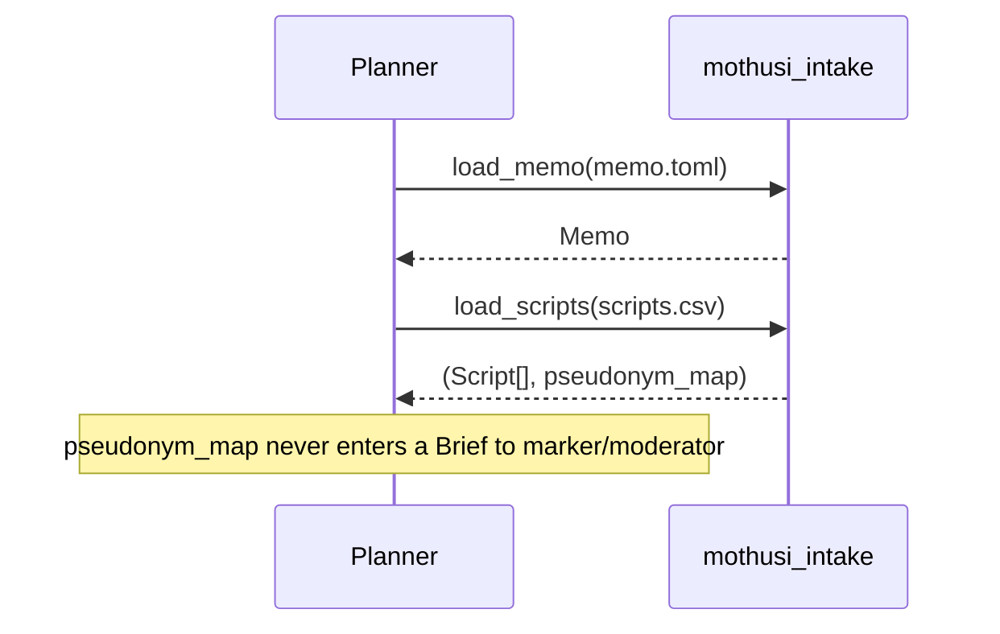
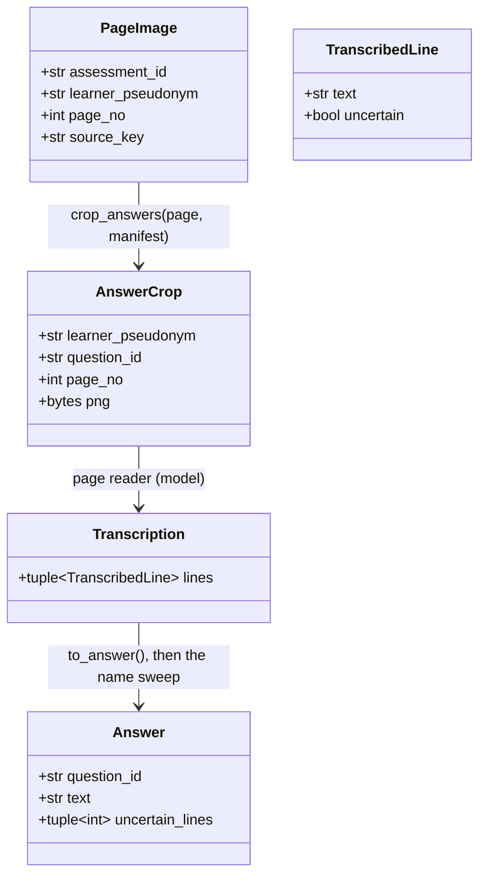
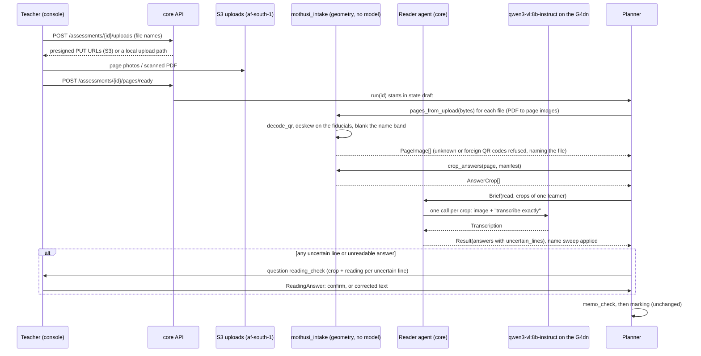
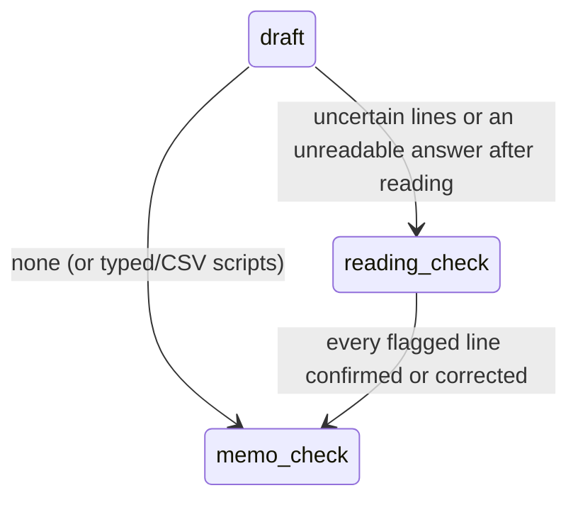
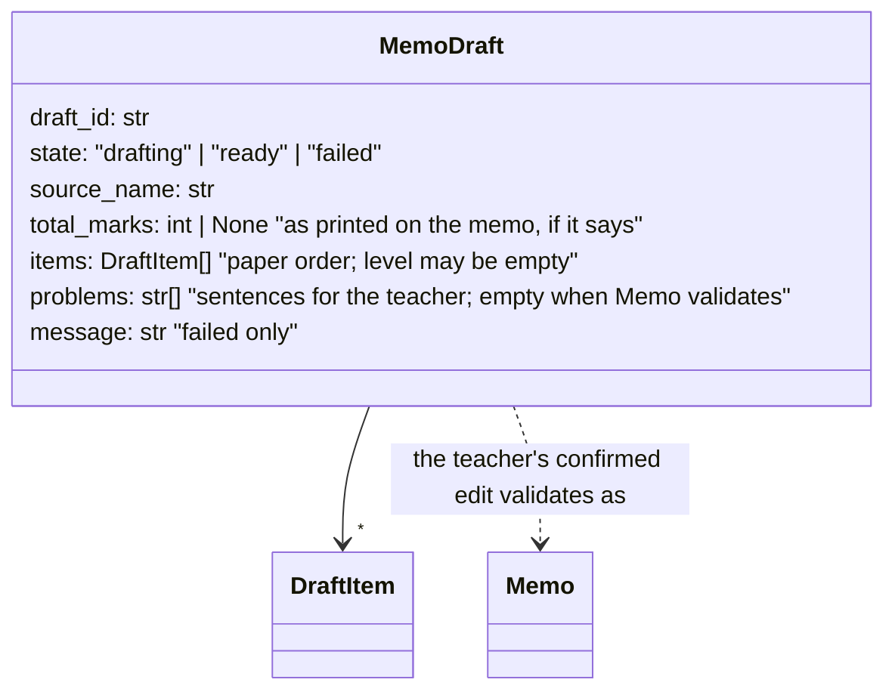

# Design — intake

**Status:** agreed (§1–9); §11 draft 2026-11-10 · **Owner:** the project researcher (Claude writes; Codex builds the intake implementation) ·
**Spec:** the product requirements US1, US9, system criterion "no learner name in any Brief"

---

## 1. What this covers

The deterministic half of intake: the file formats a teacher (or the demo fixture) hands in, how
they parse into `Memo` and `Script`, and how learner names become pseudonyms. Code lives in
`packages/intake` (`mothusi_intake`) and calls no model. The agent half (photographs, free-text
memos) is the Intake agent in [marking-pipeline.md](marking-pipeline.md) and is not here.

## 2. Reference material

| Kind | Where |
| --- | --- |
| The entities produced | [domain-model.md](domain-model.md) §3 (`Memo`, `MemoItem`, `Script`, `Answer`) |
| The memo this format mirrors | `preparation/docs/sources/dbe/exams/NSC Nov 2025 Mathematics P1 Memo.pdf` (question ids like 1.1, 1.2.3; marks per item; notes) |
| POPIA and blind marking | [marking-pipeline.md](marking-pipeline.md) §4 step 3; the project’s grounding rules §6 |
| Existing code to match | `packages/intake/src/mothusi_intake/pseudonyms.py`, `packages/rules/src/mothusi_rules/pack.py` (TOML loading style) |

## 3. Domain model

No new entities. Two file formats and one scheme:

**Memo TOML** (`memo.toml`):
```toml
assessment_id = "gr10-maths-t1-test"
total_marks = 50
[[item]]
question_id = "1.1"
question = "Solve for x: x^2 - x - 6 = 0"                                         # optional
max_marks = 4
answer = "x = 3 or x = -2"
marking_notes = "1 mark factorising, 1 mark each root, 1 mark both stated"   # optional
level = "routine_procedures"
```
One `[[item]]` per memo item, in paper order. `Memo`'s own validators do the arithmetic and
uniqueness checks; the loader adds nothing to them.

**Scripts CSV** (`scripts.csv`, UTF-8, header row, comma-separated, RFC 4180 quoting):
```
learner,question_id,answer
Zanele M,1.1,"(x-3)(x+2)=0 so x=3 or x=-2"
Zanele M,1.2,"gradient 2, intercept 1, y=2x+1"
Aarav P,1.1,...
```
One row per learner per question. A learner with no row for a question has no `Answer` for it
(the Marker awards 0 with the memo line "no attempt"). Rows are grouped by learner in order of
first appearance; a learner's rows need not be contiguous.

**Pseudonyms:** `L-001`, `L-002`, … in class-list order (first appearance in the CSV), width 3 or
the number of digits in the class size if larger. The mapping (name → pseudonym) is returned to the
caller and stored by the Planner for the teacher's outputs only. Duplicate or blank names are refused.

## 4. Flow



**Failure paths:** a CSV without the three headers, a row with a blank learner or question_id, or a
duplicate (learner, question_id) pair is a `ValueError` naming the row number. A memo that fails
`Memo`'s validators surfaces that error unchanged.

## 5. State

None.

## 6. Contracts

```
load_memo(path: Path) -> Memo
    tomllib; [[item]] -> MemoItem; ValueError (pydantic) when it does not fit.

load_scripts(path: Path) -> tuple[tuple[Script, ...], dict[str, str]]
    csv.DictReader; headers exactly learner, question_id, answer (ValueError naming the missing
    header otherwise); learner and question_id are whitespace-collapsed; answer keeps the learner's
    internal spacing and line breaks, with leading and trailing whitespace stripped (the contracts
    strip every string at the ends, so a quote and the answer it is checked against agree there);
    script_id = pseudonym (so Script.script_id == Script.learner_pseudonym at intake); Scripts in
    class-list order; answers in row order per learner.
    ValueError "row <n>: <reason>" for a blank learner/question_id or a duplicate pair.
    The dict is name -> pseudonym, from pseudonymise().

pseudonymise(names: Sequence[str]) -> dict[str, str]     (exists)
```

## 7. Structure

| Path | New? | Responsibility |
| --- | --- | --- |
| `packages/intake/src/mothusi_intake/pseudonyms.py` | exists | `pseudonymise` |
| `packages/intake/src/mothusi_intake/files.py` | new | `load_memo`, `load_scripts` |
| `packages/intake/tests/test_files.py` | new | the cases in §9 |
| `services/core/fixtures/gr10-maths-t1/{memo.toml,scripts.csv,atp-weeks.toml,traps.md}` | new | the 32-script synthetic set with planted traps, in these formats |

## 8. Decisions & alternatives

| Decision | Chosen | Rejected, and why |
| --- | --- | --- |
| Script format | One row per learner per question | One row per learner with a column per question: question ids vary per paper, and long answers do not fit cells |
| script_id | Equals the pseudonym at intake | A separate id: two identifiers for one learner with nothing to tell apart |
| Pseudonym order | Class-list order | Sorted by name: leaks the alphabetical position, which with a class list is the name |

Deviations from architecture-defaults.md: none.

## 9. How this is verified

- A three-learner CSV with one missing answer loads into three Scripts with `L-001..L-003`, the
  missing question absent from that learner's answers, and the map's keys equal to the names.
- Missing header, blank learner, duplicate pair: each `ValueError` names the row.
- A memo TOML whose items do not add up fails with `Memo`'s own message.
- Grounding test (later, the Planner implementation): no key of the pseudonym map appears in any Brief's JSON.

## 10. Open questions

- [x] Photographed and scanned scripts (ADR 0002): settled in §11. They become `Script`s directly, not
      the CSV, with the uncertain line numbers per answer.
- [ ] Reader quality on maths notation is unmeasured (no model card publishes it). the eval run measures it on
      the synthetic photographed set (resources-to-fetch row 11); if it is poor, try olmOCR-2-7B next.
- [ ] Pages that are not on Mothusi's answer sheet (a school's own paper): no QR code, no layout
      manifest. Not supported in this build. The upload refuses them, naming the missing QR code.

---

## 11. Pages: photographed, scanned and PDF scripts (ADR 0002)

### 11.1 What this covers

How a page photo or a scanned PDF becomes a pseudonymised `Script`, inside AWS af-south-1:

- QR decode, deskew and dropping the name band;
- answer-box crops from the layout manifest;
- the page reader on the Cape Town G4dn (`qwen3-vl:8b-instruct`, ADR 0001);
- a name sweep over the transcription;
- the `reading_check` question to the teacher.

The deterministic geometry lives in `packages/intake` and calls no model. The reader call is a
model agent in `services/core`, the intake worker. The answer sheet itself is rendered by
`packages/outputs`, and its layout is the contract in §11.6, shared with
[outputs-and-delivery.md](outputs-and-delivery.md).

**Mothusi only reads its own answer sheet.** Every page carries a QR code naming the assessment, the
learner's pseudonym and the page number, so a learner is identified without reading a name. The name
band is cropped off before any model sees the page. Each answer sits in a box whose rectangle is
known. This is what makes handwriting reliable enough for the golden path.

### 11.2 Reference material

| Kind | Where |
| --- | --- |
| The answer sheet and its manifest | [outputs-and-delivery.md](outputs-and-delivery.md), "Answer sheet layout (shared with intake.md)" |
| The provider seam, image input, providers per agent | [llm-seam.md](llm-seam.md) §11 |
| The Planner's states and teacher questions | [marking-pipeline.md](marking-pipeline.md) §5, §6.2 |
| Image libraries | OpenCV (`opencv-python-headless`, Apache-2.0): QR detection (`QRCodeDetector`), perspective warp. pypdfium2 (Apache-2.0 / BSD-3-Clause) renders PDF pages. Versions are pinned in the reading contracts; licences to confirm on PyPI then |
| POPIA | ADR 0001 (everything in af-south-1), ADR 0002 |

### 11.3 Domain model



- `Answer.uncertain_lines` is **new**, defaulting to `()`, so typed and CSV scripts are unchanged. Each
  entry is a 0-based index into `Answer.text.split("\n")` for a line the reader marked uncertain:
  sorted, unique, and in range (validator). Indices rather than text keep two identical lines distinct,
  so a correction targets exactly one.
- `Answer.unreadable` is **new**, defaulting to `False`. It marks a box the reader failed on twice. Its
  text is `""` until the teacher transcribes it at `reading_check`, and the Planner never sends an
  unreadable answer to the Marker. These two fields are the only changes to an existing contract.
- `PageImage`, `AnswerCrop`, `TranscribedLine` and `Transcription` are new contracts in
  `mothusi_contracts`. `Transcription` is the reader's output model. `png` bytes never enter a Brief to
  any agent except the reader, and never leave af-south-1.
- `PageImage.source_key` is the S3 key (or `MOTHUSI_DATA` path locally) of the deskewed page with the name
  band already blanked. The original upload stays in the uploads bucket. Only intake reads it.

### 11.4 Flow



**Failure paths:**

- **No readable QR code on a page.** That file is refused with `"<file>: no Mothusi QR code (only Mothusi
  answer sheets can be read)"`. The run waits for a re-upload or for the teacher to drop the page.
  Nothing is guessed. *How it waits (the upload-screen implementation review):* `POST /pages/ready` runs this geometry pass
  (no model) before the run starts. Any refusal, or any printed page that no file supplied, is a 409
  naming them (console-ui.md §11.5), and the assessment stays open for uploads and
  `DELETE .../uploads/{name}`. The teacher may start anyway (`accept_gaps`) once at least one page
  was read.
- **A learner with no pages at all** (absent, or every page refused, and the teacher started anyway).
  They stay on the roster: every answer is unreadable and comes to the reading check, like a box on
  a missing page, so they never drop off the mark sheet or reach it as a silent zero.
- **A QR code for another assessment, or a duplicate page.** Refused, naming both files.
- **Fewer than four fiducials found.** The page is refused as "retake the photo: all four corner squares
  must be visible".
- **The reader errors.** The usual retry and fallback (llm-seam.md §4). On a second failure the crop
  becomes an `Answer` with `unreadable=True` and empty text, so it reaches `reading_check` as an
  **unreadable** item. The teacher must type what the box says (or confirm it is blank, giving an
  empty correction). A failure never becomes a silent zero.
- **The name sweep finds a class-list name in a transcription** (a learner wrote a name inside an
  answer). It is replaced with that learner's pseudonym before the Answer is built, and logged as a
  `decision` event without the name.

### 11.5 State

The Planner gains one state between `draft` and `memo_check`, entered only when some answer has an
uncertain line:



`reading_check` is entered when some answer has an uncertain line **or** is unreadable. It is a
teacher question like `memo_check`'s (marking-pipeline.md §6.2). Answer contract: `ReadingAnswer(kind="reading", script_id, question_id, line, action:
"confirm" | "correct", text: str = "")`. A correction replaces that line, and the span stops being
uncertain. "Confirm all" is one console action that sends one `confirm` per line.

### 11.6 Contracts

```
# mothusi_contracts
class TranscribedLine(Contract): text: str; uncertain: bool
class Transcription(Contract): lines: tuple[TranscribedLine, ...]
class PageImage(Contract): assessment_id: str; learner_pseudonym: str; page_no: int (>= 1); source_key: str
class AnswerCrop(Contract): learner_pseudonym: str; question_id: str; page_no: int; png: bytes
Answer.uncertain_lines: tuple[int, ...] = ()   # 0-based indices into text.split("\n"); sorted, unique,
                                                # in range (validator)
Answer.unreadable: bool = False                  # the reader failed twice on this box; text must be ""
                                                 # and uncertain_lines empty (validator)
class ReadingAnswer(Contract): kind: Literal["reading"]; script_id: str; question_id: str;
                               line_no: int | None; action: Literal["confirm", "correct"]; text: str = ""
    line_no names the flagged line (its index in uncertain_lines' space); every flagged
    (script_id, question_id, line_no) is answered exactly once. "correct" replaces that one line
    (multi-line text allowed; later indices shift, and the Planner re-numbers after applying all
    answers for that Answer in descending line_no order).
    For an unreadable answer: line_no is None and action must be "correct"; text is the teacher's
    transcription ("" means the box is blank). The Answer then becomes readable with that text.

# mothusi_intake.pages: pure functions, no model, no network
pages_from_upload(data: bytes, filename: str) -> tuple[bytes, ...]
    PNG/JPEG (one page) or PDF (each page rendered at 150 dpi by pypdfium2). Any other type:
    ValueError naming the file.
decode_qr(page: bytes) -> QrPayload | None
    QrPayload(assessment_id, learner_pseudonym, page_no) parsed from
    "mothusi:v1:<assessment_id>:<learner_pseudonym>:<page_no>"; None when no Mothusi QR code is found.
deskew(page: bytes) -> bytes
    Finds the four 8 mm corner fiducials and warps to A4 at 150 dpi (1240 x 1754 px).
    ValueError("retake the photo: all four corner squares must be visible") otherwise.
blank_name_band(page: bytes, band: MmRect) -> bytes
    Page 1 only: fills the manifest's `name_band` rectangle (AnswerSheetManifest, page 1), plus a
    2 mm margin, with white, converting mm to px at 150 dpi. The rectangle comes from the manifest,
    never a constant, so the paper and intake cannot disagree. Pure; the caller decides by page_no.
crop_answers(page: PageImage, image: bytes, manifest: AnswerSheetManifest) -> tuple[AnswerCrop, ...]
    One crop per box on that page, in manifest order, from the box rectangle in mm.
to_answer(question_id: str, crops: Sequence[Transcription]) -> Answer
    Lines joined with "\n" in crop order; the indices of uncertain lines become uncertain_lines.
sweep_names(answer: Answer, names: Mapping[str, str]) -> tuple[Answer, int]
    Whole-word, case-insensitive replacement of each class-list name with its pseudonym, in text and
    spans; returns the count replaced (logged, never the name).

# AnswerSheetManifest (mothusi_contracts.sheets, the answer-sheet implementation): the manifest the answer-sheet renderer returns (outputs-and-delivery.md owns its
# schema); intake reads it with AnswerSheetManifest.model_validate_json.

# services/core reader agent
read_script(brief: Brief, provider: Provider) -> Result
    Brief.inputs: {"crops": [AnswerCrop...]} for one learner. One provider.complete per crop with
    images=(crop.png,), output=Transcription, system prompt "transcribe exactly what is written,
    line by line; mark a line uncertain when any character in it is unclear; never correct
    the learner's working". Outputs: {"script": Script} with uncertain_lines set.
```

### 11.7 Structure

| Path | New? | Responsibility |
| --- | --- | --- |
| `packages/contracts/src/mothusi_contracts/models.py` | change | the contracts in §11.6; `Answer.uncertain_lines`, `Answer.unreadable` |
| `packages/intake/src/mothusi_intake/pages.py` | new | geometry and PDF rendering, no model |
| `packages/intake/tests/test_pages.py` | new | §11.9 cases on generated sheets |
| `services/core/src/mothusi_core/agents/reader.py` | new | `read_script` |
| `services/core/src/mothusi_core/graph/` | change | the `reading_check` state and question |
| `services/core/src/mothusi_core/main.py` | change | the upload and pages-ready endpoints |
| `apps/web/src/` | change | photo/PDF upload; the reading-check question |
| `services/core/fixtures/gr10-maths-t1-photos/` | new | synthetic photographed set: photos + `manifest.toml` in the schema of [eval.md](eval.md) §6 |

**As built (the page-reader implementation, 2026-11-10).** Two deliberate simplifications for this build, each reversible:

- **Intake runs inside the core process.** `mothusi_core.pages.read_uploads` and the reader agent run
  in the core service, not in a separate intake worker on Fargate. The geometry is the same
  `mothusi_intake.pages` code either way. Splitting it out later is a deployment change, not a design
  change.
- **Uploads go through the core.** `POST .../uploads` returns `PUT /assessments/{id}/uploads/{name}`
  on the core, both locally and on AWS. The core stores the files under the assessment's data
  directory (25 MB a file). Presigned S3 PUTs (console-ui.md §11.5) are deferred: on one Fargate
  task the pages live on its disk for the run.

Crop images reach the console through `GET /c/{assessment}/{pseudonym}/{question}?exp=&sig=`, a
15-minute HMAC-signed link (`mothusi_core.pages.crop_link`). An `` cannot send the teacher's
token, so the signature is the credential, as for note links. `/c/` is exempt from Cognito
(deployment-aws.md §6.5).

### 11.8 Decisions & alternatives

| Decision | Chosen | Rejected, and why |
| --- | --- | --- |
| Identify the learner | A QR code with the pseudonym, printed per learner | Reading the handwritten name: sends a name to a model and can misread one learner as another |
| Where answers are | Fixed boxes from a layout manifest | Asking the model to find questions on a free page: the hardest part of the task for the least gain |
| Name protection | Blank the name band, then sweep transcriptions for class-list names | Trusting learners not to write names: some will |
| Uncertainty | The teacher confirms flagged lines before marking (`reading_check`) | Flagging only at approval: the marks are already built on a misreading by then |
| OCR engine | The vision model on the G4dn | Tesseract: weak on handwriting and maths notation. Textract: not in af-south-1 (ADR 0001) |
| Image library | OpenCV headless (QR + warp in one library) | pyzbar: needs a system zbar library in the container |

### 11.9 How this is verified

- **Geometry tests (no model).** Generated answer sheets (from `packages/outputs`) are rendered to
  images, rotated 7°, put in perspective and given added noise. Each test checks: decode_qr returns
  the printed payload, deskew restores the box rectangles to within 2 mm, every pixel of the
  manifest's name_band rectangle is white (so the whole printed name is gone), and crop_answers
  returns one crop per manifest box.
- **Refusals.** A page without a QR code, a QR code from another assessment, and a photo with one
  corner cut off are each refused with the message in §11.4.
- **Contracts.** `Answer` rejects an out-of-range or repeated line index, and text on an unreadable
  answer. Two identical uncertain lines are corrected independently. Typed scripts load unchanged.
- **Graph.** A replay where one crop is uncertain stops in `reading_check`. `confirm` moves on to
  `memo_check`, and `correct` replaces the line before marking.
- **No name reaches a Brief.** The grounding test is extended: no class-list name and no PNG
  bytes appear in any Brief except the reader's crops, and those carry no name band.
- **Live.** the eval run reports reader accuracy on the photographed set.

## 12. Memo from a PDF or Word file

### 12.1 What this covers

A teacher's memo is usually a typed PDF or Word document, not TOML. This section turns one into a
`Memo` the teacher confirms before the assessment exists. **In scope:** a typed PDF's text layer and
a `.docx`'s paragraphs and tables; the Setter drafting `MemoItem`s from that text; the teacher
checking and editing the draft in the set-task screen. **Out of scope:** scanned or handwritten
memos (no text layer: refused with a sentence that says so; a photographed memo is a later step
through the page reader), `.doc` (pre-2007 Word), and memos with diagrams the answer depends on.

**Why the teacher confirms at set-task, not at `memo_check`** (a change from the memo-import implementation's first wording):
pages mode prints each learner's answer sheet from the memo's items, so the items must be settled
before `POST /assessments`; and a drafting call on the G4dn can take longer than CloudFront's
60-second origin timeout, so it cannot sit inside that request. The draft is a separate, polled
resource; `POST /assessments` receives the confirmed memo as JSON, and from there nothing changes:
the Setter still sits the test at `memo_check`.

### 12.2 Domain model



`problems` holds what `Memo`'s own validators say about the draft as drafted (for example "memo
items add up to 48, not total_marks 50"), plus "level is inferred" when the memo printed no
cognitive levels. A draft with problems is still shown: the teacher fixes it in the table.

### 12.3 Flow

```mermaid
sequenceDiagram
    participant T as Teacher (console)
    participant API as core API
    participant X as mothusi_intake.memo_text
    participant S as Setter (draft_memo)
    T->>API: POST /memo-drafts (multipart: memo .pdf/.docx)
    API->>X: memo_text(bytes, filename) (thread)
    X-->>API: text, or ValueError (no text layer, unsupported, empty)
    API-->>T: 202 {draft_id, state: drafting}  /  422 {errors: [{field: memo, message}]}
    API->>S: draft_memo(text, provider[setter]) (background task)
    S->>S: one model call; on a reply that fails the MemoDraftReply contract, one retry naming it
    T->>API: GET /memo-drafts/{id} (every 2 s)
    API-->>T: {state: ready, items, total_marks, problems} or {state: failed, message}
    T->>T: edit cells, "Use this memo"
    T->>API: POST /assessments (memo = memo.json, the confirmed Memo)
```

**Failure paths:** no text layer → 422 "this PDF has no text to read (it is a scan); upload the typed
memo, or the TOML". A `.doc` or other type → 422 naming the accepted types. The model fails twice,
or every item is unusable → `failed` with that sentence; the teacher can retry or upload TOML.
Drafts live in memory for 2 hours and hold no learner data.

### 12.4 Contracts

```python
# packages/intake/src/mothusi_intake/memo_text.py
MAX_MEMO_BYTES = 10 * 1024 * 1024
def memo_text(data: bytes, filename: str) -> str
    # .pdf: pypdf text layer, pages joined by "\n\n"; .docx: python-docx, the body's paragraphs and
    # table rows in document order (a table row's cells joined by " | "), one per line.
    # Whitespace per line stripped, runs of 3+ blank lines collapsed to one blank line.
    # Raises ValueError with a teacher-facing sentence: unsupported suffix (accepts .pdf, .docx,
    # case-insensitive), over MAX_MEMO_BYTES, a file the library cannot open, an encrypted PDF,
    # or no text (fewer than 20 non-space characters: "has no text to read (it is a scan)").
```

```python
# services/core/src/mothusi_core/agents/setter.py
class DraftItem(Contract):        # the model's reply rows; level may be "" when not printed
    question_id: str; question: str = ""; max_marks: int; answer: str; marking_notes: str = ""; level: str = ""
class MemoDraftReply(Contract):
    total_marks: int | None = None; items: tuple[DraftItem, ...]
async def draft_memo(text: str, provider: Provider, levels: Sequence[str]) -> MemoDraftResult
    # MemoDraftResult(total_marks, items: tuple[DraftItem, ...], problems: tuple[str, ...]);
    # levels = the pack's cognitive levels, the only values a level may take. A missing or unknown
    # level is left "" and named in problems; the console's level column is a select of `levels`
    # for the teacher to fill. Items stay DraftItem (MemoItem needs a level) until the teacher
    # confirms, and the confirmed table must validate as a Memo.
```

```
POST /memo-drafts            multipart: memo (file), pack_id (str)
  202 {draft_id, state: "drafting"}   422 {errors: [{field: "memo" | "pack_id", message}]}
GET  /memo-drafts/{draft_id}
  200 {draft_id, state, source_name, total_marks, items: [DraftItem], problems, levels, message}
  404 unknown or expired
POST /assessments            memo may now be memo.toml or memo.json (a Memo, as confirmed)
```

### 12.5 How this is verified

- `memo_text`: a PDF and a `.docx` generated in the test (ReportLab, python-docx) round-trip their
  text in order, a table row becomes "a | b | c", an image-only PDF and a `.doc` are refused with
  their sentences, an encrypted PDF is refused.
- `draft_memo` with a scripted provider: a clean reply validates as a Memo with no problems; marks
  that do not add up give the validator's sentence as a problem; a level outside the pack's list is
  blanked and named; an invalid reply is retried once, then fails.
- API: POST then poll reaches `ready`; a scan is a 422; `POST /assessments` with `memo.json` creates
  the assessment exactly as the TOML would.
- Console: a drafted memo shows as a table with its problems; editing a mark updates the total; "Use
  this memo" is disabled while the edited draft does not validate.
