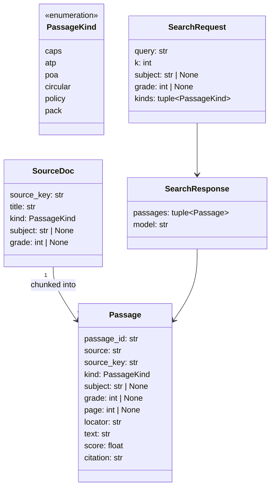
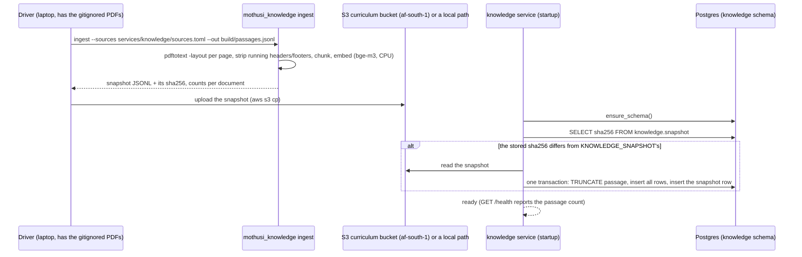
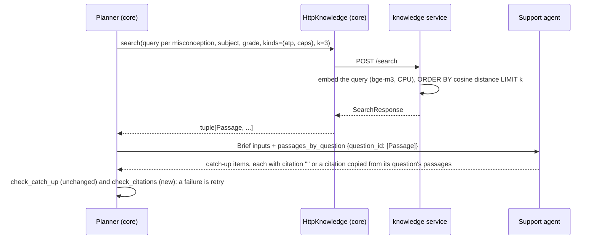

# Design — the knowledge service (retrieval with citations)

**Status:** draft · **Owner:** the project researcher (Claude) · **Spec:** the product requirements US4 (a catch-up plan that fits), Non-negotiable I (every curriculum
fact traces to the DBE document); stretch: the exhibition hall's narration (ADR 0004)

---

## 1. What this covers

`services/knowledge` covers four things:

- turning the held DBE curriculum PDFs and the packs into **passages** (page-bounded chunks of text);
- embedding the passages with **bge-m3 on CPU** (1024 dimensions, ADR 0001);
- storing them in Postgres with pgvector;
- answering `POST /search` with passages that each carry a **citation** (document title and page).

The Planner uses it to give the Support agent passages to cite for each catch-up item. The exhibition
hall's narration (stretch) uses it to cite each line it states.

It does **not** cover:

- **Placing catch-up work in a week.** That stays `check_catch_up` against the ATP weeks file,
  unchanged (marking-pipeline.md §6.1).
- **PoA weightings or the cognitive grid.** Those stay in the packs and are checked in code.
- **The AWS resources** (ECS service, S3 bucket, IAM). The deployment design owns those, written by the
  driver in parallel.

Retrieval adds sources to what agents write. It never decides a mark, a week or a weighting.

## 2. Reference material

| Kind | Where |
| --- | --- |
| Decision | [ADR 0001](../../adr/0001-aws-cape-town-open-models.md): bge-m3 on CPU in `services/knowledge`, RDS PostgreSQL 17 + pgvector 0.8.2 on AWS |
| Sources (held, gitignored) | `preparation/docs/sources/dbe/` (index: `MANIFEST.tsv`); `preparation/RATP Mathematics Grade 10 - 2024.pdf` (the ATP the fixture's `atp-weeks.toml` cites) |
| Existing code to match | `mothusi_rules.check_catch_up` (`packages/rules/src/mothusi_rules/catchup.py`); Support (`services/core/src/mothusi_core/agents/support.py`); `providers.py`'s wrapper style |
| Local database | `docker-compose.yml`: `pgvector/pgvector:0.8.7-pg17-trixie` (to be pinned to 0.8.2 to match RDS, the architecture plan Data layer) |
| Model card | `BAAI/bge-m3` on Hugging Face (MIT; 1024-dimension dense vectors). Two unverified points, checked at the start of the knowledge implementation: whether queries need an instruction prefix, and which pinned `sentence-transformers` version loads it |

**What the PDFs look like (read 2026-11-10).**

- CAPS FET Mathematics has 62 PDF pages, and its printed page numbers differ from the PDF's: PDF page
  21 is printed "16".
- CAPS FET Accounting has 78 pages; the Grade 10 ATPs have 5 (Mathematics) and 4 (Accounting); the
  Circular S8 of 2023 Annexure has 148; the RATP Mathematics Grade 10 2024 has 6.
- Every CAPS page ends with the running footer "CURRICULUM AND ASSESSMENT POLICY STATEMENT (CAPS)".
- ATP pages are wide tables, and `pdftotext -layout` keeps their columns.

Citations therefore use **PDF page numbers**. Printed page numbers are not extracted.

## 3. Domain model



- **`source_key`** is the file's path relative to the repo root, or the pack's path. It is the
  identity.
- **`source`** (the title) is the MANIFEST's `name` column, or the file stem for files not in the
  MANIFEST.
- **`page`** is the 1-based PDF page. It is `None` only for pack passages.
- **`locator`** is `"PDF p <page>"`, or for packs the TOML key path (for example `conventions[1]`).
- **`citation`** is computed as `f"{source}, {locator}"` (for example "CAPS FET Mathematics, PDF p
  21"). It is the exact string an agent copies and code checks.
- **`passage_id`** is `f"{source_key}#p{page}c{chunk}"`, or `f"{source_key}#{locator}"` for packs.
- **`score`** is the cosine similarity, from 0 to 1, rounded to 4 decimal places.
- **`subject` and `grade` of `None`** mean a cross-subject or cross-grade document (the NPA, the
  circulars, the CAPS FET documents for grade). A filter on subject or grade also returns these.
- **Persisted:** `Passage` without `score`. `score` and `citation` are derived.

## 4. Flow

### 4.1 Building and loading the index (offline, once per change to the sources)



### 4.2 Search during a run



The query for a misconception is the memo item's `question` followed by the Analyst's `pattern`,
joined by a newline. The filters are the pack's `subject` and `grade`.

**Failure paths:**

- **The knowledge service is unreachable, times out (5 s) or returns 5xx.** The Planner logs a
  `decision` event ("knowledge search failed: <error>; Support briefed without passages") and briefs
  Support with empty passages. Every citation must then be `""`, and the run continues. Retrieval
  never blocks marking.
- **`KNOWLEDGE_URL` is unset** (tests, the smoke, the offline laptop without the service).
  `NoKnowledge` returns `()`, and the Planner logs once per run: "knowledge service not configured;
  catch-up items carry no passage citations".
- **The snapshot can't be read at startup.** The service still starts if a snapshot is already
  loaded, and `/health` reports `stale: true`. If none is loaded, `/health` returns 503 and `/search`
  returns 503.
- **A query matches nothing above `min_score`.** The service returns an empty `passages`, which is a
  normal answer.
- **Ingest:** a source file is missing (exit 2, naming it); `pdftotext` is missing (exit 2); a page
  with no text, such as a scanned page, gives no passages and is counted in the report as `empty pages`.

## 5. State

The snapshot has two states, `none` and `loaded(sha256)`. `loaded(a)` becomes `loaded(b)` only by
the one-transaction reload in §4.1. Search is never served from a half-loaded table, because the
reload is a single transaction.

## 6. Contracts

### 6.1 Shared models

These go in `packages/contracts` (contracts lane, so domain-model.md gains these two). This is a
proposal; the driver confirms it.

```python
class PassageKind(StrEnum):
    CAPS = "caps"
    ATP = "atp"
    POA = "poa"
    CIRCULAR = "circular"
    POLICY = "policy"
    PACK = "pack"


class Passage(Contract):
    passage_id: str = Field(min_length=1)
    source: str = Field(min_length=1)  # document title, e.g. "CAPS FET Mathematics"
    source_key: str = Field(min_length=1)  # repo-relative path of the source file
    kind: PassageKind
    subject: str | None = None  # None: cross-subject document
    grade: int | None = Field(default=None, ge=1, le=12)
    page: int | None = Field(default=None, ge=1)  # 1-based PDF page; None only for packs
    locator: str = Field(min_length=1)  # "PDF p 21" or a pack key path
    text: str = Field(min_length=1)
    score: float = Field(ge=0, le=1)

    @property
    def citation(self) -> str:
        return f"{self.source}, {self.locator}"
```

`CatchUpItem` gains `citation: str = ""`. Empty means none was given. Otherwise it equals the
`citation` of a passage the Brief gave for that item's question. Support's reply model `SupportItem`
gains the same field.

### 6.2 Chunking rules

These live in `mothusi_knowledge.chunk` as pure functions, the Codex-ready part.

```python
def strip_running_lines(pages: Sequence[str], *, threshold: float = 0.6) -> tuple[str, ...]
    # A line (after str.strip(), digits replaced by "#") that appears on at least `threshold` of a
    # document's pages is a running header or footer and is removed from every page. Fewer than 3
    # pages: nothing is removed.
def normalise(page_text: str) -> str
    # rstrip every line; collapse 3+ consecutive blank lines to 1; strip the page.
def chunk_page(page_text: str, *, max_chars: int = 1200, overlap_max: int = 300,
               min_chars: int = 80) -> tuple[str, ...]
    # Paragraphs are separated by one or more blank lines. Pack paragraphs greedily up to max_chars;
    # a paragraph longer than max_chars is split at the last whitespace at or before max_chars (at
    # max_chars if there is none). Chunk n+1 starts with chunk n's last paragraph when that paragraph
    # is <= overlap_max characters. Chunks shorter than min_chars after .strip() are dropped. A chunk
    # never spans two pages.
def pack_passages(pack_path: Path) -> tuple[tuple[str, str], ...]
    # (locator, text) for each entry of the pack's top-level `sources` and `conventions` arrays,
    # locators "sources[i]" / "conventions[i]"; nothing else from the pack.
```

### 6.3 Sources list

`services/knowledge/sources.toml` is checked in. It holds paths only; the PDFs stay gitignored.

```toml
[[source]]
path = "preparation/docs/sources/dbe/curriculum/CAPS FET Mathematics.pdf"
title = "CAPS FET Mathematics"
kind = "caps"
subject = "Mathematics"          # optional; omitted = cross-subject
# grade omitted = all FET grades
```

First entries, all held on 2026-11-10:

| Path | kind | subject | grade |
| --- | --- | --- | --- |
| `preparation/docs/sources/dbe/curriculum/CAPS FET Mathematics.pdf` | `caps` | Mathematics | |
| `preparation/docs/sources/dbe/curriculum/CAPS FET Accounting.pdf` | `caps` | Accounting | |
| `preparation/docs/sources/dbe/curriculum/ATP 2023-24 Gr 10 Mathematics (DBE).pdf` | `atp` | Mathematics | 10 |
| `preparation/docs/sources/dbe/curriculum/ATP 2023-24 Gr 10 Accounting (DBE).pdf` | `atp` | Accounting | 10 |
| `preparation/RATP Mathematics Grade 10 - 2024.pdf` | `atp` | Mathematics | 10 |
| `preparation/docs/sources/dbe/circulars/Circular S8 of 2023 Annexure.pdf` | `poa` | | |
| `preparation/docs/sources/dbe/circulars/Circular S19 of 2025 Retention of 2023-24 ATPs with exclusions.pdf` | `circular` | | |
| `preparation/docs/sources/dbe/assessment-policy/National Protocol for Assessment Gr R-12.pdf` | `policy` | | |
| `packs/dbe-caps/mathematics-gr10.toml` | `pack` | Mathematics | 10 |
| `packs/dbe-caps/accounting-gr10.toml` | `pack` | Accounting | 10 |

### 6.4 The CLI

```
uv run --frozen python -m mothusi_knowledge ingest --sources services/knowledge/sources.toml \
    --out build/passages.jsonl [--max-chars 1200]
  -> exit 0; prints one line per source: "<title>: <pages> pages, <empty> empty, <n> passages",
     then "snapshot <sha256> (<total> passages)". Exit 2 on a missing file or missing pdftotext.
uv run --frozen python -m mothusi_knowledge load --snapshot <path|s3://bucket/key> \
    --database-url "$POSTGRES_URL"
  -> the same load the service does at startup (§4.1); prints "loaded <sha256> (<n> passages)"
     or "already loaded <sha256>".
```

**Snapshot format.** JSON Lines, read with `python3 -I` (untrusted-file rule):

- Line 1 is the header:
  `{"snapshot": 1, "model": "BAAI/bge-m3", "dim": 1024, "created": "<ISO-8601 UTC>", "sources": [{"source_key": str, "sha256": str}, ...]}`.
- Every further line is one `Passage` without `score`, plus `"chunk": int` and
  `"embedding": [1024 floats]`.
- The snapshot's identity is the sha256 of the file bytes.

**Embedding.** `BgeM3Embedder` is `sentence-transformers` on CPU, with `normalize_embeddings=True`.
Its weights are baked into the knowledge image at build time, so nothing is fetched at runtime.

```python
class Embedder(Protocol):
    dim: int
    def embed(self, texts: Sequence[str]) -> list[list[float]]
```

Tests inject a deterministic hashing embedder of the same `dim` as a test double.

### 6.5 The database

The knowledge service owns its schema. It runs `ensure_schema()` idempotently, because the repo has
no Alembic yet (the architecture plan lists it; the driver decides).

```sql
CREATE EXTENSION IF NOT EXISTS vector;
CREATE SCHEMA IF NOT EXISTS knowledge;
CREATE TABLE IF NOT EXISTS knowledge.snapshot (
  sha256 text PRIMARY KEY, loaded_at timestamptz NOT NULL DEFAULT now(), passages int NOT NULL);
CREATE TABLE IF NOT EXISTS knowledge.passage (
  passage_id text PRIMARY KEY, source_key text NOT NULL, source text NOT NULL, kind text NOT NULL,
  subject text, grade int, page int CHECK (page >= 1), chunk int NOT NULL, locator text NOT NULL,
  text text NOT NULL, embedding vector(1024) NOT NULL);
```

**No vector index (changed in the knowledge implementation's review, 2026-11-11).** The draft had an HNSW index. Under it,
a filtered search lost matching passages: pgvector applies the WHERE filters after HNSW picks its
candidates, and among near-duplicate pages the graph's pruning left a passage unreachable even with
iterative scans. The corpus is a few thousand passages, so an exact scan takes milliseconds and is
always right. `ensure_schema()` drops the old index if a database has it. Revisit if the corpus
passes about 100,000 passages.

Search is `ORDER BY embedding <=> $q LIMIT k`, and `score = 1 - (embedding <=> $q)`. The filter is
`(subject = $s OR subject IS NULL)` and `(grade = $g OR grade IS NULL)` when given, and `kind = ANY($kinds)`
when `kinds` is non-empty. Driver: `psycopg` 3 (as `AsyncPostgresSaver` uses) with the `pgvector`
Python package. Pin both in the knowledge implementation; their licences are unverified.

### 6.6 The HTTP API

`services/knowledge`, FastAPI:

```
POST /search   body SearchRequest -> 200 SearchResponse | 422 invalid body | 503 no snapshot loaded
GET  /health   -> 200 {"status": "ok", "passages": int, "snapshot": str, "stale": bool} | 503

class SearchRequest(Contract):
    query: str = Field(min_length=1, max_length=500)
    k: int = Field(default=5, ge=1, le=20)
    subject: str | None = None
    grade: int | None = Field(default=None, ge=1, le=12)
    kinds: tuple[PassageKind, ...] = ()
    min_score: float = Field(default=0.0, ge=0, le=1)

class SearchResponse(Contract):
    passages: tuple[Passage, ...]       # best first; len <= k
    model: str                          # "BAAI/bge-m3"
```

Environment: `POSTGRES_URL`, and `KNOWLEDGE_SNAPSHOT` (a path or an `s3://` URI; boto3 reads `s3://`).

### 6.7 How the core calls it

In `services/core/src/mothusi_core/knowledge.py`:

```python
class Knowledge(Protocol):
    async def search(self, query: str, *, k: int = 5, subject: str | None = None,
                     grade: int | None = None,
                     kinds: Sequence[PassageKind] = ()) -> tuple[Passage, ...]: ...

class HttpKnowledge:                     # POST {base_url}/search; httpx; timeout_s = 5
    def __init__(self, base_url: str, timeout_s: float = 5, *,
                 client: httpx.AsyncClient | None = None) -> None: ...
    # Raises KnowledgeError(message) on connection errors, timeouts, non-200 and invalid JSON.

class NoKnowledge:                       # KNOWLEDGE_URL unset: search() returns ()
    async def search(...) -> tuple[Passage, ...]: ...

class KnowledgeError(Exception): ...

def knowledge_from_environment() -> Knowledge   # HttpKnowledge(KNOWLEDGE_URL) or NoKnowledge()
```

**Support's Brief** gains `inputs["passages_by_question"]: dict[str, list[dict]]`, keyed by the
misconception's `question_id`, with `Passage.model_dump(mode="json")`. Support's prompt lists each
question's passages as `[citation] text`, with rule 5: *"citation is empty or copied exactly from a
passage listed under that item's question"*.

**The new rules check** (`packages/rules`, Codex-ready):

```python
def check_citations(plan: Sequence[CatchUpItem],
                    cited: Mapping[str, Sequence[str]],   # question_id -> allowed citations
                    question_of: Sequence[str]) -> CheckResult
    # question_of[i] is the question_id of plan[i] (Support's reply carries it; code drops it after
    # the checks, as today). Fails, naming the topic, when a non-empty citation is not in
    # cited[question_of[i]]. Empty citations always pass. check = "citations".
```

The catch-up plan's Markdown table gains a **Source passage** column with the citation, or "–" when
it is empty.

## 7. Structure

| Path | New? | Responsibility |
| --- | --- | --- |
| `packages/contracts/src/mothusi_contracts/models.py` | change | `PassageKind`, `Passage`; `CatchUpItem.citation` |
| `packages/rules/src/mothusi_rules/citations.py` | new | `check_citations` |
| `services/knowledge/pyproject.toml` | new | `mothusi-knowledge`, a uv workspace member (the root `[tool.uv.sources]` gains it) |
| `services/knowledge/src/mothusi_knowledge/chunk.py` | new | §6.2, pure |
| `services/knowledge/src/mothusi_knowledge/extract.py` | new | `pdftotext -layout` per page (subprocess, argument list, no shell) |
| `services/knowledge/src/mothusi_knowledge/embed.py` | new | `Embedder`, `BgeM3Embedder` |
| `services/knowledge/src/mothusi_knowledge/store.py` | new | `ensure_schema`, `load_snapshot`, `search` (psycopg + pgvector) |
| `services/knowledge/src/mothusi_knowledge/api.py` | new | FastAPI app, §6.6 |
| `services/knowledge/src/mothusi_knowledge/__main__.py` | new | the `ingest` / `load` CLI, §6.4 |
| `services/knowledge/sources.toml` | new | §6.3 |
| `services/knowledge/Dockerfile` | new | Python 3.14 + poppler-utils + baked bge-m3 weights (the infra lane builds and pushes it) |
| `services/core/src/mothusi_core/knowledge.py` | new | §6.7 client side |
| `services/core/src/mothusi_core/agents/support.py` | change | passages in the prompt; `citation` in the reply |
| `services/core/src/mothusi_core/graph/planner.py` | change | the search before Support, and the decision events |

## 8. Decisions & alternatives

| Decision | Chosen | Rejected, and why |
| --- | --- | --- |
| Embedding location | bge-m3 on the knowledge service's CPU (ADR 0001) | On the G4dn through Ollama: it would compete with marking for the one T4 and tie retrieval to the GPU's uptime. Still the fallback if the CPU image proves too large or slow (§10) |
| Text extraction | `pdftotext -layout` (poppler) | `pypdf`: weaker on the ATPs' wide tables, which `-layout` keeps in columns (seen 2026-11-10) |
| Chunk boundary | Never across a page | Cross-page chunks: a passage would need two page numbers and the citation would be ambiguous |
| Page numbers | PDF page | Printed page: differs from the PDF's (CAPS Maths PDF p 21 = printed 16), and extracting it from footers is unreliable |
| Getting the index to AWS | Ingest on the laptop, then a snapshot in S3 loaded at service start | Ingest on AWS: the PDFs are gitignored and not in CI; committing the snapshot: puts DBE text in a public repo (§10) |
| Citation check | Exact string match against the passages given, like `atp_source` | A model-judged "is this relevant": it is the same kind of judgement as the one being checked |
| Retrieval failure | Continue without citations, logged | Block the run: retrieval adds sources and never decides a mark |

## 9. How this is verified

- **`chunk`** (the retrieval contracts, unit):
  - a three-page fixture with a repeated footer loses the footer;
  - a 2,500-character paragraph splits at whitespace into chunks of at most 1,200 characters;
  - the overlap rule holds;
  - a 50-character page gives no chunk;
  - no chunk mixes pages.
- **`check_citations`** (the retrieval contracts, unit): an empty citation passes; a copied citation passes; an
  invented citation fails, naming the topic; a citation from another question's passages fails.
- **Store and API**: against the compose Postgres with the hashing embedder, a two-document
  snapshot loads once, a second load is "already loaded", `/search` returns `k` passages in score
  order with exact citations, the subject filter also returns `subject IS NULL` passages, and the
  503s are reached.
- **Real index** (the knowledge implementation, behind a marker; needs the PDFs). Ingesting `sources.toml` reports a passage
  count per document. A search for "volume and surface area of right prisms and cylinders" with
  subject Mathematics and grade 10 returns an ATP 2023-24 Gr 10 Mathematics passage among the top 3:
  the Term 4 Measurement row was read on 2026-11-10.
- **Core**: with a fake `Knowledge`, Support's Brief carries `passages_by_question`; an
  invented citation is a `retry` whose reason names `citations`; `KnowledgeError` gives the decision
  event and an empty-passage brief; the replay smoke still passes with `NoKnowledge`.

## 10. Open questions

- [ ] **Which ATP is authoritative.** The fixture's `atp-weeks.toml` cites the RATP 2024, while
  Circular S19 of 2025 retains the 2023/24 ATPs for 2026 (resources-to-fetch row 5). Both are
  indexed; the driver decides which one the catch-up weeks file is built from.
- [ ] **Image size and memory.** By arithmetic, bge-m3's fp32 weights are about 2.3 GB (567M
  parameters × 4 bytes; unverified against the actual files), plus torch CPU. The Fargate task is
  sized at 1 vCPU / 4 GB on the architecture page. If the image or cold start is too heavy, embed
  queries through Ollama `bge-m3` on the G4dn instead (whether Ollama offers bge-m3 is unverified).
- [ ] **CPU query latency** is unmeasured. The 5-second client timeout assumes one short query embeds
  in well under a second on one vCPU.
- [ ] **Licence for redistribution.** Is a snapshot of DBE text allowed in a public GitHub repo? Until
  that is answered, the snapshot lives only in the private S3 bucket and the laptop's `build/`.
- [ ] **bge-m3 query prefix and the pinned `sentence-transformers` version.** Check the model card at
  the start of the knowledge implementation.
- [ ] **The exhibition narration (stretch, ADR 0004)** calls `/search` with `kinds=(caps, atp)` per
  narration line. Its own design doc states how a line's citation is checked.

The deployed environment keeps its original AWS names; see infra/mothusi_infra/stage.py.
