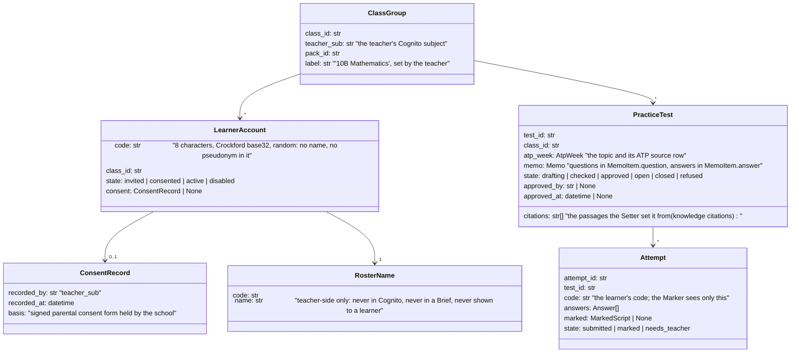
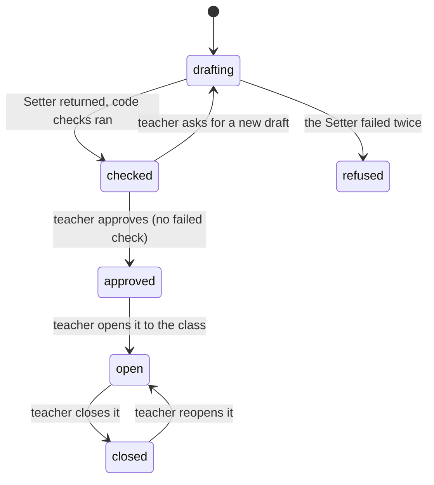

# Design — the learner section (stretch, tier 3)

**Status:** draft 2026-11-11 · **Owner:** the project researcher (Claude) · build tasks it allows are in §11 · **Spec:** [ADR 0004](../../adr/0004-learner-section-stretch.md); the architecture plan
Non-negotiable 1 and its one exception; the product requirements non-goals

## 1. What this covers

Learners sign in with a code their teacher hands out, take **practice tests** the Setter set from an
ATP week, and see the result of each attempt straight away: the code-checked mark, the words of their
own answer each mark rests on, and the memo's worked answer. **Not covered:** the exhibition hall
(exhibition-hall.md; it needs no sign-in), the teacher's formal assessments (the existing marking
cycle), and anything that teaches: see §8 for where the line with the agreed scope's "no lesson-plan
generator" sits.

**The exception this section depends on, verbatim (the architecture plan Non-negotiable 1):** "a learner's
practice-test result is shown without the teacher reading each attempt, because the teacher approved
that test and its memo once. It is the code-checked mark, the evidence quote and the memo's worked
answer, never free model prose." Everything a learner sees in §6.3 is one of those three things, or
the question as the teacher approved it.

## 2. Reference material

| Kind | Where |
| --- | --- |
| Decision | ADR 0004 (sign-in with code and PIN, consent first, the teacher's one approval) |
| The Setter, Marker and rules reused | `services/core/src/mothusi_core/agents/setter.py` (`sit_test`), `agents/marker.py`, `packages/rules` (evidence, arithmetic, cognitive grid) |
| ATP weeks | `AtpWeek` (packages/contracts), the pack's `atp-weeks.toml` |
| Retrieval for the Setter | knowledge.md §6.6–§6.7 (`Knowledge.search`, citations) |
| Teacher sign-in it mirrors | console-ui.md §12 (Cognito PKCE) |
| Visual reference | none yet: `console-ui/16-learner-test.png` (phone) and `17-practice-progress.png` (teacher) are the first step of the screens task (§11) |

## 3. Domain model



**Invariants:**
- No `LearnerAccount` can sign in before a `ConsentRecord` exists (POPIA s35(1)(a)).
- Cognito's learner pool holds only `code` as the username. It holds no name, email or phone number.
- A learner sees only tests with `state = open` in their own class, and only their own attempts.
- The Marker and every Brief see `code`; `RosterName` is joined only in the teacher's views, in the core, after marking.

## 4. Flow

### 4.1 Setting a practice test (teacher)

```mermaid
sequenceDiagram
    participant T as Teacher
    participant API as core
    participant K as knowledge
    participant S as Setter
    participant R as rules (code)
    T->>API: POST /classes/{id}/practice-tests {atp_week, marks: 10..30}
    API->>K: search(atp_week.topic, subject, grade, kinds=[caps, atp])
    API->>S: Brief(set): the ATP week, the passages, the pack's conventions and cognitive targets, marks
    S-->>API: a Memo (questions, answers, marks, levels) and the citations it used
    API->>R: Memo validators; check_cognitive_grid; check_citations (every citation is a retrieved passage)
    API->>S: sit_test(the new memo): the Setter answers it blind, code compares (equivalent)
    alt any check fails or the Setter disagrees with its own memo
        API-->>T: the test, with the failures named (state checked, not approvable until fixed or reset)
    end
    T->>API: POST /practice-tests/{id}/approve (after reading every question and answer)
    T->>API: POST /practice-tests/{id}/open
```

### 4.2 An attempt (learner)

```mermaid
sequenceDiagram
    participant L as Learner (phone)
    participant API as core
    participant M as Marker
    participant R as rules
    L->>API: POST /learn/attempts {test_id, answers} (learner token)
    API->>M: Brief(mark): the approved memo, the answers, code only
    M-->>API: MarkedScript
    API->>R: evidence check (every mark above 0 quotes the answer), arithmetic, bounds
    alt checks pass
        API-->>L: per question: marks / max, the quoted words per mark, the memo's worked answer
    else the Marker fails twice or a check still fails after retries
        API-->>L: "This attempt could not be marked yet; your teacher will see it."
        API->>API: Attempt.state = needs_teacher (the teacher marks it in the console)
    end
```

**Setting failure paths (as built, the implementation review):** no retrieved passage for the week means no test
(refused, "no curriculum passages were retrieved"; every question must cite one). A blind answer
code cannot compare is kept as `unverified` on the record for the teacher to read before approving,
never counted as agreement. A test that finishes after its class was closed is dropped, never saved.

**Failure paths:**
- **Consent not recorded.** The account stays `invited`, and sign-in shows "Ask your teacher to activate your code".
- **Five wrong PINs.** Cognito's own lockout applies, and the teacher can reset the PIN.
- **The model host is stopped** (outside judging hours). Submitting is refused with "Practice tests open when your teacher's Mothusi is running", and the answers stay on the phone.
- **A photo attempt.** Not in v1: answers are typed. Photo attempts later reuse pages mode, with the learner confirming their own reading check.

## 5. State



`LearnerAccount`: `invited → consented → active` (first sign-in sets the PIN) `→ disabled` (teacher),
with `disabled → active` only by the teacher.

## 6. Contracts

### 6.1 Sign-in

- A second Cognito user pool, `mothusi-learners` (af-south-1), created by the admin only. Username = `code`.
  - Password policy: minimum 6 characters, every character-class requirement off, so a 6-digit PIN is accepted.
  - No email or phone attribute, no MFA, no self sign-up.
  - SPA client with PKCE, as in console-ui.md §12.
- The teacher's "Print sign-in slips" makes, per learner: the code and a one-time PIN. The slip carries the code, not the name; the teacher hands it out by hand. First sign-in forces a new PIN (`NEW_PASSWORD_REQUIRED`).
- The core accepts tokens from both pools. A learner token (issuer `mothusi-learners`) is allowed only on `/learn/*`; a teacher token is refused there.
- **Laptop testing (decided by the project researcher, 2026-11-11).** When sign-in is off (no Cognito configuration,
  the laptop and tests only), `/learn/*` reads the learner's code from an `X-Learner-Code` header.
  The code must belong to a class and be `consented` or `active`. When sign-in is on, the header is
  ignored, and `/learn/*` answers 401 until the learner pool is in place.

### 6.2 Endpoints

```
Teacher (teacher token):
POST /classes                          {label, pack_id, roster: file (.csv, one column learner)} -> {class_id, codes}
POST /classes/{id}/consent             {codes: [str]}  -> records ConsentRecord for each (the school holds the forms)
GET  /classes/{id}/slips.pdf           code + one-time PIN per learner (PINs shown once)
POST /classes/{id}/practice-tests      {atp_week: int, marks: int (10..30)} -> 202 {test_id}
GET  /practice-tests/{id}              the test, its checks, its citations, its state
POST /practice-tests/{id}/approve | /open | /close
GET  /practice-tests/{id}/progress     per question: mean mark (item analysis); per learner (name joined here): best and last mark
Learner (learner token):
GET  /learn/tests                      open tests in the learner's class
GET  /learn/tests/{id}                 the questions only (MemoItem.question, max_marks): never the answers before submitting
POST /learn/attempts                   {test_id, answers: [{question_id, text}]} -> 200 Result (6.3) | 202 needs_teacher | 409 not open
GET  /learn/attempts                   the learner's own attempts and their results
Teacher, as built with the implementation:
GET  /practice-tests/{id}/progress     {test_id, learners, attempted, questions: [{question_id, max_marks, mean}],
                                        rows: [{code, name, best, last, tries, waiting}]}; waiting counts
                                        needs_teacher attempts
```

Attempts are stored beside their class (`classes/<id>/attempts/` on files, `learners.attempt` in
Postgres, cascading from the class), so closing a class deletes them.

### 6.3 What a learner sees (the whole of it)

```
Result {
  test_title: str,
  total: int, max_total: int,                 # sum of code-checked marks
  questions: [{
    question_id, question,                    # as approved
    awarded: int, max_marks: int,             # after the rules' checks
    evidence: [str],                          # the quotes from the learner's own answer that earned the marks
    worked_answer: str                        # MemoItem.answer of the approved memo, verbatim
  }]
}
```

The learner sees no rationale text from the Marker, no feedback prose and no hints. The "why" is the
quote of their own words and the memo's working.

### 6.4 Contracts, verbatim (packages/contracts/src/mothusi_contracts/learners.py, exported)

```python
LearnerCode = Annotated[str, Field(pattern=r"^[0-9A-HJKMNP-TV-Z]{8}$")]   # Crockford base32, 8 chars

class ConsentRecord(Contract):
    recorded_by: str = Field(min_length=1)       # the teacher's Cognito sub
    recorded_at: datetime
    basis: Literal["signed parental consent form held by the school"]

class LearnerAccount(Contract):
    code: LearnerCode
    class_id: str = Field(min_length=1)
    state: Literal["invited", "consented", "active", "disabled"]
    consent: ConsentRecord | None = None
    # validator: state in (consented, active) requires consent; invited requires consent is None

class ClassGroup(Contract):
    class_id: str = Field(min_length=1)
    teacher_sub: str = Field(min_length=1)
    pack_id: str = Field(min_length=1)
    label: str = Field(min_length=1, max_length=60)

class PracticeTest(Contract):
    test_id: str = Field(min_length=1)
    class_id: str = Field(min_length=1)
    atp_week: AtpWeek
    memo: Memo
    citations: tuple[str, ...] = ()
    state: Literal["drafting", "checked", "approved", "open", "closed", "refused"]
    approved_by: str | None = None
    approved_at: datetime | None = None
    # validator: state in (approved, open, closed) requires approved_by and approved_at

class PracticeQuestionResult(Contract):
    question_id: str = Field(min_length=1)
    question: str
    awarded: int = Field(ge=0)
    max_marks: int = Field(gt=0)
    evidence: tuple[str, ...] = ()               # the Marker's quotes for this question (validator: at least
                                                 # one when awarded > 0, none when 0; one Mark can award several
                                                 # marks with one evidence_quote)
    worked_answer: str = Field(min_length=1)
    # validator: awarded <= max_marks

class PracticeResult(Contract):                  # §6.3: the whole of what a learner sees
    test_title: str = Field(min_length=1)
    total: int = Field(ge=0)
    max_total: int = Field(gt=0)
    questions: tuple[PracticeQuestionResult, ...] = Field(min_length=1)
    # validators: total == sum(awarded), max_total == sum(max_marks), question_ids unique

class Attempt(Contract):
    attempt_id: str = Field(min_length=1)
    test_id: str = Field(min_length=1)
    code: LearnerCode
    answers: tuple[Answer, ...] = Field(min_length=1)
    state: Literal["submitted", "marked", "needs_teacher"]
    result: PracticeResult | None = None
    # validator: state == marked requires result; other states require result is None

def new_learner_code(rng: Callable[[int], bytes] = secrets.token_bytes) -> str
    # 8 Crockford base32 characters from 5 random bytes (40 bits), never containing I, L, O or U
```

### 6.5 Sign-in slips (packages/outputs/src/mothusi_outputs/slips.py, exported)

```python
def learner_slips_pdf(class_label: str, slips: Sequence[tuple[str, str]]) -> bytes
    # A4 portrait, ReportLab, the Noto fonts the answer sheets use; 8 slips per page (2 x 4), each
    # with a dashed cut line, the class label, "Your code" with the code in 20 pt Noto Sans Bold, letter-spaced (no mono font is bundled),
    # "First PIN" with the 6-digit PIN, and "Sign in at the address your teacher gives you; you will
    # choose a new PIN the first time." No learner name on any slip. ValueError on an empty list, a
    # code that is not a LearnerCode, a PIN that is not exactly 6 digits, or a repeated code.
```

## 7. POPIA

- **Minors.** Accounts only after the teacher records that the school holds parental consent (s35(1)(a)). The teacher records consent per learner, and the record names who recorded it and when.
- **Minimality.** The learner's identity is a random code. The name lives only in the teacher-side roster, in RDS under `mothusi-data` KMS, in af-south-1. Cognito holds the code and a PIN hash.
- **No cross-border flow.** Marking runs on the G4dn, and no learner data goes to ElevenLabs or Sketchfab.
- **Deletion.** Closing a class deletes its accounts from Cognito and its attempts within 30 days. That is a task (§11), not a promise without code.

## 8. Decisions & alternatives

- **The line with "no lesson-plan generator."** Mothusi sets *assessments* (questions with a memo) for an ATP week, from the pack and the retrieved CAPS/ATP passages, and nothing else. It writes no lesson plans, no notes, no explanations and no worked examples beyond the memo's own answers. It answers no free questions. Every question must cite a retrieved passage (`check_citations`), so a test cannot drift beyond the curriculum page it came from.
- **No moderation sample on practice attempts.** The Moderator exists for marks that count. A practice mark that fails the code's checks goes to the teacher instead.
- **Typed answers first.** Photo attempts reuse pages mode later. Typing removes the reading check from a minor's flow in v1.
- **A random code, not the assessment pseudonym.** Pseudonyms (L-001…) are per class set and per assessment. A learner needs one stable sign-in that carries no link to any assessment's pseudonyms.

## 9. How this is verified

- Every screen field traces to §6.3 or the approved test. A test asserts that the Result JSON has exactly the §6.3 keys, and that no Marker rationale string appears in it.
- An account with no consent cannot get a token (the Cognito admin-create path is gated in code). A learner token is refused on every teacher route, and a teacher token on `/learn/*`.
- A practice test whose memo fails a check cannot be approved. One the Setter disagrees with is shown with the disagreement.
- A Brief built for an attempt contains the code and never a roster name (the grounding test, extended).

## 10. Open questions

- **ElevenLabs for the voice colleague** does not touch this section.
- **Retrieval must land first**: the Setter's citations come from it.

## 11. Build tasks this allows (proposed for the implementation plan)

1. **Contracts:** `ClassGroup`, `LearnerAccount`, `ConsentRecord`, `PracticeTest`, `Attempt`, `PracticeResult` (§3, §6.3). Codex-ready.
2. **Learner pool and two-pool token check:** a `mothusi-learners` pool in MothusiFront, plus the core's issuer-based routing (§6.1).
3. **Classes, consent and slips:** the teacher endpoints, the slips PDF (ReportLab, as the answer sheets), and the roster in RDS.
4. **Setting a practice test:** the Setter's `set` Brief, the checks, `sit_test`, approve, open and close (§4.1).
5. **Attempts:** the learner endpoints, Marker plus rules, the §6.3 result and the `needs_teacher` path (§4.2).
6. **Screens:** mockups 16 and 17 first, then the learner phone screens and the teacher's progress view.
7. **Deletion on class close** (§7).

The deployed environment keeps its original AWS names; see infra/mothusi_infra/stage.py.
