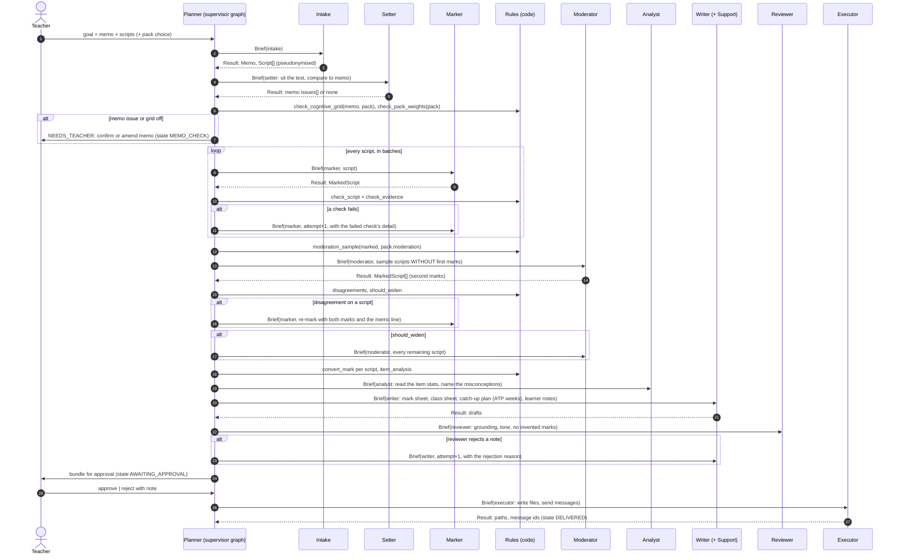
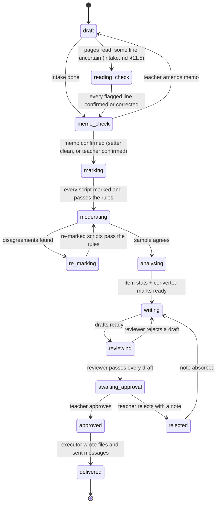
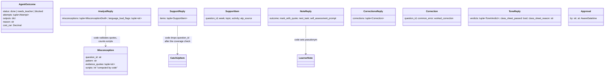
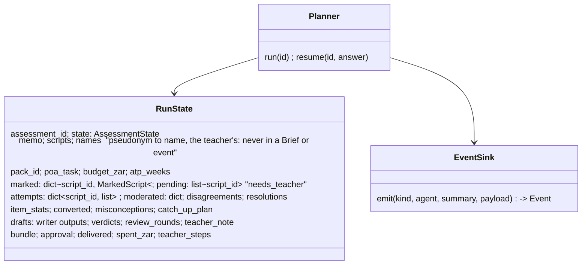

# Design — marking pipeline

**Status:** agreed · **Owner:** the project researcher (Claude) · **Spec:** the product requirements US1, US2, US4, US5, US6, US8

---

## 1. What this covers

How one assessment moves from the teacher's one-sentence goal to an approved bundle: which agent
does what, in what order, what each hands the next, and what happens when a check fails. It covers
the Planner's decisions (retry, send back, widen, ask the teacher) and the lifecycle states. It does
not cover the entities ([domain-model.md](domain-model.md)), the deterministic checks
([rules-engine.md](rules-engine.md)) or the console (`console-ui.md`, written in the console design).

## 2. Reference material

| Kind | Where |
| --- | --- |
| The chain and its tiers | The target research (source note not in this repo) |
| Proposed architecture and demo moments | The project arsenal (source note not in this repo) |
| Supervisor pattern this follows | Alfred's graph (guard → route → dispatch → wait → absorb → ask / approvals / halt / respond) (source note not in this repo) |
| Quality additions (growth mindset, three-part notes, language-load flag) | "Quality additions from the full TALIS report" (source note not in this repo) |
| Moderation practice | `docs/evidence/sa-teacher-documents.md` (pre- and post-moderation rows) |

## 3. Domain model

Uses [domain-model.md](domain-model.md) unchanged. The pipeline adds no entity; it adds the two
envelopes in §6.

## 4. Flow



**Failure paths.**

- **A rules check fails on a MarkedScript**: the Marker gets the same Brief with `attempt + 1`
  and the `CheckResult.detail` in `inputs`. After **two retries** the script goes to the teacher
  (`Result.status = NEEDS_TEACHER`) with both attempts attached. Nothing is ever silently accepted.
- **The Setter finds a memo error**: the cycle stops at `MEMO_CHECK` until the teacher confirms or
  amends the memo. Mothusi does not mark against a memo it has reason to doubt.
- **Model call fails or times out**: the provider seam retries once, then falls back to the
  configured fallback provider (Ollama) for that Brief; the Result carries `reason` saying so.
- **Budget exceeded** (tokens or rand, set per assessment): the Planner halts the loop at a batch
  boundary and asks the teacher whether to continue; everything marked so far is kept.
- **Teacher rejects the bundle**: state goes to `REJECTED`, the note becomes the Writer's next Brief
  input, and the cycle re-enters `WRITING`. Marks are not re-done unless the note names a script.

**What makes the self-correction real** (the judges' point 2): the Moderator never sees the first
marks (blind), the rules refuse any mark whose quote is not in the script, and every retry is logged
with its reason in the live log (US8).

## 5. State



Transitions not drawn are impossible in code: the graph's router only emits these. In particular
there is **no edge from any state to `delivered` that bypasses `approved`**; that edge's absence is
Non-negotiable I.

## 6. Contracts

The Planner speaks to every agent through `Brief` and `Result`
(`packages/contracts/src/mothusi_contracts/envelopes.py`):

```
Brief
  brief_id: str            unique per dispatch; attempt N of the same work gets a new id
  assessment_id: str
  agent: AgentRole         planner | intake | setter | marker | moderator | analyst | support | writer | reviewer | executor
  task: str                one imperative sentence
  inputs: dict             the exact objects the agent needs, as JSON (never "see the database")
  attempt: int >= 1
  budget_tokens: int | None

Result
  brief_id: str
  agent: AgentRole
  status: done | retry | blocked | needs_teacher
  outputs: dict            structured; the Planner validates each value against the contracts
  evidence: tuple[str]     memo lines, quotes, check ids the outputs rest on
  reason: str              required when status != done
  cost_zar: Decimal
```

Per-agent `inputs` and `outputs` are written out in the agent contracts, one
`###` per agent. **Moderator Briefs carry `Script`s and the `Memo`, never `MarkedScript`s.**

### 6.1 The output agents

Each model agent follows the Marker's shape: a deterministic `<agent>_prompts(...)` (the replay
fixtures key on it), a reply model that holds only what the model decides, and one entry point
`async def <verb>(brief, provider) -> Result`. Identity, sources and numbers are set by code, not
by the model. Code checks run inside the entry point; a failed check returns `status = retry` with
the check's detail in `reason`, and the shared loop `run_with_retries` (`agents/loop.py`) re-briefs
with that detail as `inputs["previous_failure"]`, three attempts in all, then `needs_teacher`.



| Agent | Model decides | Code decides and checks (a failure is `retry`) |
| --- | --- | --- |
| Analyst `analyse` | the pattern behind each `re-teach` item, quotes from the scripts that lost marks there, and language-load flags | one misconception per `re-teach` item, exactly; every quote a whitespace-normalised substring of a script that lost marks on that question; `scripts` = how many of those scripts contain a quote; flags are memo question ids. No `re-teach` item: no model call, empty outputs |
| Support `plan_catch_up` | which remaining week, the topic and the activity per misconception | `check_catch_up` (week remaining, source copied exactly); every misconception's question has at least one item. No misconceptions: no call, empty plan. No weeks left: `needs_teacher` |
| Writer `write` | one note per learner (one call per script, run concurrently) and the worked corrections for the three weakest questions (one call) | the note's `pseudonym`; the three weakest questions are `class_feedback_md`'s order (facility, then id) and the corrections must name exactly those; the memo answer beside each correction is copied from the memo. `class_sheet_md` = `class_feedback_md(item_stats)` + "What the scripts show" (the Analyst's patterns and counts) + the corrections; `catch_up_plan_md` is a table rendered from `catch_up_plan`; `moderation_report_md` is the rules renderer's, verbatim |
| Reviewer `review` | tone: a note that labels, compares or discourages in words the patterns miss; the class sheet's tone | `check_note_grounding` and `check_note_weeks` (an ATP week only from the checked catch-up plan) on every note first. Only notes that pass it go to the model, in one call, and the model can only add a rejection: a note code rejected cannot pass. A verdict missing for a note sent is `retry` |
| Executor `execute(brief, mailer)` | nothing (no model) | `approval` present and valid, else `blocked` and nothing written; `write_bundle` then `mailer.send` per message; a failure is `blocked` with what was written and sent so far |

Rewrites. The Writer's Brief may carry `notes` (the previous drafts) and `rewrite: {pseudonym:
reason}` (the Reviewer's rejections): only those notes are redrafted, each with its reason in the
prompt, and the rest are carried over unchanged. A teacher's rejection arrives as `teacher_note`
and every note and the corrections are redrafted with it in the prompt; marks are never inputs the
Writer can change (`marked` is read-only context).

**Names.** No model agent's Brief or prompt carries a learner name, the Writer's included: names
are joined to notes only in the Executor's bundle (`learner_note_md(note, name)`), which calls no
model. This narrows the agent contracts's earlier `pseudonym_map` for the Writer to the project’s grounding rules §6
("learners are pseudonyms in anything an agent reads").

### 6.2 The Planner graph and the API

One LangGraph `StateGraph` per run, one node per state of §5 (`draft` … `delivered`). Every node
ends in `transition(from, to)` (`graph/router.py`), which raises unless `(from, to)` is an edge of
§5 (`ALLOWED`), appends a `state` event and returns the new state; the conditional edges then route
on that state alone. The checkpointer is `AsyncPostgresSaver` when `POSTGRES_URL` is set (the demo
and the eval), `InMemorySaver` otherwise (tests, the smoke); the event log is the JSONL `EventLog`
either way, at `<MOTHUSI_DATA>/<assessment_id>/events.jsonl`.



Teacher questions are LangGraph `interrupt(...)` calls, each after a `needs_teacher` event, and
each answered by one endpoint of console-ui.md §6 (`Command(resume=answer)`):

| Where | Asked when | Answer |
| --- | --- | --- |
| `reading_check` (ADR 0002, the page-reader implementation) | the page reader marked a line uncertain (one question listing every flagged line) | `confirm` keeps the reading; `correct` replaces the line; once every line is answered, the run goes on to `memo_check` |
| `memo_check` | the Setter reports a blocking issue (one question per issue) | `use_proposed` / `amend` sends the run back to `draft` (memo amended) and the Setter sits the amended memo; `keep_memo` for every issue goes on to `marking` |
| `marking`, at a batch boundary | `spent_zar` passes `budget_zar` | `raise_to_zar` resumes the next batch; no answer leaves the run halted with every mark kept |
| `marking`, after the last batch | a script came back `needs_teacher` (one question per script) | `use_attempt` takes that attempt's marks if it produced any; `set_marks` makes Marks with principle "teacher's decision", the learner's whole answer as the quote, exempt from `check_evidence` (logged) |
| `awaiting_approval` | always | `approve` → `approved`; `reject` + note → `rejected` → `writing`, the note as the Writer's `teacher_note`; marks untouched |

Node by node: `draft` loads nothing (the API parsed the files to answer 422) and logs intake;
`memo_check` runs the Setter and `check_pack_weights` / `check_cognitive_grid` (a pack with no grid
logs "no cognitive-level grid in this pack; check skipped"; a failing grid is a failed `check`
event, not a stop); `marking` runs `mark_script` in batches of 4 (the model host serves 4 requests at once,
`OLLAMA_NUM_PARALLEL=4`; a batch of 8 queued half its calls past the client timeout in the first
evals, 2026-11-11/12). Every model call of a run, whatever the stage or role, also holds one of
the Planner's `Slots` (`batch_size` of them, `mothusi_core.providers.Limited`), so no stage puts more
than 4 calls on the host at once: in the 2026-11-12 eval the Moderator sent its whole sample
together and every call timed out, and the Writer would have sent every learner's note at once.
The Marker and Moderator reply with marks only (`MarkerReply`); the script's total is the sum of
the awarded marks, added in code. In the 2026-11-12 eval the model's own total disagreed with its
marks on 24 of 32 scripts, and each went to the teacher after three tries.
`moderating` samples, runs
`blind_check` on every moderator Brief before dispatch, `moderate_script`, then `compare` (a
`disagreement` event each) and widens to every script when `should_widen` says so; `re_marking`
re-marks each disputed script with both markings and records the resolution; the second entry to
`moderating` closes the loop (no new sample) and goes on to `analysing`; `analysing` runs
`convert_mark`, `item_analysis`, the Analyst and Support; `writing` / `reviewing` loop at most three
rounds (a note still rejected after the third stays in the bundle marked "rejected by the
Reviewer" for the teacher to see); `awaiting_approval` builds the Bundle of console-ui.md §6;
`approved` is the only node that calls `executor_brief` + `execute`; `delivered` ends.

**Model fallback** is the Planner's (llm-seam.md §4): each agent's provider is
`Fallback(primary, fallback)`; when the primary raises a `ProviderError`, the fallback is asked once
and a `decision` event says "fell back to <name> for <brief_id>: <error>"; if it fails too, the
agent's own `retry` / `blocked` handling applies, ending at `needs_teacher`.

**Delivery.** The Executor writes the bundle under `<MOTHUSI_DATA>/<assessment_id>/bundle/`. One message
is sent: the bundle notice to `MOTHUSI_TEACHER_EMAIL`, when it is set. Nothing is sent to learners or
parents: the fixtures carry no contacts, and the console lists the notes as "not sent: with the
teacher".

**API** (`main.py`, FastAPI): the eight endpoints of console-ui.md §6. `POST /assessments` parses the
files with `load_memo` / `load_scripts` (422 with their own sentence), writes the `created` event
(seq 0), then starts the graph in a background task; each teacher endpoint checks the pending
question (409 otherwise) and resumes the graph in the background. `GET /events` streams the log by
SSE: replay every event after `Last-Event-ID`, then follow the file. Provider from the environment:
`MOTHUSI_PROVIDER = anthropic | ollama | replay` (+ `MOTHUSI_REPLAY` for the recording), fallback Ollama.

**Smoke** (`the event configuration [checks] smoke`): `uv run --frozen python -m mothusi_core.smoke` runs the
6-script planted set (L-001, L-003, L-007, L-010, L-014, L-021) through the graph in replay mode
on `services/core/fixtures/gr10-maths-t1/replay-6.jsonl` and exits non-zero unless the state
sequence is §5's and the memo error, the L-014 quote and the L-021 over-mark are all caught.
The recording holds **scripted replies, not a model's**: `scripts/record_replay.py` writes it by
running the same graph against a scripted provider that answers from the fixture and its traps,
so the replay tests the Planner and the rules, never a model's judgement (the demo service declarations).

**Approval gate.** `executor_brief(assessment_id, state, approval, bundle, messages)` raises
`ValueError` unless `state` is `approved`; it is the only constructor of an Executor Brief, and the
graph calls it only from the `approved` node.

## 7. Structure

| Path | New? | Responsibility |
| --- | --- | --- |
| `services/core/src/mothusi_core/graph/` | new | the LangGraph supervisor: nodes for each decision in §4, Postgres checkpointer |
| `services/core/src/mothusi_core/agents/marker.py` | exists | `mark` (one attempt), `mark_script` (the rules-driven retry loop, max 3 attempts, then needs_teacher) |
| `services/core/src/mothusi_core/agents/<role>.py` | new | one module per agent: builds the prompt from the Brief, validates the output into contracts |
| `services/core/src/mothusi_core/agents/loop.py` | new | `run_with_retries`: the retry loop shared by the Analyst, Support, Writer (§6.1) |
| `packages/llm/src/mothusi_llm/` | new | the provider seam: Anthropic, Ollama; structured output into a pydantic model; usage meter |
| `services/core/src/mothusi_core/events.py` | new | the live log: one event per Brief, Result, check and decision, streamed by SSE to the console |

## 8. Decisions & alternatives

| Decision | Chosen | Rejected, and why |
| --- | --- | --- |
| Orchestration | A LangGraph supervisor graph with explicit nodes per decision | Free-form agent chat: decisions would be invisible and un-replayable; the judges' point 1 needs a visible plan |
| Moderation | Blind sample, then widen on disagreement rate | Re-mark everything: costs double and hides whether the first marking was reliable |
| Retry policy | Two retries with the check's detail, then the teacher | Unlimited retries: a model can loop on an ambiguous memo; the teacher is the right stop |
| Rules | In code, called by the Planner between agents | Asking a model to "double-check": it is the same kind of error as the first pass |
| Delivery | Executor runs only after `approved` | Auto-send with an undo: a sent message to a parent cannot be unsent |

Deviations from the architecture defaults: the Brief/Result bus is
in-process via the graph for the hackathon build; the RabbitMQ outbox from the defaults is kept for
when agents run as separate services (noted in the architecture plan) (source note not in this repo).

## 9. How this is verified

- A graph test runs a 6-script synthetic class with two planted traps (one over-mark, one mark
  whose quote is not in the script) and asserts: both are caught by the rules, both retries are
  logged with reasons, the Moderator's Brief contains no first marks, and the state sequence
  matches §5.
- An acceptance test for US5 asserts no Executor call happens before `approved`.
- The eval run reports agreement rate, time per class set and rand per script.

## 10. Open questions

- [ ] Batch size for marking (cost vs. latency). Start with 8; measure in the eval run.
- [ ] Which model marks and which moderates: the arsenal proposes Claude for both with a different
      system prompt; a different model family for the Moderator would be a stronger blind check.
