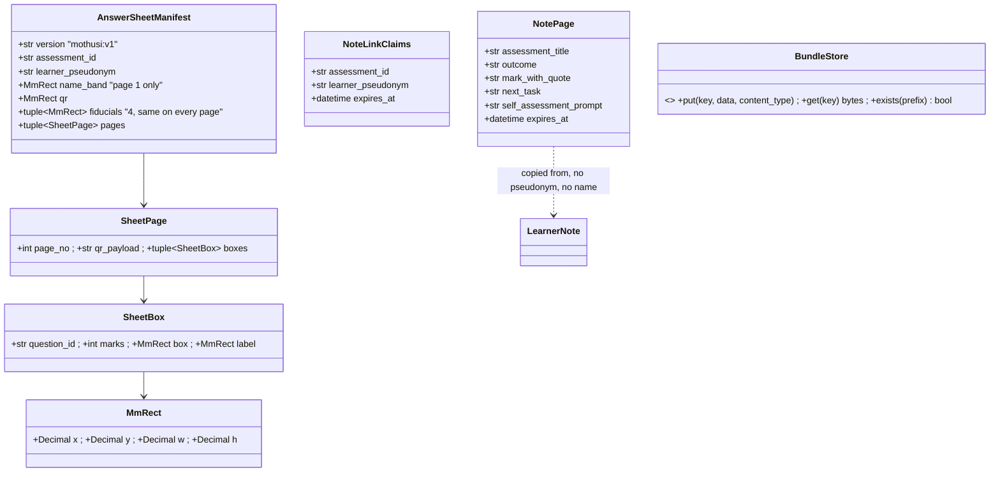
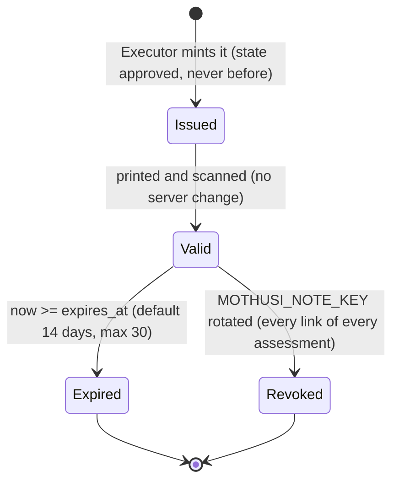

# Design — outputs and delivery

**Status:** agreed; **option A additions draft 2026-11-10** (§1, §3–§10 marked "option A") ·
**Owner:** the project researcher (Claude writes; Codex builds the implementation) ·
**Spec:** the product requirements US4, US5, US9 ·
**ADRs:** [0001](../../adr/0001-aws-cape-town-open-models.md), [0002](../../adr/0002-photo-and-pdf-intake.md)

---

## 1. What this covers

The deterministic end of the pipeline: how the finished paperwork is rendered and written to disk
as the approved bundle, how the mark sheet is also produced as a spreadsheet, and the one interface
the Executor sends messages through, with the implementation the demo uses (messages written to a
Maildir folder, not sent). It does not cover the Writer's prose
([marking-pipeline.md](marking-pipeline.md) §4) or the approval gate itself (the graph).

**Option A additions (2026-11-10).** Four more deterministic outputs:
- the **PDF moderation report** the HOD signs, rendered from `moderation_report_md` (D10);
- **printable learner notes**, one page per learner, each with a QR code that opens that learner's
  approved note on a phone through a signed, expiring link (no account);
- the **note page** behind that link, served by a core route from S3 in af-south-1, which exists only
  after approval;
- the **printable Mothusi answer sheet** per learner, whose layout is the contract intake reads
  ([intake.md](intake.md), ADR 0002).

This doc does not cover how intake reads the sheet (intake.md), the CDK stack, CloudFront behaviours
and IAM (the deployment design), or the console's download buttons (console-ui.md).

## 2. Reference material

| Kind | Where |
| --- | --- |
| What a mark sheet and a teacher file hold | `docs/evidence/sa-teacher-documents.md` (mark sheets, moderation reports, learner evidence rows) |
| Three-part notes and self-assessment | `preparation/docs/idea.md` "Quality additions" items 1–2 |
| The computed inputs | `mothusi_rules.mark_sheet_csv`, `moderation_report_md`, `class_feedback_md`; `LearnerNote` and `Message` (contracts) |
| Existing code to match | `packages/outputs/src/mothusi_outputs/notes.py`, `packages/delivery/src/mothusi_delivery/mailer.py` |
| RFC 5322 and Maildir | Python's `email.message.EmailMessage`; a Maildir is `cur/ new/ tmp/` with one file per message |
| The report's text (option A) | `mothusi_rules.moderation_report_md` (`packages/rules/src/mothusi_rules/report.py`): headings, a sample table, a disagreements table, the agreement line and four signature lines |
| The note's four parts | `LearnerNote` (`packages/contracts/src/mothusi_contracts/models.py`) and `learner_note_md` |
| Learner note page, architecture | `docs/architecture/mothusi-aws-map.html` §02 (routes table: printed note, QR to a note page, parent email later) |
| S3 presigned URL limits | AWS S3 User Guide, "Download and upload objects with presigned URLs" (read 2026-11-10): SigV4 URLs up to 7 days with IAM user keys; with role credentials "the presigned URL expires when the role session expires"; ECS task role credentials "typically rotate every 1-6 hours" |
| PDF library | ReportLab 5.1.0, PyPI 2026-10-22, "BSD license", `py3-none-any` wheel, requires `pillow>=9.0.0`, `charset-normalizer` (read 2026-11-10) |
| QR library | segno 1.6.6, PyPI 2025-03-12, classifier "BSD License", no runtime dependencies on Python ≥ 3.10 (read 2026-11-10) |
| Visual reference for the printed pages | none yet: the answer sheet's geometry in §6.3 is exact; the note page and printed note follow console-ui.md's tokens (`docs/architecture/design/console-ui.md` §2), rendered in the learner-note rendering and reviewed against a PNG of the first output |

## 3. Domain model

`LearnerNote(pseudonym, outcome, mark_with_quote, next_task, self_assessment_prompt)` and
`Message(to, subject, body)` exist. No new entities for the implementation work (option A adds the ones below). The
bundle on disk has fixed names:

```
<root>/
├── README.md               "Bundle: <title>", the list of files below with one line each
├── mark-sheet.csv          mark_sheet_csv(...) verbatim (CRLF)
├── mark-sheet.xlsx         mark_sheet_xlsx(...)
├── class-feedback.md       class_feedback_md(...)
├── catch-up-plan.md        the Writer's catch_up_plan_md
├── moderation-report.md    moderation_report_md(...)
└── notes/<pseudonym>.md    learner_note_md(note, name): file named by pseudonym, name inside
```

**Option A adds** to the bundle (and to `BUNDLE_FILES`):

```
├── moderation-report.pdf   moderation_report_pdf(moderation_report_md, ...) the HOD signs this
├── learner-notes.pdf       learner_notes_pdf(...)  one A4 page per learner, name + QR
└── note-pages/<pseudonym>.json   NotePage as JSON, no name: what GET /n/{token} serves
```

and, outside the bundle (made before the test is written), the answer-sheet set:

```
<MOTHUSI_DATA or S3 bundles bucket>/<assessment_id>/answer-sheets/
├── answer-sheets.pdf        every learner's sheet, in class-list order
└── manifests/<pseudonym>.json   AnswerSheetManifest per learner (§6.3), what intake crops by
```



- `NotePage` carries **no name and no pseudonym**: the page a QR opens shows only the note, so a
  leaked or photographed QR reveals one learner's feedback but not who it belongs to. The printed
  note (paper, handed over in class) carries the name.
- `AnswerSheetManifest`, `SheetPage`, `SheetBox` and `MmRect` live in `mothusi_contracts` because intake
  consumes them; `NotePage` and `NoteLinkClaims` live in `mothusi_delivery` (only delivery and the core
  route use them).
- Units: millimetres as `Decimal` with one decimal place; origin at the page's **top-left corner, y
  downwards** (the scanner's and the photo's natural orientation, so intake needs no flip).

## 4. Flow

Executor (after `approved`, never before): `write_bundle(...)` → paths; then for each message,
`mailer.send(Message)` → id. Both are recorded as `written` and `sent` in the Executor's Result.

**Failure paths:** a bundle root that already holds files is refused (`ValueError`), so a second run
never overwrites the record of a first; a message that fails to write raises, and the Executor
reports `blocked` with the ids sent so far. The Maildir mailer is idempotent: the same message twice
is one file, one id.

**Option A: approve → Executor → files, S3 and note pages; then a learner scans the QR.**

```mermaid
sequenceDiagram
    participant T as Teacher (console)
    participant API as core API
    participant P as Planner (approved node)
    participant X as Executor (no model)
    participant O as mothusi_outputs
    participant L as mothusi_delivery.links
    participant S as BundleStore (S3 af-south-1)
    participant M as Mailer
    T->>API: POST /assessments/{id}/approval {approve}
    API->>P: resume(approve)
    P->>X: execute(executor_brief(..., state=approved))
    X->>X: check approval again; MOTHUSI_NOTE_KEY present, else blocked
    X->>O: moderation_report_pdf(report_md, title)
    X->>L: note_link(key, id, pseudonym, expires_at) per learner
    X->>O: learner_notes_pdf(title, [(name, note, url)])
    X->>O: write_bundle(staging root, ..., report pdf, notes pdf, note pages)
    X->>S: put every bundle file under <assessment_id>/bundle/ (refused if the prefix exists)
    X->>M: send(bundle notice) when MOTHUSI_TEACHER_EMAIL is set
    X-->>P: Result(written, sent, links_issued)
    P-->>API: delivered
    Note over T: teacher prints learner-notes.pdf and hands notes out
    participant Ph as Learner's phone
    Ph->>API: GET /n/{token} (CloudFront /n/*, caching disabled, then ALB)
    API->>L: read_note_link(key, token, now)
    API->>S: get <id>/bundle/note-pages/<pseudonym>.json
    API-->>Ph: 200 HTML, Cache-Control: no-store
```

**Failure paths (option A):**
- **A PDF fails to render** (a ReportLab error, or a glyph missing from the embedded font): the
  Executor is `blocked` before anything is written. The bundle is still whole-or-nothing, and the
  console shows the error.
- **`MOTHUSI_NOTE_KEY` missing or shorter than 32 bytes:** `blocked` before writing, with the reason
  "note links need MOTHUSI_NOTE_KEY".
- **An S3 put fails part-way:**
  - the Executor deletes what it put under `<id>/bundle/` and reports `blocked`;
  - a retry starts clean;
  - an existing complete prefix is refused, as for a local root.
- **The token is bad** (malformed, wrong signature, or for an assessment or pseudonym without a note
  page): **404** with the same body every time, so a probe learns nothing.
- **The token has expired:** **410**, with the page "This link has expired. Your teacher has your
  printed note." The signature is checked before the expiry, so a forged expired token gets 404.
- **Before approval:** no token can exist, because only the Executor mints them, and no
  `note-pages/` object exists. Every `/n/` request answers 404.

## 5. State

None for the bundle. A note link (option A) moves only forward:



There is no edge back to `Valid`. A new link for a learner means a new delivery, which is a new
approval.

## 6. Contracts

```
learner_note_md(note: LearnerNote, learner_name: str) -> str                            (exists)

write_bundle(root: Path, *, title: str, mark_sheet_csv: str, mark_sheet_xlsx: bytes,
             class_feedback_md: str, catch_up_plan_md: str, moderation_report_md: str,
             learner_notes: Sequence[tuple[str, LearnerNote]]) -> tuple[Path, ...]
    learner_notes pairs the learner's display name with the note. Creates root (and notes/) if
    absent; ValueError "bundle root is not empty: <root>" if root exists with anything in it.
    Whole or nothing: the files are written to a temporary sibling directory and renamed into
    place, so an error mid-way leaves no partial bundle and a retry is not refused. A pseudonym
    with a path separator, NUL, "." or "..", or over 200 UTF-8 bytes is a ValueError before any
    write.
    Writes the files named in §3; markdown and CSV as given (UTF-8; the CSV keeps its CRLF, the
    markdown is written as given); README.md lists each file with its size in bytes. Returns every
    path written, sorted. A learner_notes entry whose note.pseudonym repeats is a ValueError.

mark_sheet_xlsx(rows: Sequence[tuple[str, ConvertedMark]], task: PoATask) -> bytes
    One worksheet named "Mark sheet". Row 1: a title "<task.name> (<task.max_marks> marks, 
    <task.weight_percent>% of SBA)"; row 2 the headers learner, raw, out_of, sba_points,
    year_points (bold); then one row per learner sorted by learner, numbers as numbers (Decimal
    accepted by openpyxl); a final TOTAL row with 2-dp sums of sba_points and year_points; header
    row frozen; columns 20/8/8/12/12 wide. Deterministic bytes for the same input (openpyxl's
    workbook properties `created`/`modified` set to a fixed datetime 2026-01-01T00:00:00Z).

class Mailer(Protocol): name: str; send(message: Message) -> str                        (exists)

MaildirMailer(root: Path, sender: str, clock: Callable[[], datetime] | None = None)
    name = "maildir". Creates root/{cur,new,tmp} if absent. send() writes
    root/new/<message_id>.eml as RFC 5322 text (EmailMessage: From = sender, To, Subject, Date
    from clock() (default: datetime.now(UTC)), Message-ID = <message_id>, UTF-8 body) and returns
    message_id = sha256(sender + "\n" + to + "\n" + subject + "\n" + body).hexdigest()[:32] +
    "@mothusi.local". The same message twice is one file and the same id (idempotent).
    sent() -> tuple[str, ...]: the ids of the files in root/new, sorted.
    Never connects to a network. Lives in packages/delivery, not mocks/: it is a real "deliver to
    a folder" implementation the teacher can open, and the demo service declarations names it as the demo's stand-in
    for sending.
```

### 6.1 Option A: PDFs (packages/outputs)

```
moderation_report_pdf(report_md: str, *, title: str) -> bytes
    Renders exactly the markdown subset moderation_report_md emits, and nothing else: "# " title,
    "## " headings, pipe tables (header row, separator row, body rows; "\|" is a literal bar),
    plain paragraph lines, and the four signature lines under "## Signatures" (each "____"
    run is drawn as a 60 mm rule for a pen signature; "Date:" gets a 35 mm rule). Any other line
    shape is a ValueError naming the line number, so the PDF can never silently drop content.
    A4 portrait, 20 mm margins, tables repeat their header row across pages, page footer
    "<title> · page n of N". Document metadata: Title = title, Author = "Mothusi", Subject =
    "Moderation report", no creation/modification time (deterministic). Same input -> identical
    bytes (ReportLab canvas `invariant=1`). Font: the vendored Noto Sans (§8), embedded and subset.

learner_notes_pdf(title: str, notes: Sequence[tuple[str, LearnerNote, str]]) -> bytes
    (Built 2026-11-10.) Each page prints "This link works until <date>", read from the URL's v1
    note token (display only; the signature is not checked here). A URL that is not a note_url()
    token is therefore a ValueError, a fourth refusal beside the three below.
    notes = (learner name, note, note URL), in the order given (the Executor passes class-list
    order). One A4 page per learner: the name and title at the top; the four parts in
    learner_note_md's order and wording ("What this task tested:", "Your mark, and the work that
    earned it:", "Your next task:", "Ask yourself:"); a 35 x 35 mm QR of the note URL in the
    bottom-right (segno, error correction "q", quiet zone 4 modules) with the line "Scan to read
    this note on a phone. The link expires on <date, Africa/Johannesburg>." The URL itself is not
    printed. Same input -> identical bytes. ValueError on an empty name, a URL not starting with
    "https://", or a pseudonym repeated across notes.

answer_sheets_pdf(assessment_id: str, memo: Memo, learners: Sequence[tuple[str, str]])
        -> tuple[bytes, tuple[AnswerSheetManifest, ...]]
    learners = (printed name, learner_pseudonym) in class-list order. Lays out every learner's
    sheet per §6.3 and returns the one PDF (every learner's pages consecutively) and one manifest
    per learner (same order). Pure: the manifest is computed by layout_answer_sheet (below) and
    the PDF is drawn from it, so the manifest and the paper cannot disagree. ValueError on a
    duplicate pseudonym, an empty name, or an assessment_id / pseudonym containing ":" (it would
    break the QR payload).

layout_answer_sheet(assessment_id: str, memo: Memo, learner_pseudonym: str)
        -> AnswerSheetManifest
    The geometry of §6.3 as data, no drawing. Deterministic.
```

### 6.2 Option A: links, note pages and storage (packages/delivery, services/core)

```
note_link(key: bytes, assessment_id: str, learner_pseudonym: str, expires_at: datetime)
        -> str
    The token: base64url(payload) + "." + base64url(HMAC-SHA256(key, payload)[:16]), no padding,
    payload = "v1|" + assessment_id + "|" + learner_pseudonym + "|" + str(int(expires_at.timestamp())).
    ValueError if len(key) < 32, expires_at is naive, or either id contains "|".

read_note_link(key: bytes, token: str, now: datetime) -> NoteLinkClaims
    Checks the signature with hmac.compare_digest **before** reading the payload's expiry.
    Raises LinkInvalid (bad shape, bad signature, unknown version) or LinkExpired (good
    signature, now >= expires_at). NoteLinkClaims(assessment_id, learner_pseudonym, expires_at).

note_url(base_url: str, token: str) -> str = base_url.rstrip("/") + "/n/" + token

class NotePage(Contract): assessment_title, outcome, mark_with_quote, next_task,
    self_assessment_prompt, expires_at: AwareDatetime
note_page(note: LearnerNote, assessment_title: str, expires_at: datetime) -> NotePage
note_page_html(page: NotePage) -> str
    A complete HTML5 document, inline CSS only, no script, no external request (no fonts, no
    images); <meta name="robots" content="noindex">; the four parts as in the printed note;
    every value HTML-escaped. No name and no pseudonym appear in it.

class BundleStore(Protocol):
    put(key: str, data: bytes, content_type: str) -> None
    get(key: str) -> bytes            KeyError if absent
    exists(prefix: str) -> bool
    delete_prefix(prefix: str) -> None
LocalBundleStore(root: Path)          keys are relative paths under root; ".." refused
S3BundleStore(bucket: str, prefix: str, client: S3Client)   boto3 client injected; SSE-KMS is the
                                      bucket's default (deployment design), not set per call

write_bundle(..., moderation_report_pdf: bytes, learner_notes_pdf: bytes,
             note_pages: Sequence[tuple[str, NotePage]]) changes as follows. It gains the two
    PDFs (bytes, written as given) and note_pages, as (pseudonym, NotePage) pairs written to
    note-pages/<pseudonym>.json with sorted keys and UTF-8. BUNDLE_FILES gains
    "moderation-report.pdf" and "learner-notes.pdf". Everything else stays as above.
publish_bundle(root: Path, store: BundleStore, prefix: str) -> tuple[str, ...]
    Refuses (ValueError) if store.exists(prefix). Puts every file under root with its content
    type (.md text/markdown, .csv text/csv, .xlsx the OOXML type, .pdf application/pdf, .json
    application/json), and returns the keys sorted. On any put error it calls
    delete_prefix(prefix) and re-raises.

Core route, public (no Cognito; the token is the credential):
GET /n/{token}   -> 200 text/html note_page_html(...)    from store.get(<id>/bundle/note-pages/<p>.json)
                 -> 404 text/html (one fixed body)         LinkInvalid, or no such note page
                 -> 410 text/html (the expiry page)        LinkExpired
    Headers on every response: Cache-Control: no-store; Referrer-Policy: no-referrer;
    X-Robots-Tag: noindex; Content-Security-Policy: default-src 'none'; style-src 'unsafe-inline'.
    CloudFront: a /n/* behaviour to the ALB with caching disabled and no query strings forwarded
    (the CDK implementation follows the deployment design; the managed cache policy's name is to confirm there).

Executor: Bundle gains nothing from the teacher; the Executor computes, in order:
    expires_at = approval.at + MOTHUSI_NOTE_LINK_DAYS (default 14, 1..30, else blocked);
    per learner note_link -> note_url(MOTHUSI_PUBLIC_URL, token); moderation_report_pdf;
    learner_notes_pdf (class-list order); note pages; write_bundle; publish_bundle to the store
    (S3BundleStore when MOTHUSI_BUNDLE_BUCKET is set, else LocalBundleStore(MOTHUSI_DATA));
    then the mailer. Result outputs gain links_issued: int. Tokens are never logged or put in
    an event (they are bearer credentials); the event says "<n> note links issued, expire <date>".
```

### 6.3 Answer sheet layout (shared with intake.md)

The contract, verbatim (the project researcher / driver, 2026-11-10):

```
A4 portrait. Every page: a QR code in the top-right 30 x 30 mm, payload "mothusi:v1:<assessment_id>:<learner_pseudonym>:<page_no>" (page_no from 1).
Page 1 only: a name band across the top 25 mm, holding the learner's printed name (from the class list) and "Name" label; intake crops this band off before any model sees the page and keeps it in S3 (af-south-1).
(Reconciled 2026-11-10: the band's exact rectangle is the manifest's `name_band`, per the geometry table below. Intake blanks that rectangle as read from the manifest (intake.md §11.6), not a fixed "top 25 mm".)
Below it, one answer box per memo item, in memo order, each box labelled with its question_id printed in a fixed 15 mm left margin; box heights from MemoItem marks (min 30 mm, 12 mm per mark, max 120 mm), boxes flow onto the next page, never split across pages.
Four corner fiducial squares (8 mm) on every page for deskewing.
A layout manifest (JSON) is generated with the sheet: per page, per box, the question_id and the box rectangle in mm; intake uses it to crop each answer box.
```

**Exact geometry** (this doc's reading of the contract). Origin top-left, y down, mm; page 210 × 297.
Intake must read every rectangle from the manifest, never from these constants.

| Element | Rectangle (x, y, w, h) | Notes |
|---|---|---|
| Fiducials | (4, 4, 8, 8), (198, 4, 8, 8), (4, 285, 8, 8), (198, 285, 8, 8) | solid black squares, every page |
| QR | (166, 14, 30, 30) | every page; segno, error "q", quiet zone 2 modules inside the 30 mm |
| Name band | (14, 14, 148, 25) | page 1 only: the label "Name" and the printed name; the top 25 mm of the writing area, left of the QR |
| Content area | x 14 to 196; y from 48 to 280 | below the QR and the band on every page |
| Label column | x 14, w 15 | the question_id, right-aligned, vertically at the box's top + 6 |
| Answer box | x 29, w 167; h = min(120, max(30, 12 × marks)) | 1 pt grey border; 4 mm gap between boxes |
| Page break | a box whose y + h > 280 starts the next page at y 48 | a box is never split |

`qr_payload = f"mothusi:v1:{assessment_id}:{learner_pseudonym}:{page_no}"`. The manifest's JSON is
`AnswerSheetManifest.model_dump_json()` with `Decimal` serialised as strings (pydantic's default for
`Decimal`). It is stored per learner (§3) for intake to read when that learner's pages come back.

## 7. Structure

| Path | New? | Responsibility |
| --- | --- | --- |
| `packages/outputs/src/mothusi_outputs/notes.py` | exists | `learner_note_md` |
| `packages/outputs/src/mothusi_outputs/bundle.py` | new | `write_bundle`, the fixed filenames |
| `packages/outputs/src/mothusi_outputs/xlsx.py` | new | `mark_sheet_xlsx` |
| `packages/delivery/src/mothusi_delivery/mailer.py` | exists | `Message`, `Mailer` |
| `packages/delivery/src/mothusi_delivery/maildir.py` | new | `MaildirMailer` |
| `packages/outputs/src/mothusi_outputs/pdf.py` | new | `moderation_report_pdf`, `learner_notes_pdf`, the shared ReportLab setup (font, `invariant=1`) |
| `packages/outputs/src/mothusi_outputs/sheets.py` | new | `layout_answer_sheet`, `answer_sheets_pdf` |
| `packages/outputs/src/mothusi_outputs/fonts/NotoSans-*.ttf` + `OFL.txt` | new | the embedded font and its licence |
| `packages/contracts/src/mothusi_contracts/sheets.py` | new | `MmRect`, `SheetBox`, `SheetPage`, `AnswerSheetManifest` |
| `packages/delivery/src/mothusi_delivery/links.py` | new | `note_link`, `read_note_link`, `note_url`, `LinkInvalid`, `LinkExpired`, `NoteLinkClaims` |
| `packages/delivery/src/mothusi_delivery/note_page.py` | new | `NotePage`, `note_page`, `note_page_html` |
| `packages/delivery/src/mothusi_delivery/store.py` | new | `BundleStore`, `LocalBundleStore`, `S3BundleStore`, `publish_bundle` |
| `packages/outputs/src/mothusi_outputs/bundle.py` | changes | `write_bundle` gains the PDFs and note pages |
| `services/core/src/mothusi_core/agents/executor.py`, `main.py` | changes | the Executor's new steps; `GET /n/{token}` |

## 8. Decisions & alternatives

| Decision | Chosen | Rejected, and why |
| --- | --- | --- |
| Demo delivery | A Maildir mailer that writes files | An SMTP sink that pretends to send: a file the teacher can open is more honest in the demo and in the demo service declarations |
| Note filenames | By pseudonym | By name: learner names in paths leak into logs and screenshots |
| Bundle overwrite | Refused | Overwrite: a moderation record must not be silently replaced |
| XLSX | openpyxl, numbers as numbers | CSV only: SA-SAMS and HODs open spreadsheets; CSV loses types |
| PDF library (option A) | **ReportLab 5.1.0** (BSD; a pure-Python wheel, needing only `pillow` and `charset-normalizer`). Exact millimetre placement for the answer sheet, tables for the report, and `invariant=1` for byte-identical output. **Locked-stack addition: the architecture plan change.** | **WeasyPrint 70.0** (BSD): HTML/CSS is pleasant for the report, but it needs Pango ≥ 1.44 and other system libraries in the Fargate image, and CSS gives no exact mm control for a scanned form. Two libraries (one per output) means two ways of drawing the same page. |
| QR library (option A) | **segno 1.6.6** (BSD classifier; no runtime dependencies on Python ≥ 3.10). Explicit error level and quiet zone; its module matrix is drawn as vector squares, so there is no raster image in the PDF. **Locked-stack addition: the architecture plan change.** | ReportLab's own QR widget: one dependency fewer, but it is a port of an old JavaScript encoder with less control. `qrcode`: needs Pillow for images, and we want vectors. |
| Font | **Noto Sans**, vendored with its OFL licence, embedded and subset. SA names include Tshivenda and other letters (ḓ, ḽ, ṅ, ṋ, ṱ) that ReportLab's built-in Helvetica (WinAnsi) cannot draw | Helvetica: a learner's name would print wrong, or the render would fail mid-bundle |
| Note link | **An HMAC token minted by the Executor and checked by a core route** (`GET /n/{token}`). Its expiry is ours (14 days by default, 30 at most) and it is short enough for a low-density QR. All links are revoked by rotating `MOTHUSI_NOTE_KEY`. It works the same on the laptop fallback, with no AWS. | **An S3 presigned URL:** one minted by the core's ECS task role "expires when the role session expires", and AWS says ECS task credentials "typically rotate every 1-6 hours". A note printed on Monday would be dead by Tuesday. Minting it with an IAM user's keys instead puts long-lived keys in the service, and caps the link at 7 days. A presigned URL is also about 1,000 characters, which needs a dense QR that phones scan badly from paper. |
| What the note page shows | **The note only:** no name, no pseudonym, no class list | The name: a photographed or shared QR would then reveal who the feedback belongs to |
| Single-use links | **No.** A link works until it expires, because a learner rescans a printed note and a single-use link would leave them a dead QR on paper | Single-use: needs per-token state, and fails the learner rather than the attacker |
| Where note pages are stored | **In the bundle, in S3 af-south-1**, read by the core route | A public static site: it could not check expiry, and the S3 objects would have to be public |
| Answer-sheet coordinates | **Top-left origin, y down, mm, with every rectangle in the manifest** | ReportLab's native bottom-left origin in the manifest: intake works in image coordinates (top-left), and a flip is a classic off-by-a-page bug |

Deviations from architecture-defaults.md: none.

## 9. How this is verified

- Bundle: the fixed files exist with the given content; a non-empty root is refused; README lists
  them; duplicate pseudonyms are refused.
- XLSX: `openpyxl.load_workbook` reads back the sheet name, headers, a learner row, the TOTAL row
  and the frozen pane; two calls produce identical bytes.
- Maildir: the written file parses back with `email.message_from_bytes` with the same headers and
  body; the id is stable and the second send of the same message adds no file; a UTF-8 subject
  and body survive the round trip.
- **Report PDF (option A).** Read back with `pypdf` (ADR 0002's library), it contains every
  disagreement row's cells and the four signature labels. An unknown line shape raises with its
  line number, two renders are byte-identical, and a name with "ṱ" renders with no missing glyph
  (the font is subset into the file).
- **Learner notes PDF.** One page per learner, in the given order. Each page's text has that learner's
  name and the four labels, and not another learner's name. Two renders are identical.
- **Answer sheets.**
  - The geometry is checked as data on `layout_answer_sheet`: no box crosses y 280, none overlaps
    another, the band, the QR or a fiducial, and a 10-mark item is 120 mm high.
  - A memo whose boxes overflow page 1 continues at y 48 on page 2.
  - The payloads read `mothusi:v1:<id>:<pseudonym>:<n>`, and the PDF has exactly
    `sum(len(m.pages))` pages.
  - **The QR round trip is verified in intake's task**, with intake's decoder on a rendered page
    (intake.md). This doc's tests check the payloads and the drawn module grid against
    `segno.make(payload, error="q").matrix`.
- **Links.**
  - A token round-trips, and a flipped byte is `LinkInvalid`.
  - An expired token with a good signature is `LinkExpired`, and with a bad signature is
    `LinkInvalid`.
  - Keys under 32 bytes and naive datetimes are refused.
  - The page HTML has no name, pseudonym, `<script` or `http`.
- **Store.**
  - `LocalBundleStore` refuses "..".
  - `publish_bundle` refuses an existing prefix, and on an injected failure leaves no key behind.
  - `S3BundleStore` is tested with botocore's `Stubber`, with no network.
- **Route.** With a fake store: 200 with `no-store` for a valid token, 404 with the same body for a bad
  token and for a missing page, and 410 for an expired one. Before approval, any token is 404.

## 10. Open questions

- [ ] Whether learner notes also go out as messages to parents (US5 says nothing reaches a parent
      without approval; what the message says is the Writer's, after the output-agent implementation). Option A answer for the
      build: no; printed notes and the QR page only, and parent email via SES waits for a consent
      process (ADR 0001).
- [x] **Where answer sheets are requested:** settled by console-ui.md §11.5. `POST /assessments` with a
      `class_list` (pages mode) creates the assessment in `draft`, pseudonymises the class list and
      keeps the map in the core. `GET /assessments/{id}/answer-sheets.pdf` renders the sheets with
      `answer_sheets_pdf`. Pages uploaded later run in that same assessment, so no pre-`draft` state is
      needed: `draft` waits for `POST .../pages/ready`.
- [ ] **CloudFront `/n/*` behaviour:** caching disabled via the AWS managed cache policy (named
      "CachingDisabled" in the console; to confirm in the deployment design). Also whether the ALB
      route needs a WAF rate limit against token guessing (128-bit HMAC tags make guessing
      infeasible; a rate limit is defence in depth, at a cost).
- [ ] **Noto Sans licence and coverage:** confirm the OFL text and that the chosen weight covers
      Latin Extended Additional (ḓ ḽ ṅ ṋ ṱ) when vendoring in the PDF report implementation.
- [ ] **Python 3.14 wheels:** ReportLab 5.1.0 is pure Python, but Pillow must have a cp314 wheel for
      the Fargate base image; `uv add` in the PDF report implementation settles it.
- [ ] **Link lifetime:** 14 days by default is our assumption (a fortnight to read feedback before the
      next task); the project researcher to confirm.
