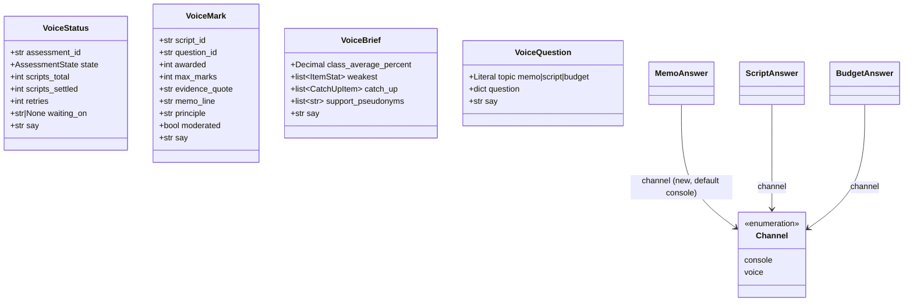
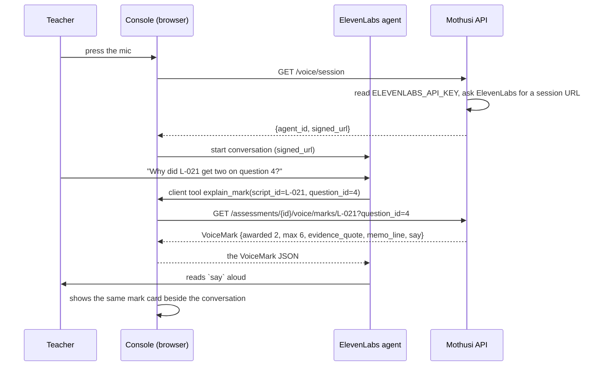
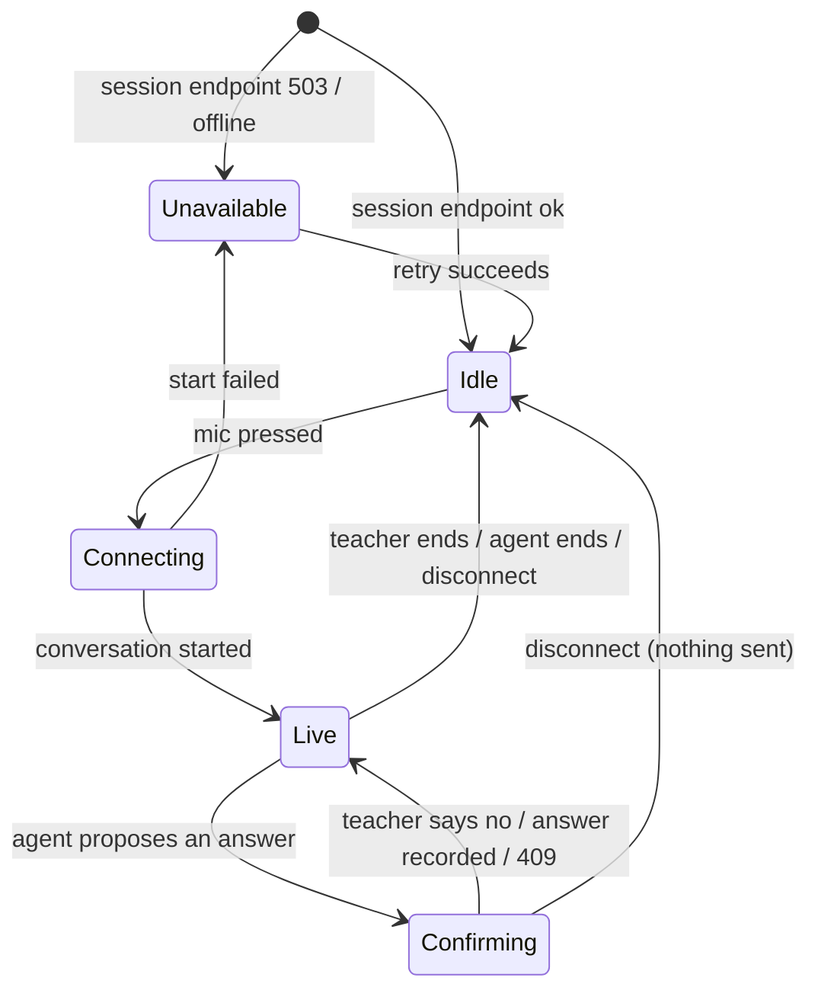
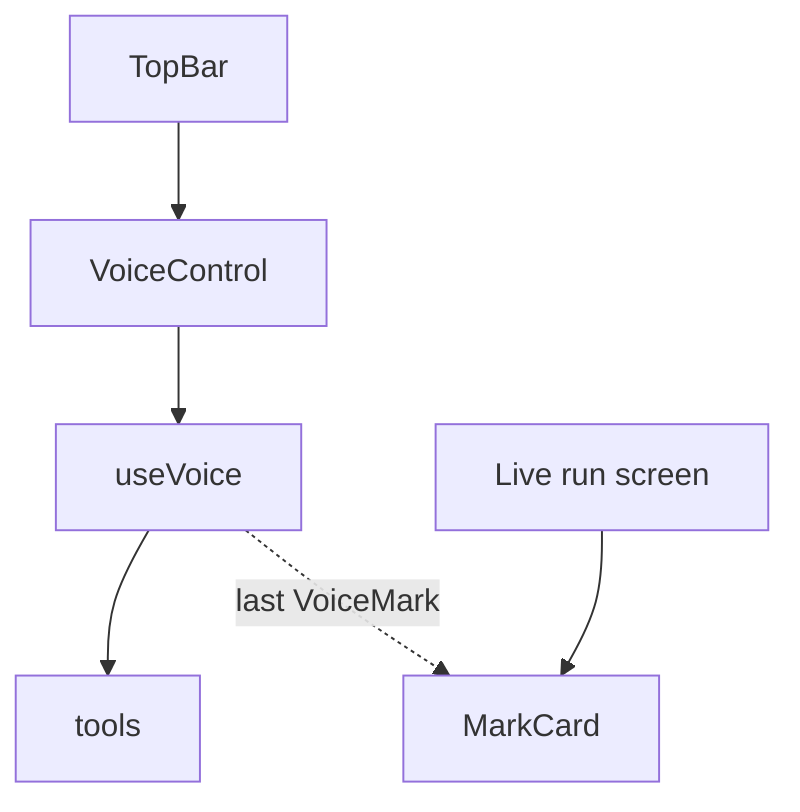

# Design — the voice colleague (ElevenLabs Agents)

**Status:** draft · **Owner:** the project researcher (Claude) · **Spec:** the product requirements US2, US4, US5 (the voice is a second way into the same cycle)

---

## 1. What this covers

A voice in the teacher console: the teacher talks to Mothusi and Mothusi talks back, through an
ElevenLabs Agents conversation started from the browser. The project researcher's decisions of 2026-11-08 fix the
scope:

| Decision | Choice |
| --- | --- |
| What the voice may do | **Report run progress, explain a mark, answer Mothusi's questions, brief the results.** |
| Where | **In the console** (a mic control; ElevenLabs React SDK). No phone number. |
| Language | **English only** for the event build. |
| In the demo | **One scripted beat** inside the golden path; the golden path still runs with voice off. |

The recorded limits hold, and this
doc turns them into structure (source note not in this repo):

1. **The voice never gives a mark or a curriculum fact itself.** Every sentence about a mark, a
   question, the class or the ATP is composed **in Mothusi's code** from run state and handed to the
   agent as a `say` string to read out. The agent's own LLM only converses: it chooses which tool
   to call and reads the result.
2. **The voice cannot approve or send.** There is no approval tool. Asked to approve, it says the
   approval is on the screen.
3. **No learner name reaches ElevenLabs from Mothusi.** Every voice endpoint returns pseudonyms
   (`L-021`), never names, even though the bundle endpoint carries names for the teacher's screen.
4. **The console does everything without the voice.** No screen, state or button depends on it.

Not covered: the phone channel, other languages, voice on the phone layout, learner-facing voice
(stretch, research note §2). The marking itself is [marking-pipeline.md](marking-pipeline.md); the
screens are [console-ui.md](console-ui.md).

## 2. Reference material

| Kind | Where |
| --- | --- |
| Visual reference | [console-ui/02-live-run.png](console-ui/02-live-run.png) for the TopBar the mic sits in; the control is new and **producing its mockup is part of the voice implementation** (in `console-ui/mockups/`, re-rendered to a PNG) |
| Design system / tokens | `docs/architecture/design/console-ui/mockups/console.css` (the console's tokens; the voice control uses the teacher's teal, not a new colour) |
| Existing code this must match | `services/core/src/mothusi_core/main.py` (routes, `MemoAnswer`, `ScriptAnswer`, `BudgetAnswer`), `services/core/src/mothusi_core/graph/planner.py` (`_memo_question`, `_script_question`, `_budget_question`, `build_bundle`), `services/core/src/mothusi_core/graph/state.py` (`RunState`), `apps/web/src/components/chrome.tsx` (TopBar) |
| Contracts it reads | `Mark`, `MarkedScript`, `ItemStat`, `CatchUpItem` in `packages/contracts/src/mothusi_contracts/models.py`; `EventKind.TEACHER` in `events.py` |
| External | ElevenLabs Agents platform and React SDK (links in the research note's Sources); facts not yet checked are §10 |

## 3. Domain model

Nothing new is persisted. The voice adds read-only views over `RunState` and one optional field on
the three existing answer bodies.



- `say` is built by a pure function in `mothusi_core.voice` from the same fields it sits beside; it
  contains no figure the response does not also carry. Tests compare the two.
- `retries` counts `check` events that failed for a script that later passed (the live log's retry
  rows). `waiting_on` is the open question's `title`, or `None`.
- `weakest` is the three `ItemStat`s with the lowest `facility_percent` (ties by `question_id`);
  `support_pseudonyms` are the learners the Support agent's plan names; both come from run state, not
  from the bundle, so no name is ever in reach.
- `VoiceQuestion.question` is the pending payload exactly as the console receives it
  (`_memo_question`, `_script_question`, `_budget_question`); a script question carries the
  learner's answer text and the pseudonym, never a name.

## 4. Flow

The agent's tools are **client tools**: functions that run in the teacher's browser and call
Mothusi's API through the console's existing `/api` proxy. ElevenLabs never calls the laptop, so
nothing on the demo laptop is exposed to the internet.



Answering a question by voice adds a **read-back**: the agent calls `answer_question` only after it
has read the teacher's decision back and heard a yes, and the console shows the decision with
"via voice" before it is sent.

```mermaid
sequenceDiagram
    participant T as Teacher
    participant E as ElevenLabs agent
    participant C as Console
    participant A as Mothusi API
    E->>C: client tool pending_question()
    C->>A: GET /assessments/{id}/voice/question
    A-->>C: VoiceQuestion {topic memo, say}
    E->>T: reads `say`; "keep the memo, use the Setter's answer, or change it?"
    T->>E: "use the Setter's answer"
    E->>T: "You want 2.3 to read x = -4. Shall I record that?"
    T->>E: "yes"
    E->>C: client tool answer_question(topic=memo, decision=use_proposed, question_id=2.3)
    C->>A: POST /assessments/{id}/memo {decision, question_id, channel: voice}
    A-->>C: 202 (the TEACHER event records channel=voice)
    C-->>E: {"recorded": true, "say": "Recorded. Marking starts now."}
```

**Failure paths**

- **No key, no network or ElevenLabs down:** `GET /voice/session` returns 503 with a reason; the
  mic shows "Voice unavailable: <reason>" and stays disabled. Nothing else changes.
- **A tool call fails** (404 unknown script, 409 nothing pending, 422 bad body): the client tool
  returns `{"error": "<message>", "say": "<the same, as a sentence>"}` and the agent reads it. It
  never guesses a substitute.
- **The run moves while the agent talks** (a question answered on screen first): the POST gets 409
  "not pending"; the agent says so. The existing 409 already guarantees one answer per question.
- **A spoken learner name:** the agent's prompt tells it to ask for the L-number shown on screen; no
  tool accepts a name, and the console never resolves one. The audio still reaches ElevenLabs (§10).
- **Mid-conversation disconnect:** the conversation ends; the console keeps the last mark card on
  screen. Nothing is half-sent, because a POST is one request.

## 5. State

The voice control's own lifecycle, in the console. Transitions not drawn are impossible: the
control's state is a discriminated union in `useVoice`, and every event handler matches on it.



## 6. Contracts

### 6.1 New endpoints (all GET, name-free, in `services/core/src/mothusi_core/main.py`)

```
GET /voice/session
  200 {agent_id: str, signed_url: str}
  503 {message: "voice unavailable: <reason>"}        no ELEVENLABS_API_KEY / ELEVENLABS_AGENT_ID, or ElevenLabs unreachable

GET /assessments/{assessment_id}/voice/status          -> VoiceStatus             404 unknown id
GET /assessments/{assessment_id}/voice/marks/{script_id}?question_id=<id>
                                                       -> VoiceMark               404 unknown id/script/question
                                                                                   409 script not settled yet
GET /assessments/{assessment_id}/voice/brief           -> VoiceBrief              409 before awaiting_approval
GET /assessments/{assessment_id}/voice/question        -> VoiceQuestion           409 nothing pending
```

Every body is JSON; every one carries `say: str` (one to three sentences, plain English, numbers as
digits, pseudonyms as written, e.g. "L-021 got 2 out of 6 on question 4. The memo line applied was
… The learner wrote: …"). A response holding a name fails its test (§9).

### 6.2 Changed: the three answer bodies (`main.py`)

```python
class MemoAnswer(BaseModel):  # existing fields unchanged
    channel: Literal["console", "voice"] = "console"


class ScriptAnswer(BaseModel):
    channel: Literal["console", "voice"] = "console"


class BudgetAnswer(BaseModel):
    channel: Literal["console", "voice"] = "console"


# ApprovalAnswer is NOT changed: approval has no voice path.
```

The Planner copies `channel` into the `TEACHER` event payload (`{"topic": ..., "channel": "voice",
...}`) and the summary ends "(by voice)". `teacher_steps` counts a voice answer like any other.

### 6.3 The agent's client tools (to be built in `apps/web/src/voice/tools.ts`)

| Tool | Parameters | Calls | Returns to the agent |
| --- | --- | --- | --- |
| `run_status` | none | `GET .../voice/status` | `VoiceStatus` |
| `explain_mark` | `script_id: str`, `question_id: str` | `GET .../voice/marks/{script_id}?question_id=` | `VoiceMark` |
| `class_brief` | none | `GET .../voice/brief` | `VoiceBrief` |
| `pending_question` | none | `GET .../voice/question` | `VoiceQuestion` |
| `answer_question` | `topic: memo\|script\|budget` plus that topic's existing body fields | `POST .../memo` / `.../scripts/{sid}` / `.../budget` with `channel: "voice"` | `{recorded: true, say}` or `{error, say}` |

There is no tool for approval, rejection, sending, starting a run or reading the bundle.

### 6.4 The agent's prompt (configured in ElevenLabs; the text is to be written in `apps/web/src/voice/agent-prompt.md`)

The prompt to be written must say, in these words or stricter: read any `say` field verbatim and add
nothing about marks, memo lines, curriculum, ATP weeks or learners that is not in it; never state a
mark you did not get from `explain_mark`; ask for the L-number when the teacher names a learner;
before `answer_question`, read the decision back and wait for a yes; approval is done on the screen.

## 7. Structure

The new voice files below are to be built; they do not exist in this checkout.

| Path | New? | Responsibility |
| --- | --- | --- |
| `services/core/src/mothusi_core/voice.py` | new | `voice_status`, `voice_mark`, `voice_brief`, `voice_question` (pure, from `RunState`) and their `say` builders; the session-URL call to ElevenLabs |
| `services/core/src/mothusi_core/main.py` | changed | the five GET routes; `channel` on three answer bodies |
| `services/core/src/mothusi_core/graph/planner.py` | changed | `channel` into the `TEACHER` event payload and summary |
| `services/core/tests/test_voice.py` | new | §9 |
| `apps/web/src/voice/useVoice.ts` | new | the §5 state machine around the ElevenLabs React SDK |
| `apps/web/src/voice/tools.ts` | new | the five client tools of §6.3 |
| `apps/web/src/voice/VoiceControl.tsx` | new | the mic control and its status line in the TopBar |
| `apps/web/src/voice/MarkCard.tsx` | new | the mark the voice just read, shown on screen with quote and memo line |
| `apps/web/src/voice/agent-prompt.md` | new | §6.4, the text pasted into the ElevenLabs agent |
| `docs/architecture/design/console-ui/mockups/` | changed | the TopBar with the control in its Idle, Live and Unavailable states |
| `.env.example` | changed | `ELEVENLABS_API_KEY`, `ELEVENLABS_AGENT_ID` |



## 8. Decisions & alternatives

| Decision | Chosen | Rejected, and why |
| --- | --- | --- |
| How the agent reaches Mothusi | Client tools in the browser, through `/api` | Server tools (webhooks): ElevenLabs' cloud would have to reach the demo laptop, which means a public tunnel to a service holding learner data. The research note said server tools; this doc overrides it for that reason. |
| Who writes the sentences about marks | Mothusi's code (`say`) | Letting the agent's LLM phrase marks from raw JSON: it could round, merge or invent, and Non-negotiable I forbids a mark without its evidence. |
| Names | Pseudonyms only; the teacher reads the L-number off the screen | A name-to-pseudonym lookup tool: it would send names to ElevenLabs on every call. |
| Answering questions by voice | Allowed, with read-back and `channel=voice` in the log | Voice read-only: the project researcher chose "answer Mothusi's questions"; the read-back and the existing 409 keep it safe. |
| Approval by voice | Not possible | Recorded limit: approval stays an explicit action on the screen. |
| Budget raise by voice | Allowed, read back with the amount in rand | Excluding it: it is one of Mothusi's questions and the amount is read back before it is sent. |

Deviations from the architecture defaults: ElevenLabs is a new
external service (recorded in the architecture plan by the scope commit); the agent's conversation LLM runs at
ElevenLabs, outside `mothusi_llm`, so its tokens are not on Mothusi's meter (§10) (source note not in this repo).

## 9. How this is verified

- `services/core/tests/test_voice.py` (to be built): for each endpoint, against the planted 6-script run in replay mode: the response
  validates; `say` contains `awarded`, `max_marks` and the evidence quote verbatim (marks), or the
  weakest question ids (brief); **no learner name from `scripts.csv` appears anywhere in any voice
  response** (scan every string); 409/404 cases as in §6.1.
- `test_graph.py` (extended): a memo answer posted with `channel="voice"` produces a `TEACHER` event
  whose payload has `channel: "voice"` and whose summary ends "(by voice)"; `ApprovalAnswer` rejects a
  `channel` field.
- Vitest: `useVoice` reaches only the transitions in §5; `answer_question` is never called from
  `Live` without passing `Confirming`; with `/voice/session` returning 503 the control renders
  Unavailable and the rest of the console renders unchanged.
- The demo beat (the demo script) rehearsed once live with a real key before the freeze.
- Visual: the TopBar control against its mockup PNG.

## 10. Open questions

- [ ] **ElevenLabs specifics, unverified today:** the exact React SDK API for client tools and for
  starting a session from a signed URL; the endpoint that issues a signed URL for a private agent;
  whether an agent can be set to keep no audio or transcripts on our plan. Check each against the
  ElevenLabs docs at the start of the voice implementation and correct §4/§6 if they differ.
- [ ] **Price and plan** (resources-to-fetch row 10): the per-minute rate, dated. Until then the
  console reports voice minutes, not rand.
- [ ] **The agent's LLM:** which model the ElevenLabs agent uses for conversation (Claude is listed
  there); its tokens bill through ElevenLabs, not our meter.
- [ ] **POPIA notice:** the wording the console shows before the first conversation (audio goes to
  ElevenLabs; say L-numbers, not names). The project researcher to approve the text.
